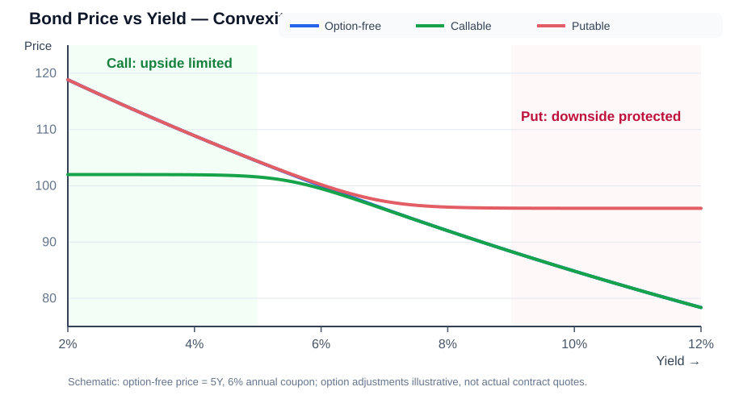

# Duration 专题｜债券久期与利率风险

> CFA Level I 复习主入口：将已有 [[Macaulay-Duration]]、[[Modified-Duration]]、[[Key-Rate-Duration]] 及本次新整理的 Effective Duration 合并成一套完整的学习框架。原专项文件保留，便于按概念深入复习。

## 1. 最重要的总览：Duration 到底衡量什么？

Duration（久期）常用于衡量债券对利率变动的敏感性；不同久期的定义、适用场景不同。

| 指标 | 中文 | 回答的问题 | 最典型的使用情景 |
|---|---|---|---|
| **Macaulay Duration** | 麦考利久期 | 现金流按现值加权后，平均何时收回？ | 固定现金流债券的平均收款时间 |
| **Modified Duration** | 修正久期 | YTM 变动，债券价格约变化多少？ | 现金流固定、无利率敏感型期权 |
| **Effective Duration** | 有效久期 | 基准利率变动且现金流可能改变，价格约变化多少？ | Callable / Putable / MBS 等 |
| **Key Rate Duration (KRD)** | 关键利率久期 | 收益率曲线某个特定期限节点变化，价格受多大影响？ | 分析非平行曲线变动 |

**速记口诀**：Macaulay 看**时间**；Modified 看**固定现金流下的价格敏感度**；Effective 看**利率可能改变现金流时的敏感度**；Key Rate 看**哪个期限节点的利率变化**。

## 2. Macaulay Duration｜麦考利久期

**核心定义**：债券各期现金流（Cash Flows）以其现值占债券价格的比例加权后的平均收款时间。

\[
\boxed{D_{Mac}=\sum_{t=1}^{N}t\frac{PV(CF_t)}{P}}
\]

- \(PV(CF_t)\)：第 \(t\) 期现金流现值；\(P=\sum PV(CF_t)\) 为债券价格。
- 若 \(t\) 用付息期数计算，算出来的单位就是“期”；要除以每年付息次数 \(m\) 才是“年”。
- 一般的固定正现金流债券：零息债券（Zero-Coupon Bond）的 Macaulay Duration = 到期期限（Maturity）；定期付息债券的 Macaulay Duration 通常小于其到期期限。
- 它的定义是**时间加权**，不能直接拿它替代 Modified Duration 估计收益率变动引发的价格百分比变化。

**直觉**：现金流越早收到，现值权重越靠前，Macaulay Duration 通常越短。

**详细计算分册：** [[Macaulay-Duration|Macaulay Duration 专题：现值、权重、完整计算与免疫速判]]。

## 3. Modified Duration｜修正久期

**核心定义**：衡量**现金流保持不变**时，债券价格对到期收益率（Yield to Maturity, YTM）微小变化的敏感程度。

当 Macaulay Duration 以年计、年化 YTM 为 \(y\)、每年复利/付息次数为 \(m\)：

\[
\boxed{D_{Mod}=\frac{D_{Mac}}{1+y/m}}
\]

价格变化一阶近似：

\[
\boxed{\frac{\Delta P}{P}\approx-D_{Mod}\Delta y}
\]

- \(\Delta y\) 以小数表示：50 bps = 0.005；100 bps = 0.01。
- **负号**：通常 YTM 上升，价格下降；YTM 下降，价格上升。
- **例题**：Modified Duration = 5，YTM 上升 50 bps，则价格约变化 \(-5\times0.005=-2.5\%\)。
- 这是小幅变动下的一阶近似；变动较大时还要考虑 Convexity（凸性）。
- **前提**：未来合同现金流不因利率变化而发生变化。对于含利率敏感型赎回/回售条款的债券，单靠 Modified Duration 往往不够。

详见：[[Modified-Duration]]。

### 3.1 Approximate Modified Duration｜上下收益率冲击法

当题目给出当前债券价格、票息、期限和收益率变动幅度，却没有直接给出 Modified Duration 时，先求当前 YTM，再分别将 YTM 下调和上调相同的 \(\Delta y\)，重新计算 \(P_-\) 与 \(P_+\)：

\[
\boxed{D_{Mod}\approx\frac{P_- - P_+}{2P_0\Delta y}}
\]

这里 \(\Delta y\) 是**单边冲击幅度**，例如20 bps = 0.002；分母中的2对应从 \(y-\Delta y\) 到 \(y+\Delta y\) 的总区间。固定 N、PMT、FV，只改变 I/Y 重新求两个价格。

**完整例题**：5年期、年票息3、面值100，当前价格91.3410，收益率冲击20 bps。

1. BA II Plus 输入 N=5、PV=−91.3410、PMT=3、FV=100，求当前 YTM≈5.00%。
2. YTM 下调至4.80%，得 \(P_-\approx92.1637\)；上调至5.20%，得 \(P_+\approx90.5276\)。
3. 代入：

\[
D_{Mod}\approx\frac{92.1637-90.5276}{2(91.3410)(0.002)}=\boxed{4.48}
\]

**考试陷阱**：20 bps 是单边的0.002；上下两个情景之间相差40 bps，但公式仍写 \(2P_0\Delta y\)。此法用于固定现金流债券的近似 Modified Duration；若利率变化会改变预期现金流，应考虑 Effective Duration。

## 4. Effective Duration｜有效久期

**核心定义**：衡量债券价格相对于**基准收益率曲线（Benchmark Yield Curve）**变化的敏感性，并允许预期现金流在利率变化后重新估计。

\[
\boxed{D_{Eff}=\frac{PV_- - PV_+}{2PV_0\Delta Curve}}
\]

- \(PV_0\)：当前债券价格。
- \(PV_-\)：基准曲线下移 \(\Delta Curve\) 后，**重新估计现金流并重新估值**所得价格。
- \(PV_+\)：基准曲线上移 \(\Delta Curve\) 后，**重新估计现金流并重新估值**所得价格。
- \(\Delta Curve\) 使用小数，如 25 bps = 0.0025；该形式通常考察基准曲线**平行移动**。
- **关键词**：Uncertain Future Cash Flows（未来现金流不确定）、Interest-Sensitive Embedded Options（利率敏感型嵌入期权）。

适用例子：

- **Callable Bond（可赎回债券）**：利率下降时发行人可能提前赎回，预期未来票息期数减少；因此价格上涨可能受到限制。
- **Putable Bond（可回售债券）**：利率上升时持有人可能行使回售权，从而改变未来现金流。
- **Mortgage-Backed Securities (MBS，抵押贷款支持证券)**：市场利率变化可能改变提前还款（Prepayment）速度，从而改变投资者实际收到本金的时间。

**简化计算例子**：假设 \(PV_0=100\)，曲线上移25 bps 后 \(PV_+=98\)，下移25 bps 后 \(PV_-=102\)：

\[
D_{Eff}=\frac{102-98}{2(100)(0.0025)}=8
\]

这表示对小幅的基准利率变动，债券价格的敏感度约为8，而不是说“平均8年收回现金流”。

**注意**：并非只要现金流含不确定性就一定选择有效久期；核心是**预期现金流可能随利率变化**，且估值模型允许这种变化。对现金流固定且其他假设一致的债券，Effective Duration 通常与 Modified Duration 相近。

### 4.1 利率变化如何影响 Callable / Putable 的 Effective Duration？

**Effective Duration（有效久期）**衡量债券价格对基准收益率曲线变动的敏感度。对于含利率敏感型嵌入期权的债券，利率变化不仅改变折现率，也可能改变预期现金流和行权概率，因此需要在利率上升、下降情景下重新估计现金流并重新定价。

\[
D_{Eff}=\frac{P_- - P_+}{2P_0\Delta Curve}
\]

其中 \(P_-\) 是基准曲线下移后的重新估值价格，\(P_+\) 是基准曲线上移后的重新估值价格。

#### Callable Bond｜可赎回债券

**期权归属：发行人（Issuer）。**

- **利率下降（Rates Fall）**：旧债券的固定票息相对市场融资成本更高，发行人更有动力按合同提前赎回，再以较低利率融资。
- **预期现金流变化**：投资者未来原本可能收到的高票息现金流可能提前终止，预期现金流期限缩短。
- **价格表现**：债券价格上涨空间受到赎回价格及行权概率限制，\(P_-\) 不会像无期权债券那样充分上涨。
- **有效久期**：在赎回权敏感的低利率区域，Effective Duration 通常下降。

**利率上升时**，发行人以更低票息旧债融资的优势减弱，提前赎回概率通常下降；债券更可能继续存续，Effective Duration 通常回升或增加。

#### Putable Bond｜可回售债券

**期权归属：投资者／债券持有人（Investor / Bondholder）。**

- **利率上升（Rates Rise）**：原债券票息相对市场收益率变得不够有吸引力，债券市场价格承压，投资者更愿意按合同回售价将债券卖回发行人。
- **预期现金流变化**：投资者可能提前收回回售价，预期现金流期限缩短。
- **价格表现**：回售权为债券价格提供下行保护。
- **有效久期**：在回售权敏感的高利率区域，Effective Duration 通常下降。

**利率下降时**，回售权通常变得不那么有价值，投资者继续持有债券的可能性增加，Effective Duration 通常回升或增加。

#### 两种债券的方向对照

| 市场利率变化 | Callable：发行人行权概率 | Callable Effective Duration | Putable：投资者行权概率 | Putable Effective Duration |
|---|---|---|---|---|
| 利率下降 | 通常上升 | 通常下降 | 通常下降 | 通常上升 |
| 利率上升 | 通常下降 | 通常上升 | 通常上升 | 通常下降 |

**记忆口诀**：
- **Call：利率下降，发行人更想收回债券 → 预期现金流缩短 → Effective Duration 通常下降。**
- **Put：利率上升，投资者更想卖回债券 → 预期现金流缩短 → Effective Duration 通常下降。**

#### 为什么提前行权会让 Effective Duration 通常下降？

Effective Duration 是通过基准曲线上下平移后债券价格的变化幅度估计的。期权更可能行权时，未来现金流可能提前结束，债券价格对进一步利率变化的反应通常被压低；因此价格差 \(P_- - P_+\) 相对缩小，估算出的 Effective Duration 通常降低。

**重要边界**：
- “通常下降”指期权开始变得有行权价值、对预期现金流影响显著的区域，并非任何利率水平下都必然单调变化。
- 行权日、赎回／回售价格、保护期、利率波动率、信用利差和模型假设都会影响实际有效久期。
- Callable 与 Putable 的有效久期都可能在各自行权敏感区域缩短，但触发这种变化的利率方向相反。
- 这与 Modified Duration 不同：含期权债券应在利率情景中重新估计预期现金流，而不能简单假设现金流固定。

#### CFA 题型复盘

**题型1：Under a circumstance of increasing interest rate, what happens to a putable bond?**

利率上升，回售权更有价值，投资者更可能回售；在回售敏感区域，Effective Duration 通常下降。**答案：Effective Duration will reduce.**

**题型2：Why does a callable bond's Effective Duration usually decline when interest rates fall?**

利率下降提高发行人赎回高票息债券的动机；未来票息可能提前终止，价格上涨受到限制，故有效久期通常下降。

**题型3：Which bond's Effective Duration tends to shorten when rates rise?**

Putable Bond（可回售债券），因为投资者回售概率上升。

### 4.2 与 Callable / Putable 凸性的联系

- Callable：低利率时发行人赎回概率上升，价格上涨受到限制；在赎回敏感区域可能出现负凸性。
- Putable：高利率时投资者回售概率上升，价格下跌受到保护；通常保持正凸性。
- 曲线与正负凸性的图形解释见本专题 **7.1 Callable / Putable Bond Convexity**。

## 5. Key Rate Duration｜关键利率久期

**核心定义**：衡量收益率曲线上**某一个特定期限节点的利率**变化时，债券或投资组合的价格敏感度；其他关键节点尽量保持不变。

\[
\boxed{KRD_i\approx\frac{P_i^- - P_i^+}{2P_0\Delta r_i}}
\]

- \(P_i^-\) 与 \(P_i^+\)：只对第 \(i\) 个关键期限节点利率分别下调、上调 \(\Delta r_i\) 后重估的价格。
- \(P_0\)：当前债券/组合价值。
- **用途**：识别收益率曲线非平行移动（Non-Parallel Shift）带来的风险，例如2年期收益率上升、10年期收益率下降。
- 不能把某一个期限节点的 KRD 误当作整只债券的总久期。
- **补充**：在节点划分和曲线扰动一致的适用框架下，各节点 KRD 之和可近似对应总的平行曲线久期，但不应把此作为在所有模型中无条件精确成立的恒等式。

详见：[[Key-Rate-Duration]]。

## 6. 四种久期之间的区别：同一题如何选？

| 题干关键词（英文） | 中文理解 | 选用 |
|---|---|---|
| Weighted Average Time / Present Value Weights | 现金流现值加权平均时间 | **Macaulay** |
| Fixed Cash Flows / YTM Sensitivity | 固定现金流下对YTM变化的敏感度 | **Modified** |
| Uncertain Future Cash Flows / Callable / Putable / MBS | 利率变化使预期现金流可能改变 | **Effective** |
| Specific Maturity Node / Non-Parallel Shift | 特定期限节点利率变化、非平行变动 | **Key Rate** |

**常见陷阱**：
1. Duration 不等于 Maturity；Macaulay 也只有在零息债等特定结构下才等于到期期限。
2. 修正久期的 \(\Delta y\) 必须是收益率的**绝对变动量**（小数）；上升1个百分点是0.01，不是1。
3. Modified 与 Effective 不是只差一个计算公式：**前者固定现金流，后者允许按利率情景重新建模现金流**。
4. Effective Duration 通常用于基准曲线变化；Modified Duration 通常基于债券 YTM；不能在不同基准和信用利差假设下随意替换。
5. Key Rate Duration 不是另一种“平均期限”，而是不同收益率曲线节点的风险分解。
6. 大幅利率变化时，单用一阶久期近似可能有误差，需要考虑 Convexity。

## 7. Duration 与 Convexity｜久期与凸性的联系

一阶近似：

\[
\frac{\Delta P}{P}\approx-D\Delta y
\]

加入凸性后的常用二阶近似：

\[
\frac{\Delta P}{P}\approx-D_{Mod}\Delta y+\frac12 Convexity(\Delta y)^2
\]

- 这条式子是对**固定现金流债券、相应 YTM 口径下**的常见近似形式。
- 对含期权债券进行利率风险分析时，应使用与定价模型及曲线变动一致的有效久期和相应的有效凸性（Effective Convexity）度量。
- 这里先记住“久期是一阶敏感度，凸性修正曲线弯曲造成的误差”；凸性的深入计算可另作专题。

### 7.1 Callable / Putable Bond Convexity｜期权债券的正负凸性与图解

**先记图的坐标：横轴 Yield（收益率，向右增加），纵轴 Bond Price（债券价格，向上增加）。三类债券价格通常都随收益率上升而下降；凸性讨论的是曲线弯曲的方向，而不是上涨/下跌本身。**

*图为教学示意，绿色左端体现 Callable 的上涨受限，红色右端体现 Putable 的下跌保护；具体行权价格、日期及合同条件会改变曲线形状。图中三线满足 \(V_{Callable}\le V_{Option-free}\le V_{Putable}\)，但不能据此推断每只真实债券的凸性都具有相同形状。*

#### 1) 基础：什么是 Convexity（凸性）？

- 债券的收益率（Yield）上升时，价格通常下降；但价格与收益率之间的关系并非直线。
- **Convexity（凸性）**描述价格—收益率曲线的弯曲程度；数学上与债券价格对收益率的二阶变化有关。
- 对普通固定现金流的 **Option-Free Bond（无期权债券）**，曲线通常具有 **Positive Convexity（正凸性）**：对于从同一收益率出发、同幅度的利率上升与下降，价格上涨幅度通常大于价格下跌幅度（忽略其他因素）。
- **Negative Convexity（负凸性）**：在某个利率区域，价格对利率下降的上涨反应受到压制，可能出现同幅度利率下降的价格上涨小于利率上升的价格下跌。

#### 2) Callable Bond（可赎回债券）：低利率区可能负凸性

- **权利持有人**：Issuer（发行人）。发行人可按合同条款提前 Call（赎回）。
- **逻辑链条**：市场利率下降 → 发行人有动力赎回高票息旧债、改以较低利率融资 → 未来高票息可能提前终止 → 投资者享有的价格上涨空间受限。
- **图像重点**：图中**绿色 Callable 曲线在左侧低收益率区变平**，不能像蓝色 Option-Free 曲线一样继续大幅上涨。
- **典型表现**：在赎回权敏感的低收益率区，可能出现负凸性（Negative Convexity）；**不代表 Callable 在所有收益率水平下都具有负凸性**。
- **价值关系**：

\[
V_{Callable}=V_{Option-free}-V_{Call}
\]

这里的 Call Option（赎回权）属于发行人，债券投资者相当于承受该赎回权的不利影响。

#### 3) Putable Bond（可回售债券）：高利率区下跌受到保护

- **权利持有人**：Investor / Bondholder（投资者／债券持有人）。可依合同 Put（回售）给发行人。
- **逻辑链条**：市场利率上升 → 原债券吸引力下降 → 投资者可能按合同回售价回售 → 债券价格下跌受到保护。
- **图像重点**：图中**红色 Putable 曲线在右侧高收益率区变平**，不像无期权债券那样持续大幅下跌。
- **典型表现**：通常维持正凸性或在回售敏感区域呈现有利的下行保护；**不是“Putable 通常负凸性”**。
- **价值关系**：

\[
V_{Putable}=V_{Option-free}+V_{Put}
\]

这里的 Put Option（回售权）对投资者有利，因此增加债券价值。

#### 4) 不要只看曲线“平不平”：用三点检验凸性方向

对于从同一中心收益率 \(y_0\) 向下和向上变化相同幅度 \(\Delta y\) 的三个价格：
- 若 \(P(y_0-\Delta y)+P(y_0+\Delta y)-2P(y_0)>0\)，为**正凸性方向**。
- 若该差值小于0，为**负凸性方向**。

| 独立的概念示例 | Yield ↓1% 后价格 | 当前价格 | Yield ↑1% 后价格 | 二阶价格差 |
|---|---:|---:|---:|---:|
| Option-Free | 108 | 100 | 93 | +1（正） |
| Callable（赎回敏感区） | 103 | 98 | 92 | −1（负） |
| Putable（回售保护区） | 109 | 102 | 97 | +2（正） |

*表中数字仅用于理解二阶差分方向，不是上图的实际曲线报价；没有给出真实债券合同，因此不能将示例数字用于估值。*

#### 5) Effective Duration（有效久期）与 Convexity 的联系

- **Callable**：利率下降时提前赎回概率通常上升，预期现金流变短，价格上涨空间受限，有效久期在赎回敏感区域可能缩短。
- **Putable**：利率上升时回售概率通常上升，回售权提供价格下行保护，有效久期在回售敏感区域可能缩短。
- 两者都具有 **Uncertain Future Cash Flows（可能随利率变化的未来现金流）**，因此衡量利率敏感度通常优先使用 Effective Duration，并在相关估值模型下评估 Effective Convexity（有效凸性）。

#### 6) CFA 本题复盘：两个 Statement 为什么都错？

> Statement 1: Both callable bonds and putable bonds have lower effective durations compared to otherwise identical option-free bonds, especially when interest rates are falling.

**错误**：Callable 通常在利率下降时更容易被赎回，而 Putable 更可能在利率上升时被回售，不能说两种期权都是**尤其在利率下降时**显著影响久期。

> Statement 2: Callable bonds often have higher positive convexity, while putable bonds often have negative convexity.

**错误**：典型方向说反了——Callable 在低利率、赎回敏感区可能出现负凸性；Putable 通常保持正凸性，并提供下跌保护。

**答案 C：None of the statements are correct。**

#### 7) 考前10秒速判

| 关键词 | 优先联想 |
|---|---|
| Rates Fall + Issuer Calls | Callable：发行人赎回，**封上涨** |
| Rates Rise + Investor Puts | Putable：持有人回售，**托下跌** |
| Negative Convexity / Capped Upside | Callable（赎回敏感区） |
| Downside Protection / Typically Positive Convexity | Putable |
| Option-sensitive Cash Flows | Effective Duration / Effective Convexity |

**口诀：Call 封上涨，Put 托下跌；负凸性常看 Call，正凸性常看普通债与 Put。**

关联：[[Embedded-Options-in-Bonds|嵌入式期权债券专项]]。

## 8. CFA 真题型练习与速判

**题型一：For bonds with uncertain future cash flows, which duration is most suitable to measure interest rate risk?**

- A. Macaulay Duration
- B. Modified Duration
- C. Effective Duration

**正确答案 C**。因为未来现金流可能随利率变化，需要在利率上下行情景中重新估计并重新定价。

**题型二：A bond has Modified Duration 5; its YTM rises by 50 bps. Estimate the price change.**

\[
\frac{\Delta P}{P}\approx-5\times0.005=-2.5\%
\]

**题型三：The 2-year yield rises while the 10-year yield falls. Which measure identifies exposures by maturity?**

选择 **Key Rate Duration**。总久期一个数不足以完整描述不同期限节点的风险。

**题型四：Which duration measures the present-value-weighted average time to receive a bond's cash flows?**

选择 **Macaulay Duration**。

## Duration 与价格风险、再投资风险及 Immunization

- **Price Risk（价格风险）**：收益率上升通常导致债券市场价格下降；Modified/Effective Duration 用于近似衡量价格对利率的敏感度。
- **Reinvestment Risk（再投资风险）**：收益率下降时，未来收到的票息可能只能以更低利率投资，降低持有期末的累积金额。
- **两种效应方向相反**：利率上升时价格效应不利但再投资效应可能有利；利率下降时价格效应有利但再投资效应可能不利。
- **Duration Matching（久期匹配）与 Immunization（免疫策略）**：通过使资产久期与目标负债或投资期限相匹配等条件，尽量让小幅利率变动带来的价格效应与再投资效应相互抵消。免疫策略还受初始收益率、现金流匹配、凸性、曲线非平行变化和再平衡等条件影响，不能仅凭一个久期数值保证完全免疫。
- **CFA 速判**：普通付息债券 + Hold to Maturity + Payments Made as Promised → 在 Market Price Risk、Reinvestment Risk、Default Risk 三者中优先选择 **Reinvestment Risk**。

详见 [[Fixed-Income-Basics]] 的 “Interest Rate Risk Components｜利率风险的组成”。

## 9. 10秒考前记忆卡

- **Macaulay = Time**：现金流现值加权平均时间。
- **Modified = YTM Sensitivity**：现金流固定，价格对YTM敏感度。
- **Effective = Option-sensitive Cash Flows**：利率变化可改变现金流，重估价格。
- **Key Rate = Curve Node**：某期限节点的利率风险。
- **Duration × Yield Change ≈ Price Change**：通常反向，注意负号。
- **Convexity**：大幅利率变动时用于改进价格变动近似。

---

## 相关专项笔记

- [[Macaulay-Duration|麦考利久期]]
- [[Modified-Duration|修正久期]]
- [[Key-Rate-Duration|关键利率久期]]
- [[Embedded-Options-in-Bonds|嵌入式期权债券]]
- [[Fixed-Income-Basics|固定收益基础概念]]

## YTM 与 Duration 的关系｜同票息、同期限债券比较

在**其他条件相同、固定现金流、无嵌入式期权**的普通债券之间比较时：

\[
\boxed{YTM\uparrow\Rightarrow D_{Mac}\downarrow\Rightarrow D_{Mod}\downarrow}
\]

原因分两层：

1. **Macaulay Duration**：YTM 越高，远期现金流折现越重，远期现金流现值在债券总价格中的权重通常下降；较早现金流的相对权重上升，因此现值加权平均收款时间缩短。
2. **Modified Duration**：在每年复利/付息次数 \(m\) 相同的条件下，
\[
D_{Mod}=\frac{D_{Mac}}{1+YTM/m}
\]
YTM 上升时，分母变大；同时 Macaulay Duration 也通常下降，所以 Modified Duration 通常更低。

因此，对相同幅度的小幅 YTM 变动：

\[
\left|\frac{\Delta P}{P}\right|\approx D_{Mod}|\Delta YTM|
\]

**Modified Duration 较低的债券，其价格百分比变化通常较小。**

### 本题速判

两只债券票息率和到期期限相同，Bond 1 的 YTM 高于 Bond 2。按普通固定现金流债券的比较关系：

- Bond 1 的 Macaulay Duration 通常较低。
- Bond 1 的 Modified Duration 通常较低。
- 若两者 YTM 发生相同的小幅变动，Bond 1 的价格百分比变化通常较小。

**答案：A. Bond 1。**

### 考试边界

- 以上是普通、固定现金流、无嵌入式期权债券在其他条件可比时的标准关系。
- 零息债券的 Macaulay Duration 等于到期期限，不随 YTM 改变；但其 Modified Duration 仍受 YTM 影响。
- 100 bps 等较大变动时，单用 Modified Duration 是一阶近似，精确价格变化还会受到 Convexity（凸性）影响；若题目要求严格比较大幅变动后的实际价格变化，应重新定价或同时考虑凸性。

## Portfolio Duration｜投资组合久期

投资组合久期（Portfolio Duration）衡量债券组合整体对利率变化的敏感度。CFA 题目常见两种计算方法。

### Method 1：Aggregate Cash Flows｜合并现金流法

1. 将组合内所有债券在相同日期收到的现金流合并。
2. 使用一致的折现口径计算合并现金流的现值。
3. 用各日期现金流现值占组合总现值的比例作为权重。
4. 对收款时间进行现值加权，得到组合 Macaulay Duration。

这是直接从整个组合的现金流计算久期。

### Method 2：Weighted Average of Individual Bond Durations｜单只债券久期加权法

先计算每只债券的市场价值权重（Market Value Weight）：

\[
\boxed{w_i=\frac{MV_i}{\sum_{j=1}^{n}MV_j}}
\]

其中，\(MV_i\) 是第 i 只债券的市场价值，分母是组合中所有债券市场价值之和。

**组合平均麦考利久期（Average Portfolio Macaulay Duration）：**

\[
\boxed{D_{Mac,P}=\sum_{i=1}^{n}w_iD_{Mac,i}}
\]

**组合平均修正久期（Average Portfolio Modified Duration）：**

\[
\boxed{D_{Mod,P}=\sum_{i=1}^{n}w_iD_{Mod,i}}
\]

先计算每只债券自己的久期，再以市场价值权重加权；不能简单地对各债券久期做算术平均。

对于年度复利（Annual Compounding）：

\[
D_{Mod,i}=\frac{D_{Mac,i}}{1+YTM_i}
\]

如果每年复利/付息 m 次，则在相应名义年化收益率口径下：

\[
D_{Mod,i}=\frac{D_{Mac,i}}{1+YTM_i/m}
\]

**重要区别**：组合平均 Modified Duration 应按 Method 2 对各债券的 Modified Duration 分别加权；不要先求组合 Macaulay Duration，再随意除以一个“组合平均 YTM”。

### Method 1 与 Method 2 对比

| 比较 | Method 1 | Method 2 |
|---|---|---|
| 计算对象 | 组合合并后的现金流 | 每只债券自己的久期 |
| 核心步骤 | 合并现金流、折现、算现值权重 | 计算市场价值权重、加权单只债券久期 |
| 适用理解 | 从组合现金流直接计算 | 从组成债券的久期汇总 |
| Macaulay Duration | 直接计算组合现金流久期 | 市场价值加权单只债券 Macaulay Duration |
| Modified Duration | 需保持一致的收益率与折现口径 | 市场价值加权单只债券 Modified Duration |

在现金流、估值和折现口径一致时，Method 1 与 Method 2 的组合 Macaulay Duration 应一致。若各债券使用不同 YTM，组合 Modified Duration 应按题目指定的方法与各债券口径处理，不能假设存在一个简单的组合 YTM 可直接代入。

### CFA 例题：三只零息债券的组合久期

题目数据：

| 债券 | Maturity | Coupon | YTM | Par Value | Market Value |
|---|---:|---:|---:|---:|---:|
| Bond A | 1年 | 0% | 2.37% | 100 | 97.68 |
| Bond B | 3年 | 0% | 3.64% | 1,000 | 898.29 |
| Bond C | 5年 | 0% | 5.39% | 10,000 | 7,691.36 |

**第一步：利用零息债券特征确定单只债券 Macaulay Duration。**

Zero-Coupon Bond（零息债券）只有到期本金这一笔现金流，因此：

\[
D_{Mac}=Maturity
\]

所以 Bond A、B、C 的 Macaulay Duration 分别为 1、3、5 年。

**第二步：计算组合总市场价值。**

\[
MV_P=97.68+898.29+7691.36=8687.33
\]

**第三步：计算市场价值权重。**

| 债券 | Market Value | Portfolio Weight |
|---|---:|---:|
| A | 97.68 | 1.1244% |
| B | 898.29 | 10.3402% |
| C | 7,691.36 | 88.5354% |
| 合计 | 8,687.33 | 100% |

**第四步：计算组合 Average Macaulay Duration。**

\[
D_{Mac,P}=w_A(1)+w_B(3)+w_C(5)
\]

使用题目截图显示的四舍五入后市场价值：

\[
D_{Mac,P}\approx\boxed{4.7482\text{ years}}
\]

**第五步：计算每只零息债券的 Modified Duration。**

年度复利下，\(m=1\)：

\[
D_{Mod,i}=\frac{D_{Mac,i}}{1+YTM_i}
\]

| 债券 | Macaulay Duration | YTM | Modified Duration |
|---|---:|---:|---:|
| A | 1 | 2.37% | 0.97685 |
| B | 3 | 3.64% | 2.89464 |
| C | 5 | 5.39% | 4.74428 |

**第六步：计算组合 Average Modified Duration。**

\[
D_{Mod,P}=w_AD_{Mod,A}+w_BD_{Mod,B}+w_CD_{Mod,C}
\]

\[
D_{Mod,P}\approx\boxed{4.5107}
\]

根据截图中显示的四舍五入市场价值计算，结果约为 Macaulay 4.7482、Modified 4.5107，最接近选项 **B（4.7492，4.5108）**。题库答案与显示数据存在极小差异，可能来自底层未显示的精确市场价值或中间计算精度。

### 考试易错点

1. Portfolio Weight 使用 Market Value（市场价值），不是 Par Value（面值）。
2. 零息债券的 Macaulay Duration 等于 Maturity。
3. 组合 Macaulay Duration = 各债券 Macaulay Duration 按市场价值加权。
4. 组合 Modified Duration = 各债券 Modified Duration 按市场价值加权。
5. 先分别计算单只债券 Modified Duration，再加权；不要把组合 Macaulay Duration 直接除以简单平均 YTM。
6. 年度复利时 m=1；半年复利时注意每期收益率与年数/期数单位匹配。
7. 本题使用 Method 2，重点是先求权重，再做两次加权平均。

