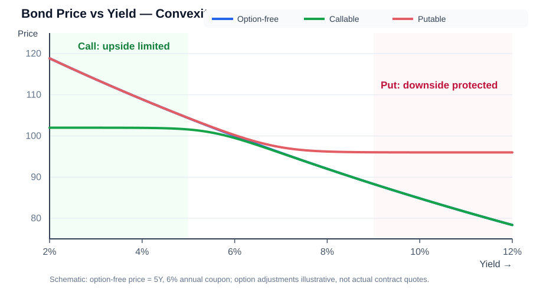

# Embedded Options in Bonds｜嵌入式期权债券

## 1. 核心概念

**Embedded Option（嵌入式期权）**：附加在债券合同中的期权条款，会改变债券对发行人或投资者的价值。

比较时，假设债券的发行人信用风险、期限、票面利率等其他条件相同。

## 2. 三种债券对比

| 债券类型 | 中文 | 期权权利归属 | 相对普通债券的价值 | 相对普通债券的价格 | 相对普通债券的收益率 |
|---|---|---|---|---|---|
| Option-Free Bond | 无期权债券 | 无嵌入式期权 | 基准 | 基准 | 基准 |
| Callable Bond | 可赎回债券 | 发行人（Issuer） | 普通债券价值 − 看涨期权价值 | 更低 | 更高 |
| Putable Bond | 可回售债券 | 投资者（Investor） | 普通债券价值 + 看跌期权价值 | 更高 | 更低 |

### Callable Bond｜可赎回债券

- 发行人拥有在约定日期或条件下提前赎回债券的权利。
- 该权利对发行人有利、对投资者不利。
- 投资者承担债券被提前赎回的风险，因此通常要求更高收益率（Higher Yield）。
- 价值关系：$V_{Callable}=V_{Option-Free}-V_{Call}$。

### Putable Bond｜可回售债券

- 投资者拥有在约定日期或条件下，按约定价格将债券卖回给发行人的权利。
- 该权利为投资者提供保护，因此增加债券对投资者的价值。
- 投资者愿意为这项保护支付价格，表现为债券价格更高、要求收益率更低（Lower Yield）。
- 价值关系：$V_{Putable}=V_{Option-Free}+V_{Put}$。

## 3. 价格与收益率关系

债券价格（Bond Price）与收益率（Yield）反向变动：

$$
Price\uparrow \Rightarrow Yield\downarrow
$$

$$
Price\downarrow \Rightarrow Yield\uparrow
$$

因此，在其他条件相同的情况下：

- Callable Bond：价格低于普通债券，收益率高于普通债券。
- Putable Bond：价格高于普通债券，收益率低于普通债券。

## 4. 考试记忆

- **Callable：Issuer has the right to call**——发行人有权赎回，对投资者不利，要求更高收益率。
- **Putable：Investor has the right to put**——投资者有权回售，对投资者有利，接受更低收益率。
- **Option-Free：No embedded option**——无嵌入式期权，作为比较基准。

记忆口诀：**发行人拿到期权，投资者要补偿；投资者拿到期权，投资者愿意让利。**

## 5. 本题考点

题干：Compared with an equivalent option-free bond, a putable bond always has a(n) ______.

正确答案：**B. Lower yield（较低收益率）**。

原因：可回售权（Put Option）属于投资者，增加债券价值；在其他条件相同的情况下，债券价格更高，因此收益率更低。

注意：这里的比较建立在债券其他关键特征相同的前提下，不能脱离可比条件，单独比较不同债券的实际收益率。

## 6. 转换条款与应急可转换债券

### Conversion Provision｜转换条款

- 普通可转换债券（Convertible Bond）通常赋予**债券持有人（Bondholder）**按约定转换比例（Conversion Ratio）将债券换为发行人股票的**选择权**。
- 当股价上涨使转换价值（Conversion Value）较高时，投资者可能选择转股，分享股票上涨收益。
- 转换权通常对投资者有利；但转股后持有的是股票，其风险与债权不同。
- 在可比条件下，可转换债券价值可表示为：

$$
V_{\text{Convertible}}=V_{\text{Straight Bond}}+V_{\text{Conversion Option}}
$$

### Contingent Convertible Bond (CoCo Bond)｜应急／或有可转换债券

- CoCo 通常由银行发行，具有**损失吸收（Loss Absorption）**功能。
- 发生约定的**触发事件（Trigger Event）**时，可能强制转换为股票（Equity Conversion），也可能直接减记本金（Principal Write-down），具体取决于合同条款。
- 触发标准可能涉及银行资本充足率，例如普通股一级资本充足率（Common Equity Tier 1 Ratio，CET1 Ratio）；亦可能涉及监管认定的不可持续经营状态。
- **关键区别**：普通 Convertible Bond 通常由投资者决定是否转股；CoCo 的转换／减记由合同约定条件触发，投资者无法随意阻止，可能遭受重大损失。
- CoCo 常以较高票息补偿风险，但高票息不代表本金安全。
- **注意**：CoCo 的触发损失吸收机制不应简单套用普通可转债“投资者可自主行权”的估值公式。

### 债券条款四项对比

| 条款／债券 | 核心机制 | 对谁有利／风险重点 |
|---|---|---|
| Put Provision（回售条款） | 持有人有权按约定条件回售 | 通常有利于投资者 |
| Call Provision（赎回条款） | 发行人有权提前赎回 | 通常有利于发行人；投资者承担再投资风险（Reinvestment Risk） |
| Conversion Provision（转换条款） | 持有人通常可自主选择转股 | 通常有利于投资者；转股后承担股权风险 |
| Contingent Conversion（或有转换机制） | 达到触发条件后转股或本金减记 | 以吸收损失为目的；投资者可能被动承担损失 |

**考试记忆**：
- Put：投资者决定卖回；Call：发行人决定赎回；
- Convertible：投资者通常选择转股；
- CoCo：特定条件触发强制转换或本金减记。

**题型提醒**：“Which provision is *least likely* a benefit to the bondholder?” 应选 **Call Provision**，因为提前赎回权属于发行人。

## 7. Callable / Putable 的价格曲线、久期和凸性

**这里的 Convexity（凸性）指债券价格—收益率曲线的弯曲方向；横轴收益率向右上升，纵轴债券价格向上上升。** 三类债券价格通常都与收益率反向变化，但**曲线弯曲方向**不同。

图为教学示意，不代表某只债券真实报价：

| 类型 | 期权归属 | 利率变动下的典型行权情境 | 曲线关键特征 | 典型凸性 |
|---|---|---|---|---|
| Option-Free | 无 | 无嵌入式行权 | 价格—收益率关系向外弯 | 正凸性 |
| Callable | 发行人 | 利率下降，更可能赎回 | 低利率左侧上涨受限（封上涨） | 赎回敏感区可能负凸性 |
| Putable | 投资者 | 利率上升，更可能回售 | 高利率右侧下跌受保护（托下跌） | 通常正凸性 |

**价格关系**：其他条件相同，$V_{Callable}\le V_{Option-free}\le V_{Putable}$。

**为何是不同的弯曲方向**：Callable 的发行人有权提前终止高票息债券，使价格在利率下降时涨幅被限制；Putable 的投资者可按约定价格回售，使价格在利率上升时跌幅被限制。两者都可能因利率变化改变预期现金流，故分析利率风险时通常需要 Effective Duration / Effective Convexity。

**本题两句判断**：
- “Callable 和 Putable 都在利率下降时尤其降低 Effective Duration”不成立：Putable 更典型的行权压力来自**利率上升**。
- “Callable 通常更高正凸性，Putable 通常负凸性”把常见表现**说反了**。
- 正确选项 **C（两句均不正确）**。

进一步的定义、公式、三点价格凸性例子及考试速判见：[[Duration-Study-Guide|Duration 久期总专题第7.1节]]。

### 7.1 Effective Duration 如何随利率变化？

**Effective Duration（有效久期）**会考虑利率变化对预期现金流和期权行权概率的影响。对期权债券，应在基准收益率曲线上下移动后重新估计现金流、重新定价。

| 利率变化 | Callable Bond（发行人持有 Call） | Putable Bond（投资者持有 Put） |
|---|---|---|
| 利率下降 | 发行人更可能赎回；预期现金流缩短；Effective Duration 通常下降 | 投资者较不需要回售；预期继续持有；Effective Duration 通常上升 |
| 利率上升 | 发行人较不愿赎回；债券更可能继续存续；Effective Duration 通常上升 | 投资者更可能回售；预期现金流缩短；Effective Duration 通常下降 |

**理解机制**：
- Callable：发行人想在市场利率下降后替换旧的高融资成本债券，因此更可能提前赎回。
- Putable：投资者想在市场利率上升、旧债券价格承压时使用回售权，按合同价格收回资金。
- 提前行权可能使未来现金流提前结束，价格对进一步利率变化的敏感度通常降低。

**CFA 速记**：
- Call + Rates Fall → Effective Duration 通常下降。
- Put + Rates Rise → Effective Duration 通常下降。

**边界**：以上是行权敏感区域的典型关系，不代表所有合同条款和所有利率水平下都必然单调成立。实际有效久期还取决于行权价格、可行权日期、保护期、利率波动率、信用利差及估值模型。

更完整的现金流逻辑、Effective Duration 公式与题型见 [[Duration-Study-Guide|Duration 久期总专题第4.1节]]。

## 7. Z-spread 与 OAS（Option-Adjusted Spread）

### Z-spread｜零波动利差

Z-spread（Zero-Volatility Spread）是在基准即期利率曲线（Spot Rate Curve）上增加的恒定利差，使债券未来现金流折现值等于当前市场价格。它不对嵌入式期权的影响作单独调整。

### OAS｜期权调整利差

OAS（Option-Adjusted Spread）是在考虑利率路径及嵌入式期权行权影响后，剔除嵌入式期权价值影响所得到的利差。它用于更公平地比较含权债券与无期权债券的利差水平。

### Callable 与 Putable 的 OAS / Z-spread 关系

| 债券类型 | 嵌入期权归属 | Z-spread 与 OAS 关系 | 原因 |
|---|---|---|---|
| Callable Bond（可赎回债券） | 发行人持有 Call | Z-spread > OAS | 赎回权对投资者不利，债券价格受到压低；Z-spread 包含了期权影响，剔除后 OAS 较小 |
| Putable Bond（可回售债券） | 投资者持有 Put | OAS > Z-spread | 回售权对投资者有利，债券价格得到支撑；剔除投资者持有的期权价值后，OAS 高于 Z-spread |

记忆：
- **Callable：OAS < Z-spread**
- **Putable：OAS > Z-spread**

### 本题判断

- A. Callable bond 的 OAS 大于 Z-spread → 错误。
- B. Callable bond 的 OAS 小于 Z-spread → 正确。
- C. Putable bond 的 OAS 小于 Z-spread → 错误；通常 OAS 大于 Z-spread。

**正确答案：B. For a callable bond, OAS is smaller than Z-spread.**

注意：OAS 是模型估计值，依赖利率波动率、利率树或期权调整模型等假设。上述大小关系是 CFA 基础题中标准的方向判断。

### 补充练习：OAS 的用途与 Callable Bond 的利差关系

题目陈述：
- Statement 1：OAS is used for bonds with embedded options.
- Statement 2：For a callable bond, the Z-spread is lower than OAS.

判断：
- **Statement 1 正确**：OAS 会考虑嵌入式期权对债券现金流和价值的影响，因此特别适用于含权债券的利差分析。
- **Statement 2 错误**：可赎回债券的标准关系是 \(\text{Z-spread}>\text{OAS}\)，而不是 Z-spread < OAS。

**正确答案：B. Statement 2。**

考试提示：题目问 most likely to be wrong 时，先分别判断每条陈述，不要被两条陈述放在同一题干中误导。
