# 财报极速串讲：讲义原文（文字版）

[原版 PDF](./【财报讲义】极速串讲-1956009.pdf) · [整理规范](../../讲义整理规范.md)

英文保留英文，中文保留中文。正文按原教案逐页提取，支持搜索、复制及在 Markdown 编辑器中选取标注；仅整理标题、段落、列表、公式和表格格式，不翻译、不总结、不增加例题答案。

每页提供原图链接。思维导图同时保留文字与原图，T 型账户、图形连接和标记以原图为准；讲师介绍及手写结束语保留原图。重复装饰性标识、页眉页脚不转录。正文保留原讲义本身的措辞及旧口径，不把转录等同于勘误后的教材。

## 章节导航

| 原章节 | PDF 页码 | 入口 |
| --- | --- | --- |
| 封面、讲师介绍 | 1–2 | [p. 1](#pdf-p-1) |
| 财务报表分析基础 | 3–13 | [p. 3](#pdf-p-3) |
| 利润表 | 14–27 | [p. 14](#pdf-p-14) |
| 资产负债表 | 28–34 | [p. 28](#pdf-p-28) |
| 现金流量表 | 35–41 | [p. 35](#pdf-p-35) |
| 财务分析技术 | 42–48 | [p. 42](#pdf-p-42) |
| 存货、长期资产 | 49–60 | [p. 49](#pdf-p-49) |
| 租赁、养老金计划、股份支付 | 61–71 | [p. 61](#pdf-p-61) |
| 所得税费用 | 72–80 | [p. 72](#pdf-p-72) |
| 财报质量、财务建模 | 81–87 | [p. 81](#pdf-p-81) |
| 结束语 | 88 | [p. 88](#pdf-p-88) |

<!-- PDF page 1 -->

## PDF p. 1

[查看第 1 页原图](./assets/讲义原页/page-001.png)

### 极速串讲

Financial Statement Analysis

财务报表分析

Level I

<!-- PDF page 2 -->

## PDF p. 2

[查看第 2 页原图](./assets/讲义原页/page-002.png)

> 讲师介绍页，保留原图。

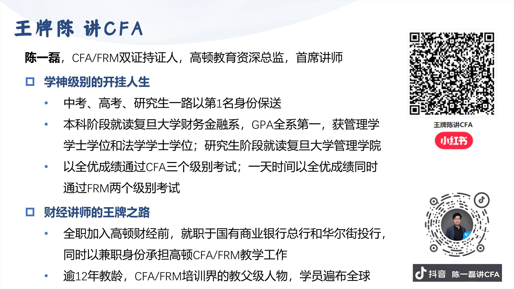

<!-- PDF page 3 -->

## PDF p. 3

[查看第 3 页原图](./assets/讲义原页/page-003.png)

### 财务报表分析基础

<!-- PDF page 4 -->

## PDF p. 4

[查看第 4 页原图](./assets/讲义原页/page-004.png)

### 0.1 资产负债表

Balance sheet presents a company's current financial position by disclosing the resources the company controls and its obligations to lenders or other creditors at a specific point in time

- Assets are the resources controlled by the firm
- Liabilities are amounts owed to creditors
- Owner's equity is the residual interest in the net assets of an entity

### 0.2 会计恒等式

$$
\mathrm{Assets}=\mathrm{Liabilities}+\mathrm{Owners'\ Equity}
$$

$$
\Delta A=\Delta L+\Delta E
$$

> 原页右侧 T 型示意：A 对应 L 与 E；ΔA 对应 ΔL 与 ΔE。

<!-- PDF page 5 -->

## PDF p. 5

[查看第 5 页原图](./assets/讲义原页/page-005.png)

### 0.3 利润表

Income statement presents information on the financial results of a company's business activities over a period of time

- Accrual basis

### 0.4 现金流量表

Cash flow statement reports the sources and uses of cash over a period of time

- Cash flows from operating / investing / financing activities (CFO / CFI / CFF)
- Cash basis

### 0.5 报表间的勾稽关系

Balance sheet is the core statement

- Application of BASE Rule

$$
\mathrm{Retained\ Earnings}_{end}=\mathrm{Retained\ Earnings}_{begin}+\mathrm{Net\ Income}-\mathrm{Dividend}
$$

$$
\mathrm{Cash}_{end}=\mathrm{Cash}_{begin}+\mathrm{Cash\ Inflow}-\mathrm{Cash\ Outflow}
$$

<!-- PDF page 6 -->

## PDF p. 6

[查看第 6 页原图](./assets/讲义原页/page-006.png)

### 1.1 财务报告与财务报告分析

- Definition of financial reporting: the way companies provide information to wide range of interested parties about 1) financial position, 2) financial performance, 3) changes in financial position
- The role of financial reporting analysis: use financial reports and other information to evaluate company's performance and financial position for the purpose of making economic decisions

### 1.2 财务报表分析基本框架和步骤

1. Articulate the purpose and context of the analysis
2. Collect data
3. Process data
4. Analyze / interpret the data
5. Develop and communicate conclusions and recommendations
6. Follow-up, and producing updated reports and recommendation

<!-- PDF page 7 -->

## PDF p. 7

[查看第 7 页原图](./assets/讲义原页/page-007.png)

### 2.1 财务分析信息来源

> 原页为层级图；文字标签列于下方，连接关系以原图为准。

- 财务分析
- 财务报告 Financial Report
- 财务报表 Financial Statements
- 资产负债表 Balance Sheet
- 综合收益表 Comprehensive Income Statement
- 现金流量表 Cash Flow Statement
- 股东权益变动表 Statement of Changes in Equity...
- 附注 Footnotes
- 审计对象
- 财务报告补充信息 Supplementary Information
- 管理层讨论与分析 Management Discussion and Analysis (MD&A)
- 审计报告 Auditor's Report
- 其他信息 Other Informations
- Proxy Statements 股东代理声明
- Conference Call 分析师电话会议
- Press Release 新闻发布

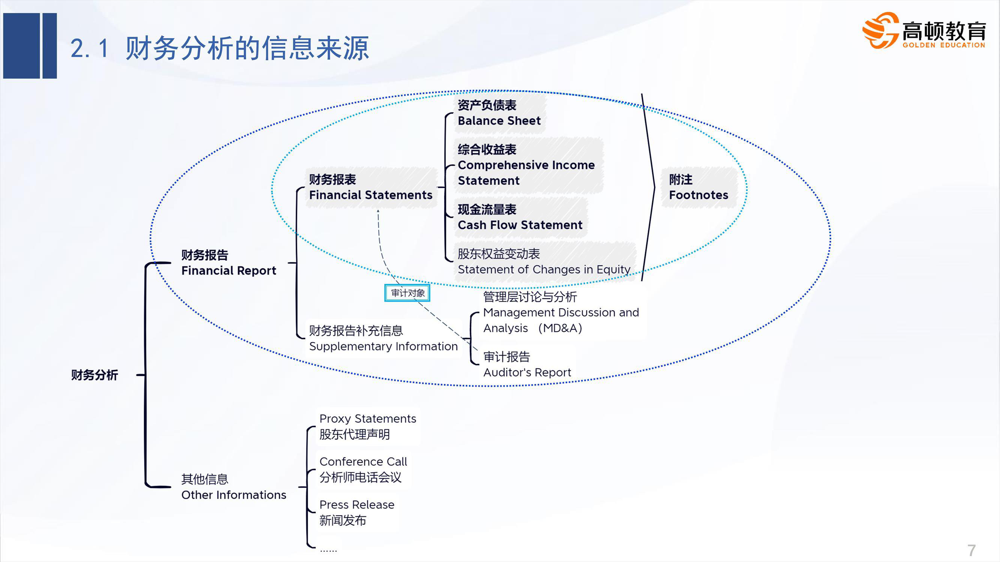

<!-- PDF page 8 -->

## PDF p. 8

[查看第 8 页原图](./assets/讲义原页/page-008.png)

### 2.2 财务报表附注

Footnotes (notes) are a necessary part of financial statements and must be audited

- The notes disclose the basis of preparation for the financial statements
- The notes also disclose information about the accounting policies, methods, and estimates used to prepare the financial statements

### 2.3 分部报告

A company must disclose separate information about any operating segment that meets certain quantitative criteria — namely, the segment constitutes 10% or more of the combined operating segments' revenue, total assets, or operating profits

If any single customer represents 10% or more of the company's total revenues, the company must disclose that fact, though not the identity of that customer

<!-- PDF page 9 -->

## PDF p. 9

[查看第 9 页原图](./assets/讲义原页/page-009.png)

### 2.4 审计报告与审计意见

Audit report is an independent review of an entity's financial statements

- Reasonably assure the statements are fairly presented, free from misstatement and in accordance with accounting principle
- Must provide opinion on company's internal controls for US listed companies

**Auditor's opinion**

1. Unqualified opinion (clean opinion): free from material omissions and errors, fairly presented
2. Qualified opinion: if statements make some exceptions to the accounting principles
3. Adverse opinion: if statements materially depart from accounting standards and are not presented fairly
4. Disclaimer of opinion: unable to express an opinion due to scope limitation

<!-- PDF page 10 -->

## PDF p. 10

[查看第 10 页原图](./assets/讲义原页/page-010.png)

### 2.5 管理层分析与讨论

Management's Discussion and Analysis (MD&A, typically unaudited) is decision-useful management commentary

- Nature of business
- Management's objectives and strategies
- Company's significant resources, risks, and relationships
- Results of operations
- Critical performance measures

### 2.6 其他相关信息来源

- Issuer sources
- Public third-party sources
- Proprietary third-party sources
- Proprietary primary research

<!-- PDF page 11 -->

## PDF p. 11

[查看第 11 页原图](./assets/讲义原页/page-011.png)

### 3. 会计准则制定主体和监管主体

**Standard-setting bodies**

1. Financial Accounting Standards Board (FASB) sets U.S. GAAP
2. International Accounting Standards Board (IASB) sets IFRS

Government agencies have the enforcement power (IASB and FASB don't have)

- The Securities and Exchange Commission (SEC) in the US
- International Organization of Securities Commissions (IOSCO)
  1. Protect investors
  2. Ensure that markets are fair, efficient, and transparent
  3. Reduce systemic risk

**SEC filings**

- Form S-1: registration statement filed for issuing new securities
- Form DEF-14A: proxy statement
- Form 8-K: eg. acquisitions or disposals of major assets / changes in management
- Form 144: notice of the proposed sale of restricted securities
- Form 10-K: annual financial statements (audited)
- Form 10-Q: quarterly statements (not necessarily audited)

<!-- PDF page 12 -->

## PDF p. 12

[查看第 12 页原图](./assets/讲义原页/page-012.png)

### 一. 财务报表分析基础【0–3】

**财务报表分析简介**

- 财务报告和财务报表分析
- 财务报表分析基本框架和步骤
- 财务分析的信息来源
  - 财务报告
    - 财务报表
      - 分部报告
      - 财务报表附注
    - 财务报告补充信息
      - 管理层分析与讨论
      - 审计报告
  - 其他相关信息来源
- 会计准则和市场监管
  - 市场监管
    - 国际证监会组织
      - 监管核心目标
    - 美国证券交易委员会
      - 标准化文件
  - 会计准则
    - 国际财务报告准则
    - 美国通用会计准则

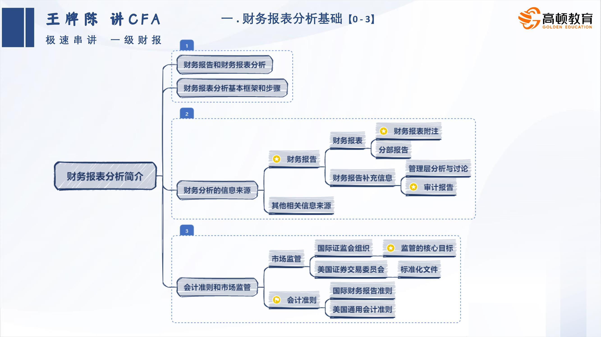

<!-- PDF page 13 -->

## PDF p. 13

[查看第 13 页原图](./assets/讲义原页/page-013.png)

### 一. 财务报表分析基础【0–3】

**会计核心基础知识**

- 会计要素
  - “静态时间点”要素：资产，负债，所有者权益
  - “动态时间段”要素：收入，费用，利润
- 会计恒等式
- 报表的基本格式
  - 资产负债表
  - 利润表和综合收益表
  - 现金流量表
- 报表之间的勾稽关系
  - “资产负债表”观
  - B/S 与 I/S，B/S 与 CF/S
- 基本经济业务的 T 型账务处理

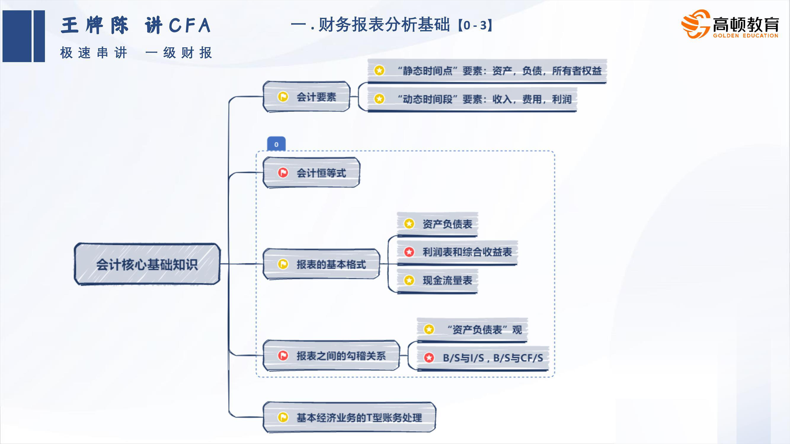

<!-- PDF page 14 -->

## PDF p. 14

[查看第 14 页原图](./assets/讲义原页/page-014.png)

### 利润表

<!-- PDF page 15 -->

## PDF p. 15

[查看第 15 页原图](./assets/讲义原页/page-015.png)

### 4. 收入确认的基本原则

A fundamental principle of accrual accounting is that revenue is recognized when it is earned, so the company's financial records reflect revenue when it is able to satisfy the performance obligation by transferring control of the good or service to the customer

Accrual accounting does not necessarily coincide with the receipt of cash

### 5.1 五步法确认收入

1. Identify the contract(s) with a customer
2. Identify the separate or distinct performance obligations in the contract
3. Determine the transaction price
4. Allocate the transaction price to the performance obligations in the contract
5. Recognize revenue when (or as) the entity satisfies a performance obligation

Long-term contract revenue is recognized over the contract term as the work progresses

<!-- PDF page 16 -->

## PDF p. 16

[查看第 16 页原图](./assets/讲义原页/page-016.png)

### 5.2 确定履约进度：投入法

BM has a long-term contract to build a ship for \$1 million and a reliable estimate of the contract's total cost is \$700,000. The contract specifies consideration of a bonus of \$200,000 if the ship is completed in 2 years. BM has only little experience. Project costs incurred in the first year are \$420,000. How much revenue should be recognized for the first year?

- Costs incurred = \$420,000 / \$700,000 = 60%
- Revenue recognized = 60% × \$1 million = \$600,000

In the beginning of year 2, BM and customer agree to modify the contract: the consideration will increase by \$150,000. BM expects costs will increase by \$120,000, and BM concludes that it now meets the criteria for including the \$200,000 bonus in revenue. They incurs \$250,000 in cost in second year. How much revenue should be recognized in second year?

- BM's total revenue on the transaction = \$1 million + \$150,000 + \$200,000 = \$1.35 million
- BM's progress toward completion is now = \$670,000 / \$820,000 = 81.71%
- The amount of revenue in year 2 = 81.71% × \$1.35 million − \$600,000 = \$503,049

<!-- PDF page 17 -->

## PDF p. 17

[查看第 17 页原图](./assets/讲义原页/page-017.png)

### 6.1 主要责任人和代理人

**Principal:** controls the product before the goods are transferred to the customer

- Revenue is the total amount received for transfer of product

**Agent:** arranges for the transfer of a product controlled by a third-party seller

- Revenue is the fee or commission

### 6.2 授予知识产权许可

Provides a license to use software: if a company provides a license to use software, the company will report revenue either over the term of the license or at the time of the transfer of the license

### 6.3 售后代管安排

Bill and hold arrangements: company recognizes revenue when the customer obtains control of the product, although it still holds the product as requested by the customer

<!-- PDF page 18 -->

## PDF p. 18

[查看第 18 页原图](./assets/讲义原页/page-018.png)

### 7. 费用确认

Accrual basis and matching principle

- Eg. Sale of inventory: costs of goods sold (COGS), warranty expense
- Period costs that less directly match revenues, are generally expensed as incurred

A policy that results in recognition of expenses later rather than sooner is considered less conservative (more aggressive)

### 8.1 资本化与费用化

Depending on the nature of the expenditure, an expenditure can be:

1. Recognized as an expenses in the I/S (CFO out)
2. Capitalized as an asset on the B/S (CFI out)
   - The asset capitalized will be expensed in the future

| | Capitalizing | Expensing |
| --- | --- | --- |
| Total Asset | Higher | Lower |
| Total Equity | Higher | Lower |
| NI — first year | Higher | Lower |
| NI — later year | Lower | Higher |
| Total NI | Same | Same |
| $\sigma_{NI}$ | Lower | Higher |
| ROA, ROE — first year | Higher | Lower |
| ROA, ROE — later year | Lower | Higher |
| CFO | Higher | Lower |
| CFI | Lower | Higher |
| Total Cash Flow | Same | Same |

<!-- PDF page 19 -->

## PDF p. 19

[查看第 19 页原图](./assets/讲义原页/page-019.png)

### 8.2 利息费用资本化

Companies generally must capitalize interest costs associated with acquiring or constructing an asset that requires a long period of time to get ready for its intended use

**Analyst's view of capitalization of interest costs**

For interest coverage ratio analysis, we should include both the capitalized interest portion and the expensed portion

> Analysts may make adjustments to the financial information, based on their “subjective judgment”

### 8.3 内部开发支出资本化

- Research should be expensed as incurred
- Development costs are expensed as incurred, except for certain criteria are met, including: technical feasibility, ability to use or sell the resulting asset, ability to complete the project

<!-- PDF page 20 -->

## PDF p. 20

[查看第 20 页原图](./assets/讲义原页/page-020.png)

### 9.1 需要在利润表单独披露的事项

IFRS require that items of income or expense that are material or relevant to the understanding of the entity's financial performance should be disclosed separately

- Discontinued operation
- Unusual items
- Infrequent items
- Effects due to accounting changes
- Changes in scope
- Changes in exchange rates

### 9.2 异常或非常见事项

**Unusual items**

- Gains or losses from the sale of assets or part of a business

**Infrequent items**

- Impairment (write-off, write-down) of long-term assets
- Gains or losses arising when a company sells an asset or part of a business
- Restructuring charges

<!-- PDF page 21 -->

## PDF p. 21

[查看第 21 页原图](./assets/讲义原页/page-021.png)

### 9.3 非持续经营事项

When a company disposes of or establishes a plan to dispose of one of its component operations and will have no further involvement in the operation, discontinued operations are presented on a net of tax basis

**原页利润表示意**

| | |
| --- | --- |
| | Operating Income |
| +/− | Non-Operating Income |
| +/− | Unusual or Infrequent Items |
| = | Earning before Interest and Tax, EBIT |
| − | Interest Expense |
| = | Earning before Tax, EBT |
| − | Tax Expense |
| = | Net Income from Continuing Operations |
| +/− | Gain or loss from discontinued operation (net of tax) |
| = | Net Income, NI |

- recurring items：Operating Income；Non-Operating Income
- non-recurring items：Unusual or Infrequent Items；Gain or loss from discontinued operation (net of tax)

### 9.4 会计变更

- Change in accounting principle requires retrospective application and restates financial statements for prior periods shown in a report
- Change in accounting estimate should be applied prospectively
- Correction of an error requires restating financial statements for prior periods presented in the current financial statements

<!-- PDF page 22 -->

## PDF p. 22

[查看第 22 页原图](./assets/讲义原页/page-022.png)

### 10.1 基本每股收益

$$
\mathrm{Basic\ EPS}=\frac{NI-\mathrm{Div}_{preferred\ stock}}{\text{weighted average number of common shares outstanding}}
$$

- New issue / repurchase is weighted by time
- If the number of shares of common stock increases as a result of a stock split, the EPS calculation reflects the change retroactively to the beginning of the period

**原页例题**

For this year, JinSan had net income of \$9,000, and paid \$200 in dividends to common shareholders

The company also had the common stock share information shown in the following Exhibit:

What is JinSan's basic earnings per share for this year?

| JinSan's Common Stock Shares | |
| --- | --- |
| Jan. 1 | 1,000 outstanding |
| Mar. 1 | +600 (new issue) |
| May. 1 | 3-for-2 split |
| Jul. 1 | −400 (repurchase) |
| Oct. 1 | 10% stock dividend |

<!-- PDF page 23 -->

## PDF p. 23

[查看第 23 页原图](./assets/讲义原页/page-023.png)

### 10.2 稀释每股收益

Financial instruments that are potentially convertible into common stock could, as a result of conversion or exercise, potentially dilute (i.e., decrease) EPS

The EPS that would result if all dilutive financial instruments were converted is called diluted EPS

**1. Has convertible preferred stock outstanding**

$$
\mathrm{Diluted\ EPS}=\frac{NI-\mathrm{Div}_{preferred}+\mathrm{Div}_{convertible\ preferred}}{\begin{gathered}\text{weighted average number of common shares outstanding}\\+\text{new common shares that would have been issued at conversion}\end{gathered}}
$$

**原页例题**

- BM's net income was \$7,600 with 2,000 common shares outstanding
- BM had 50 shares of 10%, \$1,000 par value non-convertible preferred stock outstanding, also had 10 shares of 8%, \$1,000 par value convertible preferred stock outstanding
- Each preferred share was convertible into 20 shares of common stock

<!-- PDF page 24 -->

## PDF p. 24

[查看第 24 页原图](./assets/讲义原页/page-024.png)

### 10.2 稀释每股收益

**2. Has convertible debt outstanding**

$$
\mathrm{Diluted\ EPS}=\frac{\begin{gathered}NI-\mathrm{Div}_{preferred}\\+\text{after-tax interest on convertible debt}\end{gathered}}{\begin{gathered}\text{weighted average number of common shares outstanding}\\+\text{new common shares that would have been issued at conversion}\end{gathered}}
$$

**原页例题**

- BY had net income \$1,250, and pays preferred stock dividend \$120
- BY had a weighted average of 500 common shares outstanding during the year
- There was \$1,000 of 8% convertible bonds outstanding, convertible into a total of 60 shares
- Assuming the tax rate is 30%

<!-- PDF page 25 -->

## PDF p. 25

[查看第 25 页原图](./assets/讲义原页/page-025.png)

### 10.2 稀释每股收益

**3. Has options (warrants) outstanding**

$$
\mathrm{Diluted\ EPS}=\frac{NI-\mathrm{Div}_{preferred}}{\begin{gathered}\text{weighted average number of common shares outstanding}\\+\big[\text{new shares that would have been issued at option exercise}\\-\text{shares that could have been purchased with cash received upon exercise}\big]\\\times\text{proportion of year during which the financial instruments were outstanding}\end{gathered}}
$$

**原页例题**

The following relates to a BS's common equity over the course of the year:

- Outstanding shares at start of the year = 2,000
- Shares issued on April 1 = 300, Shares repurchased on July 1 = 200
- Stock options outstanding on March 1 = 100, Exercise price is \$5
- Average market price of common shares is \$20
- BS's net income for the year is \$5,000

<!-- PDF page 26 -->

## PDF p. 26

[查看第 26 页原图](./assets/讲义原页/page-026.png)

### 二. 利润表【4–10】

**对利润表的分析**

- 收入确认
  - 权责发生制
  - 五步法确认收入
    1. 识别与客户的合同
    2. 识别单项履约义务
    3. 确定交易价格
    4. 把交易价格分摊至单项履约义务
    5. 履行义务后确认相应收入
  - 收入确认过程中的一些细节问题
    - 总额法和净额法确认收入
    - 取得或履行合同中的必要支出
    - 收入确认的时间
    - 相关的披露要求
- 费用确认
  - 费用确认的一般原则
  - 与存货成本相关的费用
  - 资本化与费用化
    - 资本化与费用化的定义
    - 资本化与费用化比较
    - 资本化的具体应用
      - 利息支出资本化
      - 开发支出资本化
- 利润表分析
- 每股盈利
- 非经常性项目

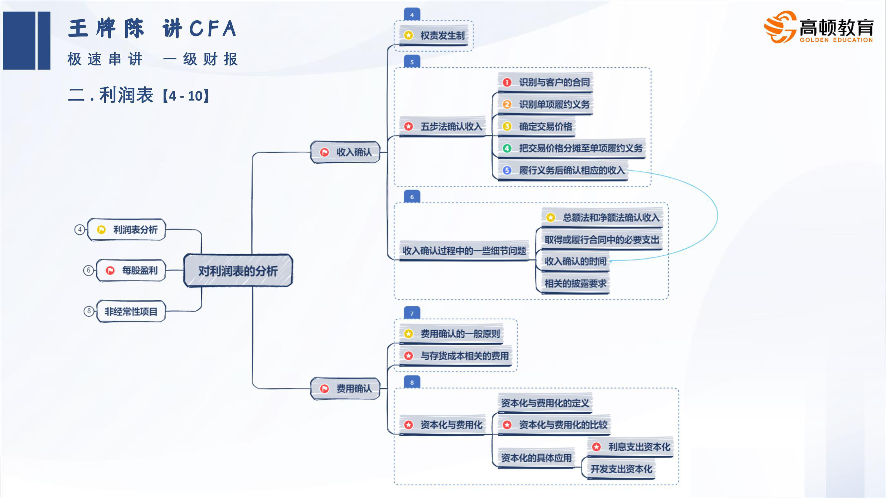

<!-- PDF page 27 -->

## PDF p. 27

[查看第 27 页原图](./assets/讲义原页/page-027.png)

### 二. 利润表【4–10】

**对利润表的分析**

- 收入确认
- 费用确认
- 非经常性项目
  - 需要在利润表单独披露的事项
    - 异常或非常见事项
    - 非持续经营
  - 会计变更的处理原则
    - 会计政策变更
    - 会计估计变更
    - 前期会计差错更正
- 每股盈利
  - 简单/复杂资本结构
  - 基本每股盈利
  - 稀释与反稀释
  - 稀释每股盈利
    - 存在“可转换优先股”情形
    - 存在“可转换债券”情形
    - 存在“看涨期权或权证”情形
- 利润表分析
  - 同比分析
  - 比率分析
    - 销售净利率
    - 销售毛利率

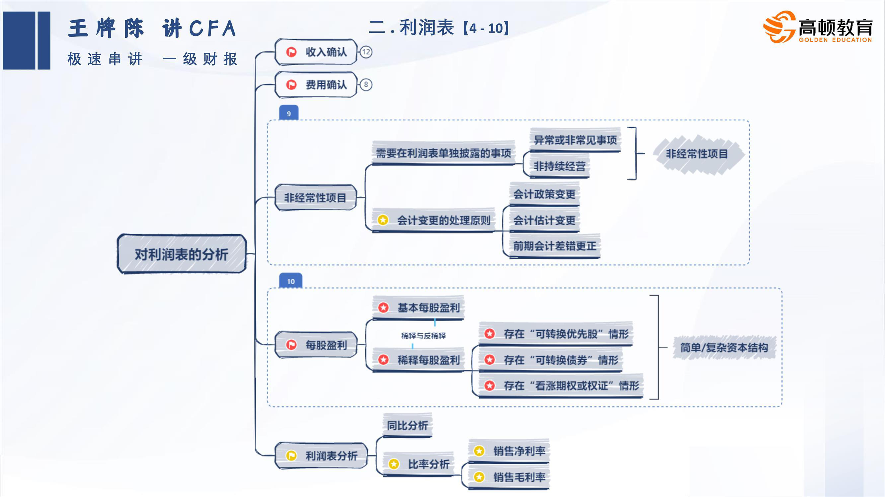

<!-- PDF page 28 -->

## PDF p. 28

[查看第 28 页原图](./assets/讲义原页/page-028.png)

### 资产负债表

<!-- PDF page 29 -->

## PDF p. 29

[查看第 29 页原图](./assets/讲义原页/page-029.png)

### 11.1 无形资产的初始确认

Intangible assets refer to identifiable non-monetary assets without physical substance

- Examples include patents, licenses, and trade-marks

For internally generated intangible assets, IFRS require:

- Costs incurred during the research phase must be expensed
- Costs incurred in the development stage can be capitalized as intangible assets if certain criteria are met, including technological feasibility

### 11.2 无形资产的后续计量

An intangible asset with a finite useful life is amortized on a systematic basis over the best estimate of its useful life, with the amortization method and useful life estimate reviewed at least annually

- Intangibles are subject to impairment as well

An intangible asset with an indefinite useful life is not amortized,

- It is tested for impairment at least annually

<!-- PDF page 30 -->

## PDF p. 30

[查看第 30 页原图](./assets/讲义原页/page-030.png)

### 12. 商誉

If the purchase price is greater than the fair value of the identifiable assets and liabilities acquired, the excess amount is recognized as an asset, goodwill

- Goodwill is the intangible asset that is not a separately identifiable

**原页例题**

- BJ 出资 1000 万元，收购 EJ 80%的股份
- EJ 总资产账面价值为 2100 万元（其中包括商誉 300 万元）
- 除商誉以外其他资产合计公允价值比账面价值高 100 万元
- EJ 资产负债表显示其总负债为 800 万元（公允价值与账面价值相同）
- EJ 资产负债表的附注表明，未计入资产负债表的或有负债 contingent liabilities 公允价值为 100 万元

EJ 可辨认总资产的公允价值 = (2100 − 300) + 100 = 1900 万元

EJ 可辨认净资产的公允价值 = 1900 − (800 + 100) = 1000 万元

Goodwill = 1000 − 1000 × 80% = 200 万元

Goodwill is not amortized; instead it is tested for impairment at least annually

<!-- PDF page 31 -->

## PDF p. 31

[查看第 31 页原图](./assets/讲义原页/page-031.png)

### 13.1 金融资产三分类

Financial instruments are contracts that give rise to both a financial asset of one entity and a financial liability or equity instrument of another entity

Financial assets are measured in two ways

1. Amortized cost **AMC**
2. Fair value: **FVPL** / **FVOCI**

| | B/S | realized g/l | unrealized g/l |
| --- | --- | --- | --- |
| AMC | amortized costs | → I/S | |
| FVPL | fair value | → I/S | → I/S |
| FVOCI | fair value | → I/S | → OCI |

**原页分类图文字**

- 金融资产
  - 债务工具
    - 合同现金流不是（本金 + 利息）→ FVPL
    - 合同现金流是（本金 + 利息）
      - 业务模式：收取合同现金流 → AMC
      - 业务模式：其他 → FVPL
      - 业务模式：既收取合同现金流又出售金融资产 → FVOCI
  - 权益工具
    - 不是为交易而持有
      - 指定为“FVOCI” → FVOCI
      - 没有指定为“FVOCI” → FVPL
    - 为交易而持有 → FVPL

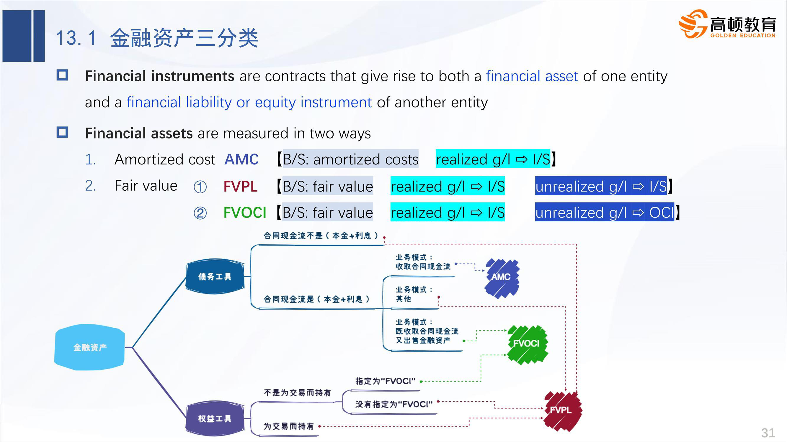

<!-- PDF page 32 -->

## PDF p. 32

[查看第 32 页原图](./assets/讲义原页/page-032.png)

### 13.2 权益类金融资产的后续计量

- T=0, buy 10 shares stocks at \$10
- T=1, each stock pay cash dividend \$1, and price of the stock is still at \$10
- T=2, stock's price is at \$12, and sell 4 shares

> 原页分别列 FVPL、FVOCI 的 T=0 / T=1 / T=2 空白 T 型账户。保留空白，不补答案。

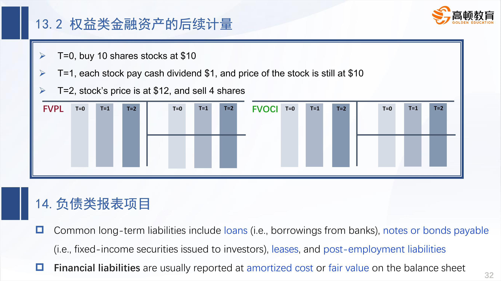

### 14. 负债类报表项目

Common long-term liabilities include loans (i.e., borrowings from banks), notes or bonds payable (i.e., fixed-income securities issued to investors), leases, and post-employment liabilities

Financial liabilities are usually reported at amortized cost or fair value on the balance sheet

<!-- PDF page 33 -->

## PDF p. 33

[查看第 33 页原图](./assets/讲义原页/page-033.png)

### 13.3 债务类金融资产后续计量

- T=0, buy a two-year bond with coupon rate = 10%, par value = \$1000, market price = \$1035.67
- T=1 market price equals to \$1030, T=2 market price equals to \$1000

> 原页列 AMC、FVOCI、FVPL 的 T=0 / T=1 / T=2 空白 T 型账户。保留空白，不补答案。

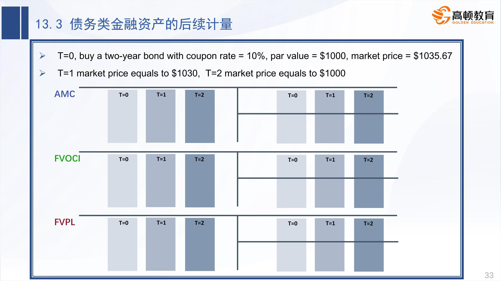

<!-- PDF page 34 -->

## PDF p. 34

[查看第 34 页原图](./assets/讲义原页/page-034.png)

### 三. 资产负债表【11–14】

**对资产负债表分析**

- 无形资产
  - 无形资产初始确认
  - 无形资产后续计量
- 商誉
  - 商誉初始确认
  - 商誉后续计量
- 金融资产
  - 金融资产分类
  - 金融资产计量
    - 权益类投资
    - 债权类投资
- 非流动负债
  - 长期金融负债
  - 递延所得税负债
- 资产负债表分析
  - 同比分析
  - 比率分析
    - 流动比率
    - 偿付比率

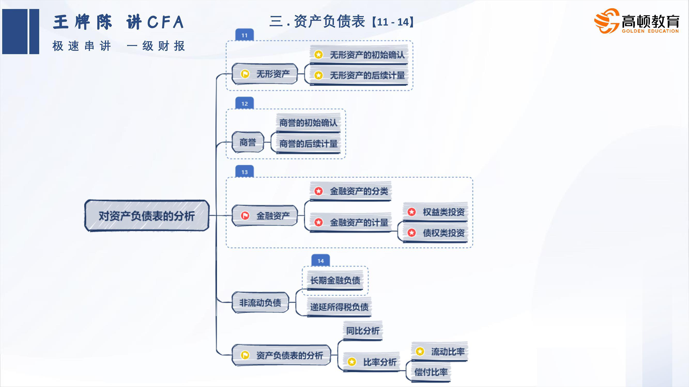

<!-- PDF page 35 -->

## PDF p. 35

[查看第 35 页原图](./assets/讲义原页/page-035.png)

### 现金流量表

<!-- PDF page 36 -->

## PDF p. 36

[查看第 36 页原图](./assets/讲义原页/page-036.png)

### 15. 现金流的分类

- Cash flow from operating activities (CFO) includes company's day-to-day activities
- Cash flow from investing activities (CFI) exclude any securities considered cash equivalents and securities held for dealing or trading purposes
- Cash flow from financing activities (CFF) includes financing activities of obtaining or repaying capital

| Items | GAAP | IFRS |
| --- | --- | --- |
| Interest received | CFO | CFO or CFI |
| Interest paid | CFO | CFO or CFF |
| Dividends received | CFO | CFO or CFI |
| Dividends paid | CFF | CFO or CFF |

### 16. 现金与利润

- For a mature company, because net income includes non-cash expenses (depreciation and amortization), it is expected and desirable that operating cash flow exceeds net income
- If a company has large net income but poor operating cash flow, it may be a sign of poor earnings quality: the company may be making aggressive accounting choices to increase net income but may not be generating cash for its business

<!-- PDF page 37 -->

## PDF p. 37

[查看第 37 页原图](./assets/讲义原页/page-037.png)

### 17.1 经营现金流的计算：直接法

| | |
| --- | --- |
| + | Cash received from customers |
| − | Cash paid to suppliers |
| − | Interest paid |
| − | Taxes paid |
| = | CFO |

$$
A/R_{begin}+Revenue-Cash\ Received=A/R_{end}
$$

$$
A/P_{begin}+Purchase-Cash\ Paid=A/P_{end}
$$

$$
Inventory_{begin}+Purchase-COGS=Inventory_{end}
$$

$$
Interest\ Payable_{begin}+Interest\ Expense-Cash\ Paid=Interest\ Payable_{end}
$$

$$
Tax\ Payable_{begin}+Taxable\ Income\times Tax\ Rate-Cash\ Paid=Tax\ Payable_{end}
$$

**原页例题**

- Purple Fleur S.A., a retailer of floral products, reported cost of goods sold for the year of USD 75 million.
- Total assets increased by USD 55 million, but inventory declined by USD 6 million.
- Total liabilities increased by USD 45 million, and accounts payable increased by USD 2 million.
- What is the cash paid by the company to its suppliers?

<!-- PDF page 38 -->

## PDF p. 38

[查看第 38 页原图](./assets/讲义原页/page-038.png)

### 17.2 经营现金流的计算：间接法

| | | |
| --- | --- | --- |
| | Net income | Income Statement Items |
| + | Non Cash Charge (eg: depreciation, amortization) | Income Statement Items |
| +/− | Non operating items (eg: gain from selling the old machine) | Income Statement Items |
| − | Increase in current asset accounts (eg: A/R, inventory) | Balance Sheet Items |
| + | Increase in current liability accounts (eg: A/P, tax payable) | Balance Sheet Items |
| = | CFO | |

**原页例题**

- JinSan's retained earnings increased by ¥100 during the last year, and the annual dividend was ¥30
- JinSan set aside depreciation expense of ¥10 and gain on disposal of assets of ¥15 during the year
- The beginning inventory of was ¥38, and the ending inventory was ¥58
- The ending accounts receivable is ¥5 less than that at the beginning of the year, and the employee compensation payable at the end of the period was ¥10 less than that at the beginning of the year
- What is the operating cash flow for last year?

<!-- PDF page 39 -->

## PDF p. 39

[查看第 39 页原图](./assets/讲义原页/page-039.png)

### 18. 投资性现金流的计算

- BM sold a machine, and pay \$10 million for new machine
- Income statement shows \$0.5 million gain from selling machine and \$4 million depreciation cost
- The balance sheet shows

| Items | Last Year End | This Year End |
| --- | --- | --- |
| Property, Plant & Equipment — gross | \$12 | \$19 |
| Accumulated Depreciation | (\$5) | (\$7) |
| Property, Plant & Equipment — net | \$7 | \$12 |

What is the cash flow from investing activities?

### 19. 融资性现金流的计算

- BY achieved a net profit of \$1,000 for the year
- Retained earnings was \$500 at the beginning of the period, and changed to \$800 at the end of the year; also, dividends payable decreased by \$100 for the year
- What is the cash flow from financing activities?

<!-- PDF page 40 -->

## PDF p. 40

[查看第 40 页原图](./assets/讲义原页/page-040.png)

### 20. 自由现金流

Free cash flows are the cash flows available for distribution

1. Fulfilling all obligations (operating expenses and taxes)
2. Without impacting on the future growth plans of the company (working capital and fixed capital)

**Free cash flow to firm (FCFF)**

$$
FCFF=NI+Int\times(1-t)+NCC-WCInv-FCInv
$$

$$
FCFF=CFO+Int\times(1-t)-FCInv
$$

**Free cash flow to equity (FCFE)**

$$
FCFE=FCFF-Int\times(1-t)+Net\ Borrowing
$$

$$
FCFE=CFO-FCInv+Net\ Borrowing
$$

<!-- PDF page 41 -->

## PDF p. 41

[查看第 41 页原图](./assets/讲义原页/page-041.png)

### 四. 现金流量债表【15–20】

**对现金流量表的分析**

- 财务报表之间的勾稽关系
- 现金流的基本分类
  - 经营活动现金流
  - 经营活动现金流
  - 投资活动现金流
  - 会计准则之间的差异
- 评估现金流的来源与用途
- 现金流的计算
  - 经营活动现金流
    - 直接法
    - 间接法
  - 投资活动现金流
  - 融资活动现金流
- 自由现金流
  - 归属于企业的自由现金流 FCFF
  - 归属于股东自由现金流 FCFE
- 现金流量表的分析
  - 同比分析
  - 比率分析
    - 业绩表现相关
    - 偿付能力相关

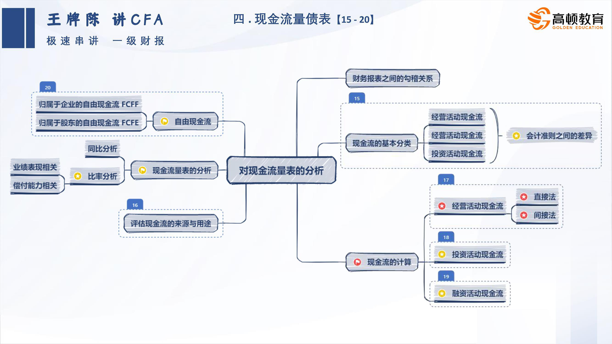

<!-- PDF page 42 -->

## PDF p. 42

[查看第 42 页原图](./assets/讲义原页/page-042.png)

### 财务分析技术

<!-- PDF page 43 -->

## PDF p. 43

[查看第 43 页原图](./assets/讲义原页/page-043.png)

### 21. 同比分析

- Common-size income statement analysis: income statement account / revenue
- Common-size balance sheet analysis: balance sheet account / total asset
- Common-size cash flow statement analysis
  1. cash flow statement account / revenue
  2. cash outflow / total cash outflow; cash inflow / total cash inflow

### 22. 比率分析的局限性

Ratio analysis has limitations, and factors to consider include the following:

- The heterogeneity or homogeneity of a company's operating activities
- The need to determine whether the results of the ratio analysis are consistent
- The need to use judgment
- The use of alternative accounting methods

<!-- PDF page 44 -->

## PDF p. 44

[查看第 44 页原图](./assets/讲义原页/page-044.png)

### 23. 活动比率

Activity ratios reflect the efficiency in using assets to generate revenue

| 原编号 | Ratio | Formula |
| --- | --- | --- |
| 1 | Total Asset Turnover | revenue / average total assets |
| 2 | Fixed Asset Turnover | revenue / average net fixed assets |
| 3 | Working Capital Turnover | revenue / average working capital |
| | working capital | current assets − current liabilities |
| 4 | Inventory Turnover | COGS / average inventory |
| 7 | Days of Inventory on Hand (DOH) | 365 / Inventory Turnover |
| 5 | Receivable Turnover | revenue / average accounts receivable |
| 8 | Days of Sales Outstanding (DSO) | 365 / Receivable Turnover |
| 6 | Payable Turnover | purchase / average accounts payable |
| 9 | Number of Days of Payable | 365 / Payable Turnover |
| 10 | Operating Cycle | DOH + DSO |
| 11 | Cash Conversion Cycle | DOH + DSO − Number of Days of Payables |

<!-- PDF page 45 -->

## PDF p. 45

[查看第 45 页原图](./assets/讲义原页/page-045.png)

### 24. 流动性比率

Liquidity ratios reflect a firm's ability to meet short-term obligations

| | Formula |
| --- | --- |
| 1. Current Ratio | current assets / current liabilities |
| 2. Quick Ratio | (cash + short term marketable security + receivable) / current liabilities |
| 3. Cash Ratio | (cash + short term marketable security) / current liabilities |
| 4. Defensive Interval | (cash + short term marketable security + receivable) / daily cash expenditures |

### 25. 偿付比率

Solvency ratios reflects a firm's ability to pay long-term debt

| | Formula |
| --- | --- |
| 1. Debt-to-Equity Ratio | total debt / total shareholder's equity |
| 2. Debt-to-Capital Ratio | total debt / (total debt + total shareholder's equity) |
| 3. Financial Leverage Ratio | average total assets / average total equity |
| 4. Interest Coverage Ratio | EBIT / interest payments |
| 5. Fixed Charge Coverage | (EBIT + lease payments) / (interest payments + lease payments) |

Total debt is the sum of interest-bearing short-term & long-term debt

<!-- PDF page 46 -->

## PDF p. 46

[查看第 46 页原图](./assets/讲义原页/page-046.png)

### 26.1 盈利比率

Profitability ratios reflect company's ability to generate profits

| | Formula |
| --- | --- |
| 1. Gross Profit Margin | gross profit / revenue |
| 2. Operating Profit Margin | operating profits / revenue |
| 3. Pretax Margin | EBT / revenue |
| 4. Net Profit Margin | net income / revenue |
| 5. Return on Asset (ROA) | NI / average total assets |
| 6. ROA′ | [NI + interest × (1 − tax rate)] / average total assets |
| 7. Return on Equity (ROE) | NI / average total equity |
| 8. Return on capital | EBIT / average capital |

<!-- PDF page 47 -->

## PDF p. 47

[查看第 47 页原图](./assets/讲义原页/page-047.png)

### 26.2 杜邦分析

**DuPont two-part approach**

$$
ROE=\frac{\text{net income}}{\text{average total assets}}\times\frac{\text{average total assets}}{\text{average shareholder equity}}
$$

$$
=ROA\times\mathrm{Financial\ Leverage\ Ratio}
$$

**DuPont three-part approach**

$$
ROE=\frac{\text{net income}}{\text{revenue}}\times\frac{\text{revenue}}{\text{average total assets}}\times\frac{\text{average total assets}}{\text{average shareholder equity}}
$$

$$
=\mathrm{Net\ Profit\ Margin}\times\mathrm{Total\ Asset\ Turnover}\times\mathrm{Financial\ Leverage\ Ratio}
$$

**DuPont five-part approach**

$$
ROE=\frac{\text{net income}}{EBT}\times\frac{EBT}{EBIT}\times\frac{EBIT}{\text{revenue}}\times\frac{\text{revenue}}{\text{average total assets}}\times\frac{\text{average total assets}}{\text{average shareholder equity}}
$$

- Tax burden ratio = NI / EBT = 1 − tax rate
- Interest burden ratio = EBT / EBIT

<!-- PDF page 48 -->

## PDF p. 48

[查看第 48 页原图](./assets/讲义原页/page-048.png)

### 五. 财务分析技术【21–26】

**财务分析技术**

- 财务分析的基本概念
  - 财务分析的基本步骤与框架
  - 比率分析的价值和用途
  - 比率分析的局限性
- 同比分析
  - 利润表
  - 资产负债表
  - 现金流量表
- 比率分析
  - 常见比率
    - 活动比率：周转率；周期天数
    - 流动性比率：偿还短期负债；应对日常支出
    - 偿付比率：资本结构类；覆盖率
    - 盈利比率：结合利润表；结合资产负债表
  - 杜邦分解
    - 二分解
    - 三分解
    - 五分解
  - 行业特定比率
- 盈利预测与建模

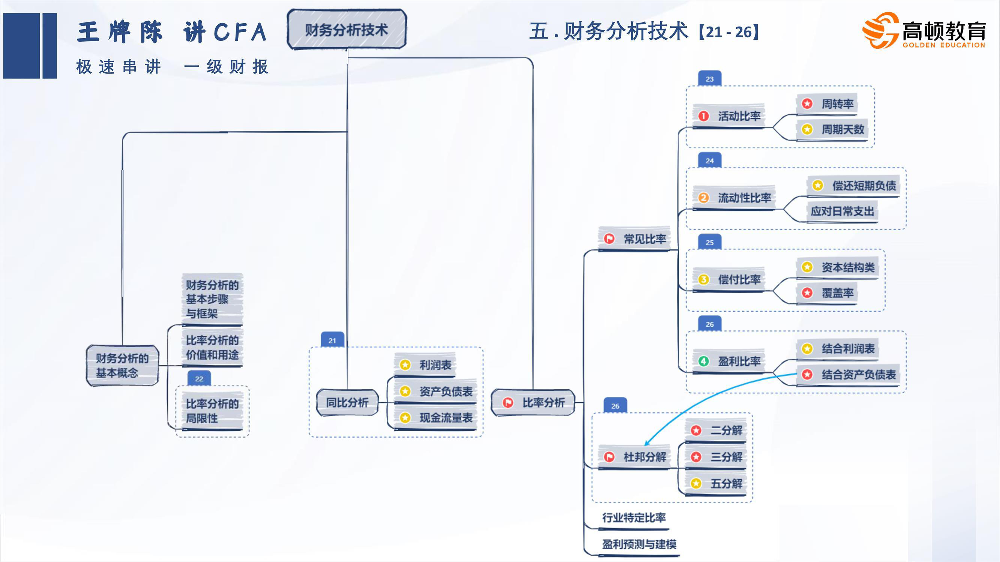

<!-- PDF page 49 -->

## PDF p. 49

[查看第 49 页原图](./assets/讲义原页/page-049.png)

### 存货

### 长期资产

<!-- PDF page 50 -->

## PDF p. 50

[查看第 50 页原图](./assets/讲义原页/page-050.png)

### 27.1 发出存货的计量

1. Specific identification (IFRS / US. GAAP)
2. Weighted average cost (IFRS / US. GAAP)
3. First-in, first-out, FIFO (IFRS / US. GAAP)
4. Last-in, first-out, LIFO (US. GAAP only)

### 27.2 物价变动对财务报表的影响

| Rising Prices | LIFO | FIFO |
| --- | --- | --- |
| Income Statement | Higher COGS; Lower operating income; Lower tax expense; Lower net income | Lower COGS; Higher operating income; Higher tax expense; Higher net income |
| Balance Sheet | Lower inventory balance; Lower working capital | Higher inventory balance; Higher working capital |
| Cash Flow Statement | Higher CFO | Lower CFO |
| Profitability Ratios | Lower gross and net margins | Higher gross and net margins |
| Liquidity Ratios | Lower current ratio | Higher current ratio |
| Solvency Ratios | Higher D/A and D/E | Lower D/A and D/E |
| Activity Ratios | Higher inventory turnover | Lower inventory turnover |

**原页例题**

RGB uses the FIFO inventory accounting method, and HBP uses the LIFO method. During periods of rising prices, the cost of goods sold reported by:

A. HBP is too low

B. RGB is too low

C. HBP is too high

<!-- PDF page 51 -->

## PDF p. 51

[查看第 51 页原图](./assets/讲义原页/page-051.png)

### 28.1 存货减值的会计处理

**IFRS:** inventory should be measured at the lower of the cost or net realizable value (NRV).

- If cost > NRV, inventory is written down to NRV on B/S, and a loss is recognized in I/S
- NRV = estimated selling price − estimated selling cost
- Inventory can be written up but limited to the amount of the original write-down

**GAAP:** inventory should be measured at the lower of the cost or “market”

- If cost > “market”, inventory is written down to “market” on B/S, and a loss is recognized in I/S

I. FIFO / weighted average costs / specific identification: “market” is same as in IFRS

II. LIFO / retail inventory methods:

- If replacement cost > NRV, “market” = NRV
- If replacement cost < NRV − normal profit, “market” = NRV − normal profit
- If NRV − normal profit margin < replacement cost < NRV, “market” = replacement cost

No matter how inventory is measured, no subsequent reversal is allowed under US GAAP

<!-- PDF page 52 -->

## PDF p. 52

[查看第 52 页原图](./assets/讲义原页/page-052.png)

### 28.2 存货减值影响

- Inventory write-down reduces both profit and the carrying value of inventory
- Inventory write-down has negative effect on some profitability, liquidity, and solvency ratios
- Inventory write-down has positive effect on some activity ratios

High inventory turnover and low days of inventory on hand may indicate:

- High inventory management efficiency
- Inventory shortages along with a low sale growth rate
- Poor inventory management due to inventory write-down

### 29. 特殊存货价值调整

If an active market exists, the inventories of producers of agricultural and forest products and minerals and mineral products may be measured at net realizable value

Any gain or losses resulting from changes in value should be recognized in I/S

<!-- PDF page 53 -->

## PDF p. 53

[查看第 53 页原图](./assets/讲义原页/page-053.png)

### 六. 存货【27–29】｜长期资产

**对存货分析**

- 存货的初始确认
- 存货的计量方法
  - 发出存货的计量方法
    - 各类计量方法
      - 个别计价法
      - 加权平均法
      - 先进先出法 FIFO
      - 后进先出法 LIFO
    - 物价变动的影响
    - LIFO 的特殊处理
      - 报表的调整：从 LIFO 调整为 FIFO
      - LIFO 消耗
  - 存货的盘点方法
    - 实地盘存制
    - 永续盘存制
- 存货的减值
  - 国际会计准则 IFRS
  - 美国通用会计准则 GAAP
  - 存货减值的分析
- 对存货的分析

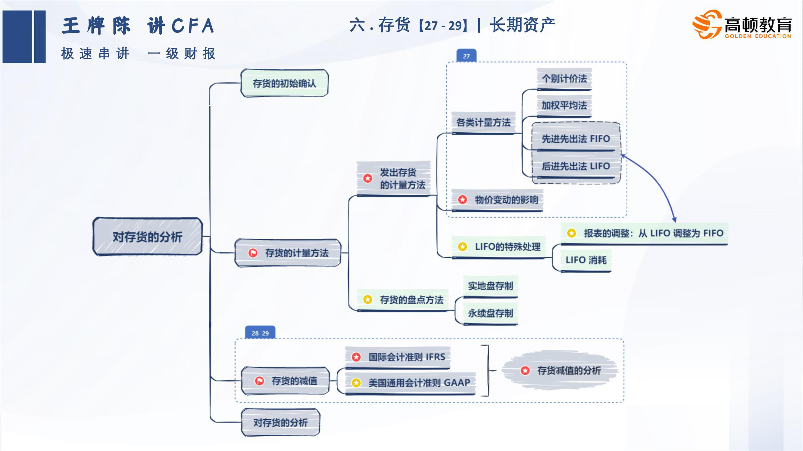

<!-- PDF page 54 -->

## PDF p. 54

[查看第 54 页原图](./assets/讲义原页/page-054.png)

### 11. 无形资产

**1. Intangible assets purchased in situations other than business combinations**

**2. Intangible assets developed internally**

- Research stage: must be expensed
- Development stage:
  - IFRS: can be capitalized as intangible asset, if technical feasibility is established
  - GAAP: only software development can be capitalized as intangible asset when:
    - Technical feasibility is established, if the software is for sale
    - The project will be completed and it will be used as intended, if it is for internal use

**3. Intangible assets acquired in a business combination**

<!-- PDF page 55 -->

## PDF p. 55

[查看第 55 页原图](./assets/讲义原页/page-055.png)

### 30.1 固定资产的减值处理

**Step 1: Indications of Asset Impairment**

At the end of each reporting period, a company assesses whether there are indications of asset impairment

- Accounting standards do not require that the long-lived assets be tested annually for impairment, and they are tested only when significant events suggest the need to test

**Step 2: Impairment Test**

The impairment losses are recognized when the asset's carrying amount is not recoverable (i.e. the carrying amount is more than the recoverable amount)

- IFRS: recoverable amount of an asset is defined as “the higher of its fair value less costs to sell and its value in use”
  - Value in use is based on the present value of expected future cash flows
- GAAP: recoverable amount is defined as “undiscounted expected future cash flows”

<!-- PDF page 56 -->

## PDF p. 56

[查看第 56 页原图](./assets/讲义原页/page-056.png)

### 30.1 固定资产的减值处理

**Step 3: Impairment Loss**

The amount of the impairment loss will reduce the carrying amount of the asset on the balance sheet and will reduce net income on the income statement

- The impairment loss is a non-cash item and will not affect cash from operations

IFRS: impairment loss is measured as the excess of carrying amount over the recoverable amount of the asset

GAAP: the impairment loss is the difference between the asset's carrying amount and fair value

### 30.2 无形资产的减值处理

I. Impairment accounting for intangible assets with a finite life is the same as for tangible assets

II. Intangibles with indefinite lives

- They are tested at least annually for impairment
- Impairment exists when the carrying amount exceeds its fair value

<!-- PDF page 57 -->

## PDF p. 57

[查看第 57 页原图](./assets/讲义原页/page-057.png)

### 30.3 划转为持有待售资产的处理

A long-lived asset is reclassified as held for sale rather than held for use when management's intent is to sell it and its sale is highly probable

At the time of reclassification, assets previously held for use are tested for impairment

- If the carrying amount at the time of reclassification exceeds the fair value less costs to sell, an impairment loss is recognized and the asset is written down to fair value less costs to sell

Long-lived assets held for sale cease to be depreciated or amortized

### 30.4 长期资产减值损失的转回

- IFRS permit impairment losses to be reversed if the recoverable amount of an asset increases regardless of whether the asset is classified as held for use or held for sale
- Under US GAAP, once an impairment loss has been recognized for assets held for use, it cannot be reversed; for assets held for sale, if the fair value increases after an impairment loss, the loss can be reversed

<!-- PDF page 58 -->

## PDF p. 58

[查看第 58 页原图](./assets/讲义原页/page-058.png)

### 28. 30. 资产减值

> 以下按原图各分支列出文字，保留原图以核对关系。

| 触发/类别 | 方法 | 比较/计量 |
| --- | --- | --- |
| 转为持有待售进行减值测试 | 一步法 | 原账面价值 vs 公允价值 − 销售成本 |
| 根据减值迹象进行减值测试：存货 IFRS | 一步法 | 原账面价值 vs 可变现净值 NRV；预期售价 − 预计成本 |
| 根据减值迹象进行减值测试：存货 GAAP | 一步法 | 原账面价值 vs “市场价值 market”；NRV − 利润 → 重置成本 → NRV |
| 根据减值迹象进行减值测试：长期资产 IFRS | 一步法 | 原账面价值 vs 可收回金额 recoverable；max（公允价值 − 销售成本，使用价值）；使用价值 = Σ PVCF |
| 根据减值迹象进行减值测试：长期资产 GAAP | 两步法 | 进行减值测试：可收回金额 recoverable，Σ CF；确认减值损失：公允价值 |
| 至少一年一次进行减值测试：使用寿命不确定或无限的无形资产 | 一步法 | 原账面价值 vs 公允价值 |
| 至少一年一次进行减值测试：商誉 | 两步法 | CFA 二级继续 |

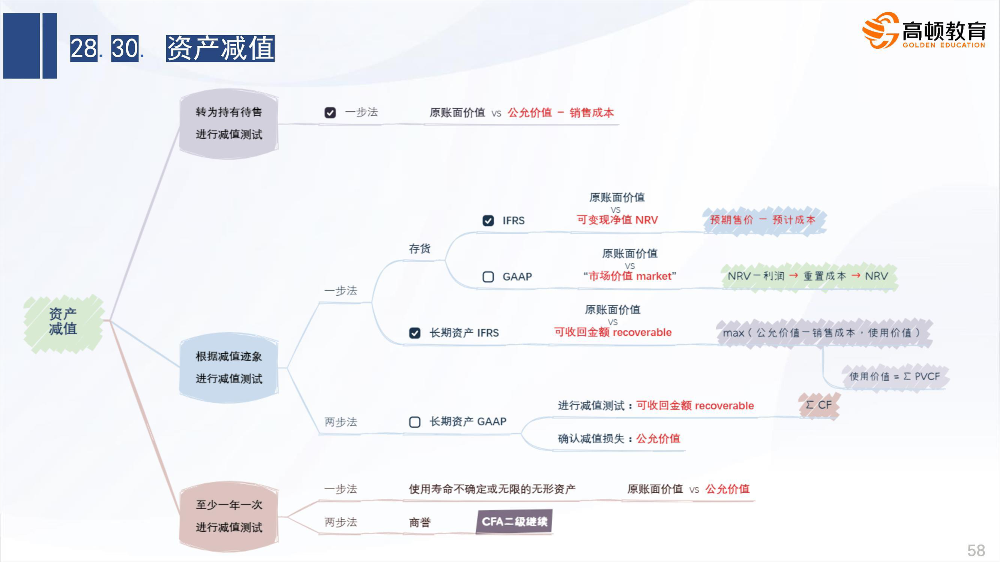

<!-- PDF page 59 -->

## PDF p. 59

[查看第 59 页原图](./assets/讲义原页/page-059.png)

### 31. 长期资产处置

- If a long-lived asset is sold, a gain or loss of disposal, the difference between cash proceeds and book value of the assets sold at the time of sale, should be reported in income statement
- If a long-lived asset is abandoned, a loss, the book value of disposed long-lived assets at the time of abandoned, should be reported in income statement
- If a long-lived asset is exchanged

I. Removing the carrying amount of the asset given up (A)

II. Adding a fair value for the asset acquired (B), which is equal to:

1. the fair value of the asset given up
2. the fair value of the asset acquired
3. the carrying amount of the asset given up

III. Reporting any difference between the carrying amount (A) and the fair value (B) as a gain or loss

<!-- PDF page 60 -->

## PDF p. 60

[查看第 60 页原图](./assets/讲义原页/page-060.png)

### 六. 存货｜长期资产【30–31】

**对长期资产的分析**

- 长期资产的基础会计处理
  - 长期资产的初始确认
  - 长期资产的折旧和摊销
- 无形资产
  - 外购方式取得的无形资产
  - 内部自行研发的无形资产
  - 在企业并购交易中确认的无形资产
- 长期资产的减值
  - 正常使用的长期资产
    - 固定资产的减值
      - 国际会计准则
      - 美国会计准则
    - 无形资产减值
  - 转为“持有待售资产”的处理
- 长期资产的处置
  - 长期资产的出售
  - 长期资产的交换
- 长期资产的计量模式
  - 历史成本计量属性
  - 公允价值计量属性
  - 重评估计量属性
- 对长期资产的分析
  - 长期资产的列报和披露
  - 固定资产的分析
    - 固定资产周转率
    - 固定资产年限

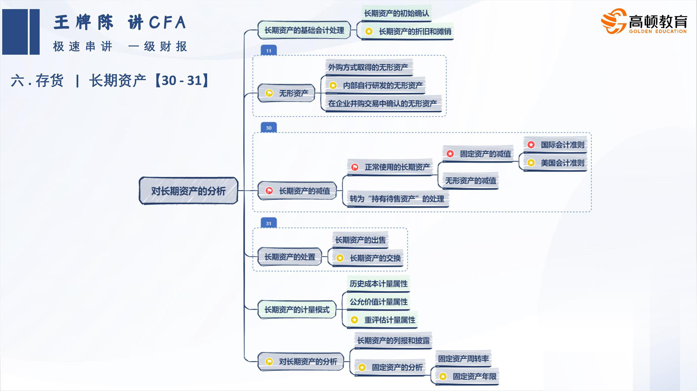

<!-- PDF page 61 -->

## PDF p. 61

[查看第 61 页原图](./assets/讲义原页/page-061.png)

### 租赁

### 养老金计划

### 股份支付

<!-- PDF page 62 -->

## PDF p. 62

[查看第 62 页原图](./assets/讲义原页/page-062.png)

### 32. 租赁基本概念

A lease is a contract that conveys the right to use an asset for some time in exchange for consideration

- The party who uses the asset and pays the consideration is the lessee, and the party who owns the asset, grants the right to use the asset, and receives consideration is the lessor

A lease that resembles a purchase is a finance lease if any of the following five criteria are met

If none of the criteria are met, the lease is an operating lease

1. The lease transfers ownership of the underlying asset to the lessee
2. The lessee has an option to purchase the underlying asset and is reasonably certain it will do so
3. The lease term is for a major part of the asset's useful life
4. The present value of the sum of lease payments equals or exceeds substantially fair value of asset
5. The underlying asset has no alternative use to the lessor

**Advantages of leasing**

| Lessee | Lessor |
| --- | --- |
| Cheaper financing | Earning interest income |
| Less or no down payments | Increasing market shares |
| Less covenants restrictions | |

<!-- PDF page 63 -->

## PDF p. 63

[查看第 63 页原图](./assets/讲义原页/page-063.png)

### 33.1 租赁会计处理整体框架

**租赁会计处理**

- 承租人
  - IFRS → ① lessee | IFRS
  - GAAP
    - 融资租赁 → ② lessee | GAAP | FL
    - 经营租赁 → ③ lessee | GAAP | OL
  - 短期租赁和低价值资产租赁 → ④ lessee | exemption
- 出租人
  - 融资租赁 → ⑤ lessor | FL
    - IFRS
    - GAAP direct finance / sales-type
  - 经营租赁 → ⑥ lessor | OL

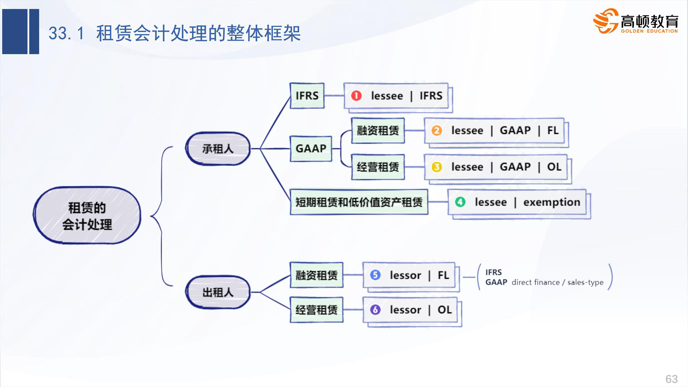

<!-- PDF page 64 -->

## PDF p. 64

[查看第 64 页原图](./assets/讲义原页/page-064.png)

### 33.2 承租人的会计处理

> 原图有 T 型账户及现金流箭头。以下保留原图文字与原有简化表达，不添加口径修正。

| | ① lessee · IFRS / ② lessee · GAAP · FL | ③ lessee · GAAP · OL | ④ lessee · exemption |
| --- | --- | --- | --- |
| 初始计量 | + ROU；+ 租赁负债 | + ROU；+ 租赁负债 | None |
| 后续计量：现金 | LP = Δcash = 利息（CFO 出）+ 还本（CFF 出） | LP = Δcash（CFO 出）= ΔRE | LP = Δcash（CFO 出）= ΔRE |
| I/S | ① 利息 = 期初租赁负债 × r；② 对 ROU 的摊销 amortization 直线法 | rental expense = LP | rental expense = LP |
| 费用 | 由两笔费用组成；利息费用逐期降低 | 由一笔费用组成；费用每期保持不变 | 由一笔费用组成；费用每期保持不变 |
| ROU | 通过摊销 amortization 直线法降低 | 通过摊销 amortization 实际利率法降低 | |
| 租赁负债 | 通过摊销 amortization 实际利率法降低 | 通过摊销 amortization 实际利率法降低 | |

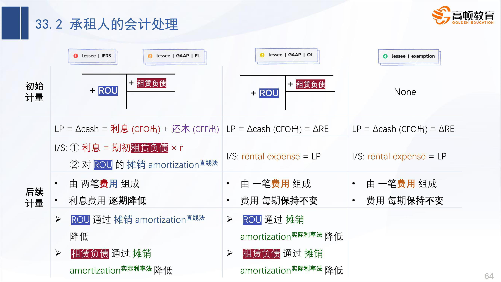

<!-- PDF page 65 -->

## PDF p. 65

[查看第 65 页原图](./assets/讲义原页/page-065.png)

### 33.3 出租人的会计处理

| | ⑤ lessor · FL（IFRS；GAAP direct finance / sales-type） | ⑥ lessor · OL |
| --- | --- | --- |
| 初始计量 | − 租赁资产；+ 应收租赁款；RE +/− | None |
| 后续计量：现金 | LR = Δcash（CFO 入）= 利息收益 + 应收款项收回 | LR = Δcash（CFO 入）= 部分 ΔRE |
| I/S | 利息收益 = 期初应收租赁款 × r | ① lease income = LR；② 租赁资产的折旧费用 |
| 收益/费用 | 由一笔收益组成；利息收益逐期降低 | 由一笔收益和一笔费用组成；收益和费用每期保持不变 |
| 后续账户 | 应收租赁款通过实际利率法逐期收回 | 租赁资产计提折旧 |

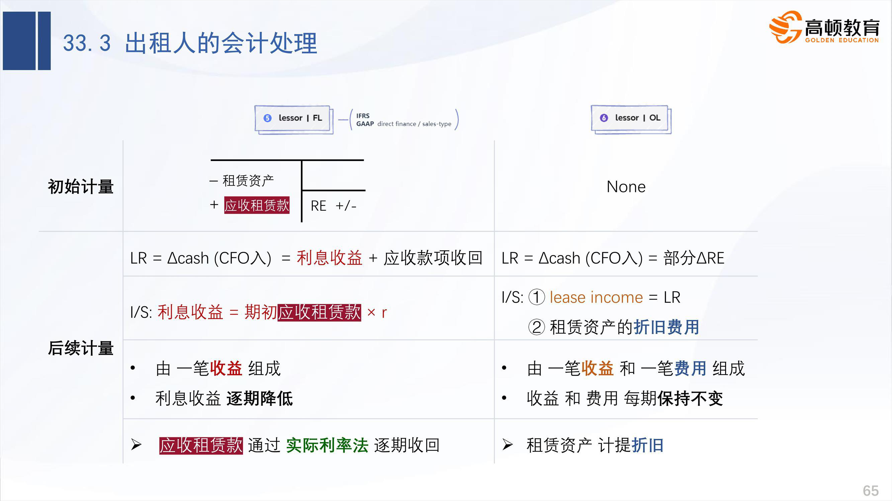

<!-- PDF page 66 -->

## PDF p. 66

[查看第 66 页原图](./assets/讲义原页/page-066.png)

### 七. 租赁【32–33】｜养老金计划｜股份支付

**长期负债和所有者权益**

- 租赁
  - 租赁基本概念
    - 承租人 lessee
    - 出租人 lessor
    - 租赁的分类
      - 经营租赁 operating lease (OL)
      - 融资租赁 finance lease (FL)
      - IFRS vs. GAAP
  - 租赁的会计处理
    - 承租人的会计处理
      - IFRS：① lessee | IFRS
      - GAAP：融资租赁 ② lessee | GAAP | FL；经营租赁 ③ lessee | GAAP | OL
      - 短期租赁和低价值资产租赁：④ lessee | exemption
    - 出租人的会计处理
      - 融资租赁：⑤ lessor | FL
      - 经营租赁：⑥ lessor | OL
- 养老金计划
- 股份支付
- 列报与披露

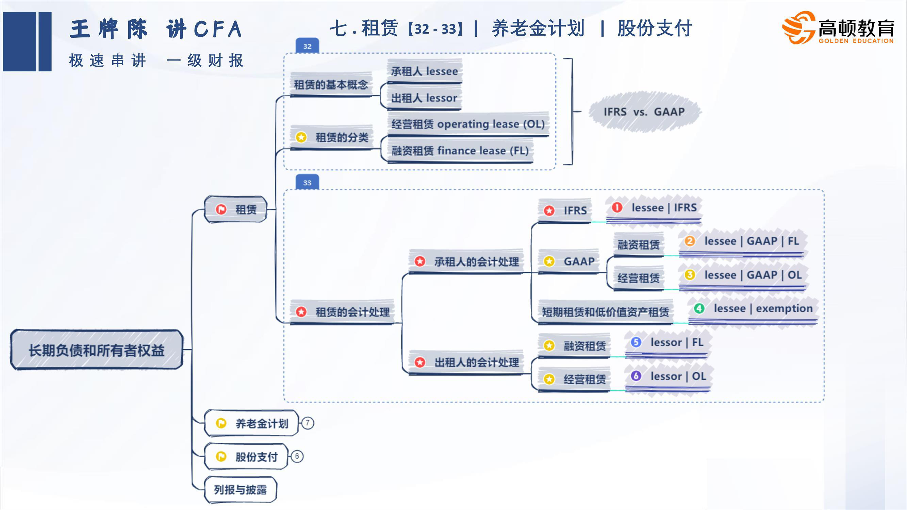

<!-- PDF page 67 -->

## PDF p. 67

[查看第 67 页原图](./assets/讲义原页/page-067.png)

### 34. 养老金计划分类

Pensions and other postemployment benefit plans are a common type of deferred compensation

**1. Defined contribution (DC) pension plans**

- The company (employer) contributes an agreed-upon amount into the plan, and the company contribution is the pension expense and is reported as an operating cash outflow
- Employee owns the plan and bears all risk and return consequences of investment

**2. Defined benefit (DB) pension plans**

- To measure the employer's liability (projected benefit obligation, PBO), the employer should make some financial assumptions and actuarial assumptions
- The discount rate used is the yield on a high-quality corporate bond
- Employer bears the actuarial risk and investment risk
- DB plans are funded through pension plan assets held in a separate legal entity
- If the fair value of the plan's assets is higher (lower) than the present value of the estimated pension obligation, the plan's funded status is positive (negative) or surplus (deficit), and the company will report a net pension asset (liability) on its balance sheet

<!-- PDF page 68 -->

## PDF p. 68

[查看第 68 页原图](./assets/讲义原页/page-068.png)

### 35. 对设定收益计划的会计处理

**Accounting for DB plans under IFRS**

- 计入利润表，影响当期损益
  - 服务成本 employees' service costs
    - 当期服务成本 current service costs
    - 过去服务成本 past service costs
  - 设定受益计划净负债或净资产的利息净额
    - net interest expense or income accrued on the beginning net pension liability or asset
- 以重新计量 remeasurements 形式计入其他综合收益 other comprehensive income
  - 精算利得和损失 actuarial gains and losses
  - 养老金资产的实际回报，扣除包括在设定受益净负债或净资产的利息净额中的金额
    - actual return on plan assets, less any return included in the net interest expense or income
  - Remeasurements are not amortized into profit or loss over time

**Accounting for DB plans under GAAP**

- 计入利润表，影响当期损益
  - 当期服务成本 current service costs
  - 设定受益计划义务现值产生的利息费用，扣除养老金资产预期回报
    - interest expense accrued on the beginning pension obligation, less expected return on plan assets
- 计入其他综合收益 other comprehensive income
  - 过去服务成本 past service costs
    - PSC are amortized to P&L over the average service lives
  - 精算利得和损失 actuarial gains and losses
  - 养老金资产的实际回报，扣除养老金资产预期回报
    - actual return on plan assets, less expected return on plan assets
  - Two parts are partially amortized using the corridor approach

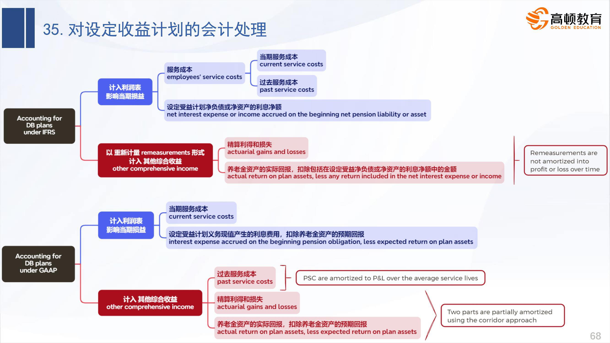

<!-- PDF page 69 -->

## PDF p. 69

[查看第 69 页原图](./assets/讲义原页/page-069.png)

### 36.1 以权益结算的股份支付

Share-based compensation serves to align employees' interests with those of the shareholders, and requiring no current-period cash outlays

**原页时间轴**：grant date → vesting date → exercise date；grant date 至 vesting date 为 service period

**1. Equity-settled share-based compensation:** ① stock grants with restrictions, ② stock options

- Advantages: no additional outlay of cash
- Disadvantages: dilute existing shareholders / limited influence over company's market value / managers to be risk averse or excessive risk-taking
- It is measured using fair value at the grant date and recognized as compensation expense over the vesting period
  - Fair value of option is estimated by using the models, not by using the market price
  - Fair value of stock grants can be estimated by using the market price

<!-- PDF page 70 -->

## PDF p. 70

[查看第 70 页原图](./assets/讲义原页/page-070.png)

### 36.2 以现金结算的股份支付

**2. Cash-settled share-based compensation**

① Stock appreciation rights (SARs) gives the employee the right to receive compensation based on the increase in the price of the firm's stock

- Advantages of SARs: potential for risk aversion is limited / shareholder ownership is not diluted

② Phantom shares can be used by private companies or business units within a company that are not publicly traded or by highly illiquid companies

Cash-settled share-based compensation are valued at fair value of each balance-sheet date, and the compensation expense is allocated over the service period of the employee

<!-- PDF page 71 -->

## PDF p. 71

[查看第 71 页原图](./assets/讲义原页/page-071.png)

### 七. 租赁｜养老金计划【34–35】｜股份支付【36】

**长期负债和所有者权益**

- 租赁
- 养老金计划
  - 设定提存计划
  - 设定收益计划
  - 比较
  - 基本概念
  - 会计处理原则
    - 国际会计准则
    - 美国通用会计准则
    - I/S vs. OCI
- 股份支付
  - 以权益结算的股份支付
    - 股票期权
    - 限制性股票
  - 以现金结算的股份支付
    - 现金股票增值权
    - 模拟股票
- 列报与披露

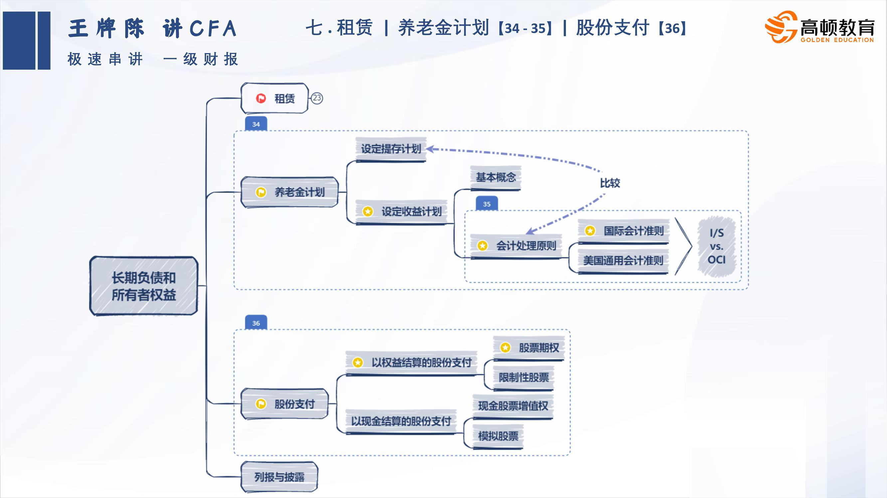

<!-- PDF page 72 -->

## PDF p. 72

[查看第 72 页原图](./assets/讲义原页/page-072.png)

### 所得税费用

<!-- PDF page 73 -->

## PDF p. 73

[查看第 73 页原图](./assets/讲义原页/page-073.png)

### 37.1 利润表和纳税申报表

| Income Statement | Tax Return Form |
| --- | --- |
| Revenues | Taxable Revenues |
| (Expenses) | (Deductible Expenses) |
| EBT | Taxable Income |
| (Income Tax Expense) | → Current Tax Payable |
| Net Income | |

**Tax reporting**

- Taxable income = taxable revenue − tax deductible expense
- Taxes payable = taxable income × tax rate
- Income tax paid = actual cash outflow for income tax

**Financial reporting**

- Pretax income (accounting profit) = earning before tax = revenue − expense

$$
\mathrm{Income\ tax\ expense}=\mathrm{current\ taxes\ payable}+\Delta DTL-\Delta DTA
$$

- Net income = pretax income − income tax expense

<!-- PDF page 74 -->

## PDF p. 74

[查看第 74 页原图](./assets/讲义原页/page-074.png)

### 37.2 税会差异

Sources of differences between accounting profits (EBT) and taxable income

1. Timing differences (temporary differences)
   - I. Taxable temporary differences → deferred tax liability (DTL)
   - II. Deductible temporary differences → deferred tax asset (DTA)
2. Permanent differences

### 38.1 资产账面价值和计税基础

Tax base of asset is the amount deductible for tax purposes in future as economic benefits are realized

**Depreciable assets**

- Accounting base = original cost − accumulated accounting dep. − impairment
- Tax base = original cost − accumulated tax depreciation

**Account receivable**

- Accounting base = invoiced amount − allowance for bad debt
- Tax base = invoiced amount

**Research in R&D**

- Accounting base (expensed as incurred) = 0
- Tax base (capitalized) = original cost − accumulated tax amortization

<!-- PDF page 75 -->

## PDF p. 75

[查看第 75 页原图](./assets/讲义原页/page-075.png)

### 38.2 负债的账面价值和计税基础

Tax base of liabilities is the carrying value of the liability less any amounts that will be deductible on the tax return in the future

- Accounts payable: tax base = carrying value
- Other payable: tax base = carrying value
- Warranty liability: tax base = 0
- Customer advance: tax base = 0

### 39. 递延所得税资产和递延所得税负债的确认

| | Carrying Value > Tax Base | Carrying Value < Tax Base |
| --- | --- | --- |
| Assets | DTL | DTA |
| Liability | DTA | DTL |

Tax loss carrying forward will result in a DTA

<!-- PDF page 76 -->

## PDF p. 76

[查看第 76 页原图](./assets/讲义原页/page-076.png)

### 40.1 递延所得税资产的减值

A deferred tax asset may be created only if the company expects to be able to realize the economic benefit of the deferred tax asset in the future

- If it were doubtful that future economic benefits will be realized from a temporary difference, the temporary difference will not lead to recognition of a DTA

DTA should be assessed at every balance sheet date

- If a deferred tax asset was recognized previously, but there was sufficient doubt about the economic benefits being realized, then:
  - Under IFRS, an existing deferred tax asset would be reduced
  - Under US GAAP, a valuation allowance would be established to reduce the DTA

If any subsequent recovery of the deferral is expected to realize (future earning power is expected to increase), the impairment of DTA can be reserved

<!-- PDF page 77 -->

## PDF p. 77

[查看第 77 页原图](./assets/讲义原页/page-077.png)

### 40.2 对递延所得税负债的分析

If deferred tax liability is unlikely to be reversed

- Treated DTL as “equity”

If deferred tax liability is to be reversed

- Treated DTL as true liability

### 40.3 列报与披露

Both DTA and DTL are presented on the balance sheet, not netted

- GAAP: Either current or non-current on B/S
- IFRS: Non-Current items on B/S

<!-- PDF page 78 -->

## PDF p. 78

[查看第 78 页原图](./assets/讲义原页/page-078.png)

### 41. 所得税费用

$$
\mathrm{Income\ tax\ expense}=\mathrm{current\ tax\ payable}+\Delta DTL-\Delta DTA
$$

- Current tax payable = taxable income × current tax rate
- DTA or DTL = difference between carrying value and tax base × future tax rate

**原页关系图文字**

- 税会差异
  - 暂时性差异
    - 应纳税暂时性差异 → 递延所得税负债 DTL
      - 资产的账面价值大于计税基础
      - 负债的账面价值小于计税基础
    - 可抵扣暂时性差异 → 递延所得税资产 DTA
      - 资产的账面价值小于计税基础
      - 负债的账面价值大于计税基础
      - 待弥补亏损
  - 永久性差异
- 暂时性差异乘预期未来税率 → DTA (DTL) 时点数
- DTA (DTL) 时间段变化量
- 所得税费用 = 当期应交税费（使用当前税率），加 change of DTL，减 change of DTA

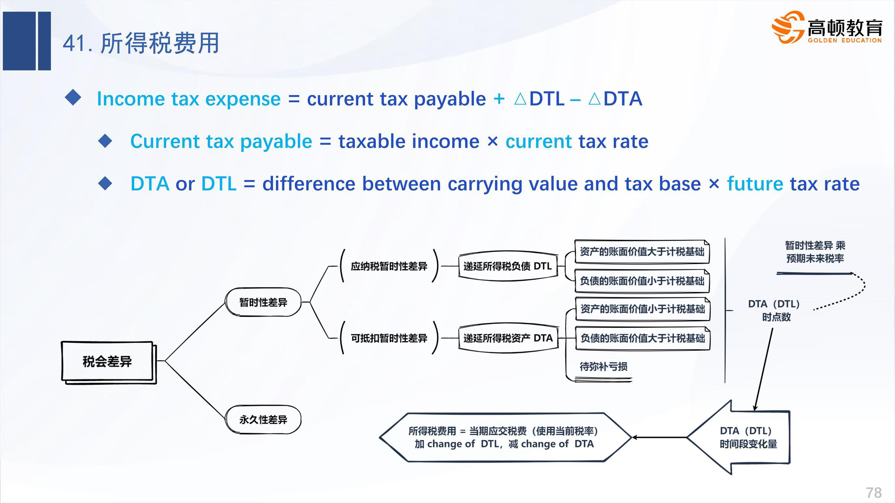

<!-- PDF page 79 -->

## PDF p. 79

[查看第 79 页原图](./assets/讲义原页/page-079.png)

### 42. 所得税税率

The statutory tax rate, which is the corporate income tax rate in the country in which the company is domiciled

The effective tax rate, which is calculated as the reported income tax expense amount on the income statement divided by the pre-tax income

- The effective tax rate is relevant for projecting earnings on the income statement

The cash tax rate, which is the tax paid in cash that period (cash tax) divided by pre-tax income

- The cash tax rate is used for forecasting cash flows

<!-- PDF page 80 -->

## PDF p. 80

[查看第 80 页原图](./assets/讲义原页/page-080.png)

### 八. 所得税费用【37–41】

**对所得税的分析**

- 税会差异
  - 利润表和纳税申报表
  - 暂时性差异和永久性差异
  - 账面价值和计税基础
  - 递延所得税资产和递延所得税负债
- 所得税费用
  - 所得税费用计算
  - 税率变化影响
- 企业所得税率
  - 法定税率
  - 有效税率
  - 现金税率
  - 辨析
- 相关分析
  - 对递延所得税资产的分析
  - 对递延所得税负债分析

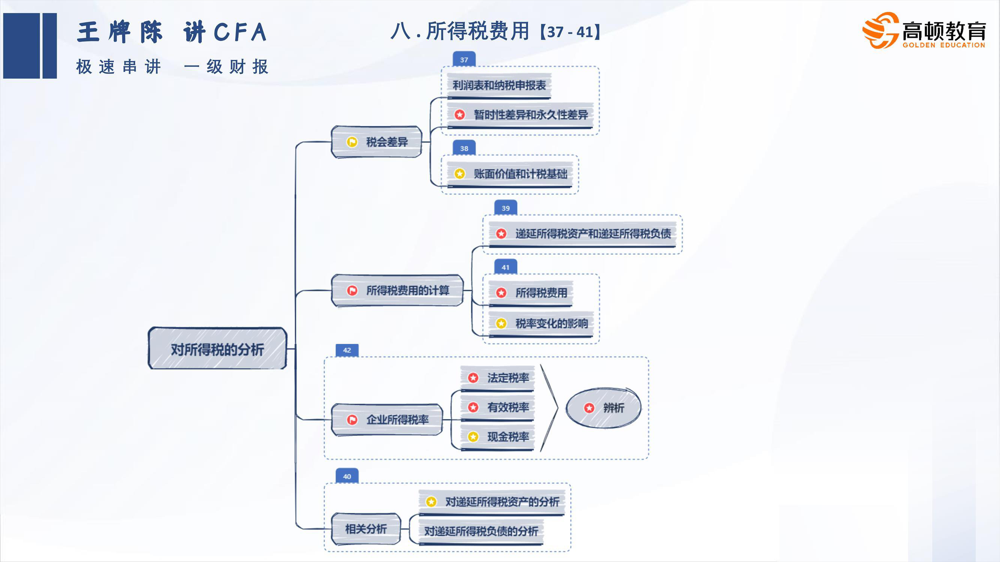

<!-- PDF page 81 -->

## PDF p. 81

[查看第 81 页原图](./assets/讲义原页/page-081.png)

### 财报质量

### 财务建模

<!-- PDF page 82 -->

## PDF p. 82

[查看第 82 页原图](./assets/讲义原页/page-082.png)

### 43. 财务报告质量和企业盈利质量

Financial reporting quality and earnings quality are separated but interrelated with each other

- High-quality earning means there are sufficient return on the company's investment, and it is able to sustain in the future
  - High (low) earnings quality increases (decreases) company value
- High-quality financial reporting provides decision-useful information, which is relevant, complete, neutral, and free from error
  - Low financial reporting quality impedes assessment of earnings quality and impedes valuation

**Quality spectrum of financial reports**

1. (a) Within GAAP (b) Decision-useful (c) Sustainable and adequate returns
2. (a) Within GAAP (b) Decision-useful (c) Not sustainable return
3. (a) Within GAAP (b) Biased choices
4. (a) Within GAAP (b) Earnings management
5. Non-compliant GAAP
6. Fictitious transactions

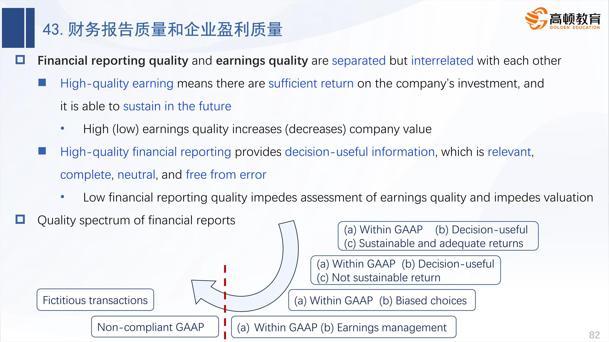

<!-- PDF page 83 -->

## PDF p. 83

[查看第 83 页原图](./assets/讲义原页/page-083.png)

### 44. 激进和保守的会计处理

| Aggressive Accounting | Conservative Accounting |
| --- | --- |
| capitalize | expense |
| longer useful life of fixed assets | shorter useful life of fixed assets |
| higher estimates of salvage values | lower estimates of salvage values |
| smaller valuation allowance on DTA | larger valuation allowance on DTA |

### 45.1 财务舞弊三角形

| Fraud Triangle | typical situations in issuing low quality reports |
| --- | --- |
| Motivation | meet market expectations |
| Motivation | career and compensation concerns |
| Motivation | avoid debt covenant violations |
| Opportunity | internal opportunity: eg. poor internal control |
| Opportunity | external opportunity: eg. divergent accounting policies |
| Rationalization | justify himself or herself |

### 45.2 应对舞弊的措施

**Discipline Mechanism**

| | |
| --- | --- |
| Internal discipline | Markets |
| External discipline | Market regulatory authorities |
| External discipline | Auditors |
| External discipline | Private contracting |

<!-- PDF page 84 -->

## PDF p. 84

[查看第 84 页原图](./assets/讲义原页/page-084.png)

### 46.1 针对利润表进行建模预测

- Sales revenue: using top-down analysis to estimate the YOY growth rate
- COGS has a direct link with sales: forecasted COGS = (1 − gross margin) × estimate of future revenue
- Selling, general, and administrative expenses (SG&A) overall are less closely linked to revenue than COGS
  - Selling and distribution expenses are more variable than others and can be estimated as a percentage of sales, other general and administrative expenses are more fixed in nature
- Financing expenses: net interest expense = Debt (beg) × market interest rate − interest income

### 46.2 针对资产负债表进行建模预测

- Many balance sheet items flow directly from or very closely linked to income statement
- Projections for PP&E and intangible assets are less directly tied to the income statement
  - Maintenance capital expenditures, growth capital expenditures
- Leverage ratios can be used to project capital structure

<!-- PDF page 85 -->

## PDF p. 85

[查看第 85 页原图](./assets/讲义原页/page-085.png)

### 47. 分析师在财务预测过程中常见行为偏差

- Overconfidence in forecasting: prediction overconfidence and certainty overconfidence
- Illusion of control: overestimate their ability to control what cannot be controlled
- Conservatism bias: maintain prior views by inadequately incorporating new information
- Representativeness bias: base-rate neglect and sample-size neglect
- Confirmation bias: look for information that confirms prior beliefs and to ignore information that contradicts them

### 48.1 建模考虑因素：竞争因素

Impact of competitive factors: Porter's five forces

- Intensity of rivalry among incumbent companies
- Threat of new entrants
- Threat of substitutes products
- Bargaining power of suppliers
- Bargaining power of customers

<!-- PDF page 86 -->

## PDF p. 86

[查看第 86 页原图](./assets/讲义原页/page-086.png)

### 48.2 建模考虑因素：通胀膨胀

Inflation and deflation can significantly affect the accuracy of forecasts for a company's future revenue, profit, and cash flow

Faced with rising input prices, a company might decide to preserve its margins by passing on the costs to its customers, or it might decide to accept some margin reduction to increase its market share

Forecasting revenue for a company faced with inflation in input costs requires an understanding of the price elasticity of the products (price-volume trade-off), industry structure, corporate strategy

### 48.3 建模考虑因素：长期限预测

Normalized earnings are the expected level of mid-cycle earnings for a company in the absence of any unusual or temporary factors that affect profitability

<!-- PDF page 87 -->

## PDF p. 87

[查看第 87 页原图](./assets/讲义原页/page-087.png)

### 九. 财报质量【43–45】｜财务建模【46–48】

**财务报告质量**

- 报告质量
  - 财务报告质量 vs. 企业盈利质量
  - 财务报告总体质量的排序
  - 激进和保守的会计处理
- 财务舞弊
  - 舞弊三角模型
  - 应对舞弊的措施
  - 财务报告被操纵的迹象

**财务报表建模简介**

- 财务建模的基本概念
  - 财务报表分析 vs. 财务报表建模
  - 财务报表建模框架
    - 利润表
    - 现金流量表
- 分析师预测过程中的常见行为偏差
  - 过度自信
  - 控制幻觉
  - 保守型偏差
  - 代表性偏差
  - 确认偏差
- 波特五力模型
- 建模时考虑通胀和通缩
- 预测期限和长期限预测

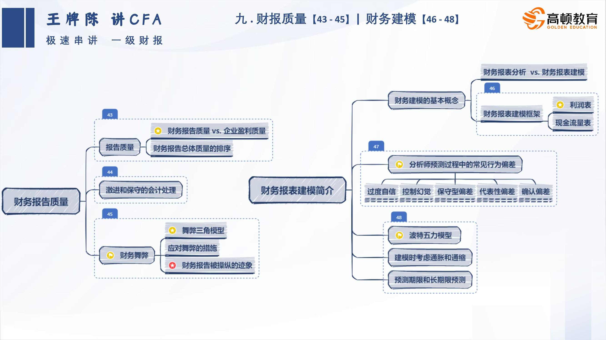

<!-- PDF page 88 -->

## PDF p. 88

[查看第 88 页原图](./assets/讲义原页/page-088.png)

> 手写结束语，保留原图。

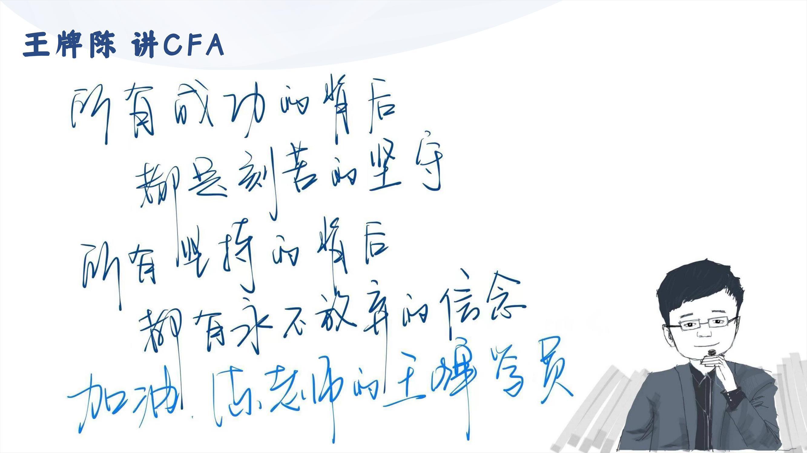

## 转录完整性

- PDF 页码 1–88 全部有对应标记，顺序与原教案一致。
- 原编号 0.1–48.3 的正文、例题和表格均已提取；重复章节与导图仍在原页位置。
- 复杂图示保留原图，并提供可辨认文字；p. 32–33 空白 T 型账户保持空白，未新增解答。
- 原 PDF 及原页面图片未改动。正文无待猜补的 OCR 内容；原讲义的语法、拼写或会计口径问题不在本文件修正。
- 本文件为来源材料；个人理解和心得仍与讲义分开记录。
