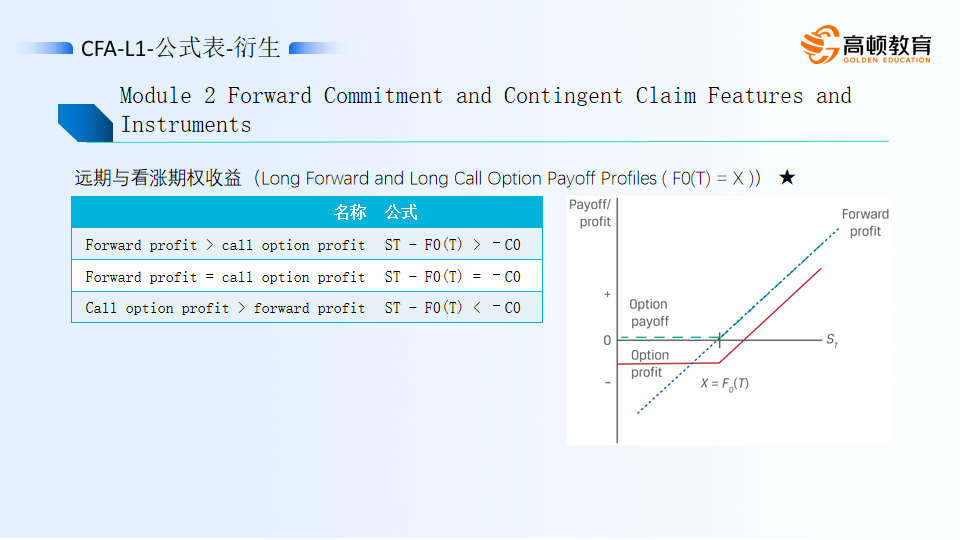
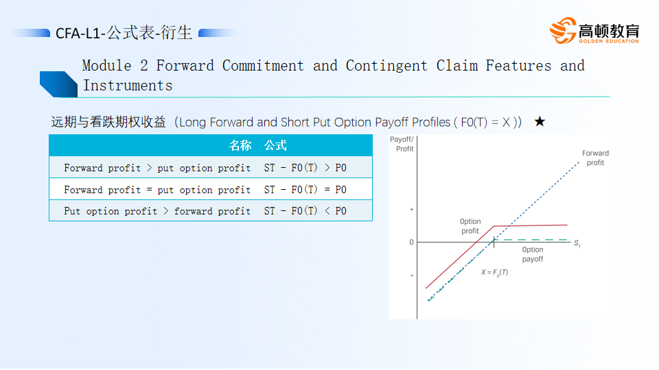
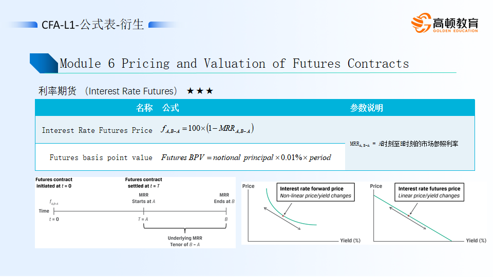
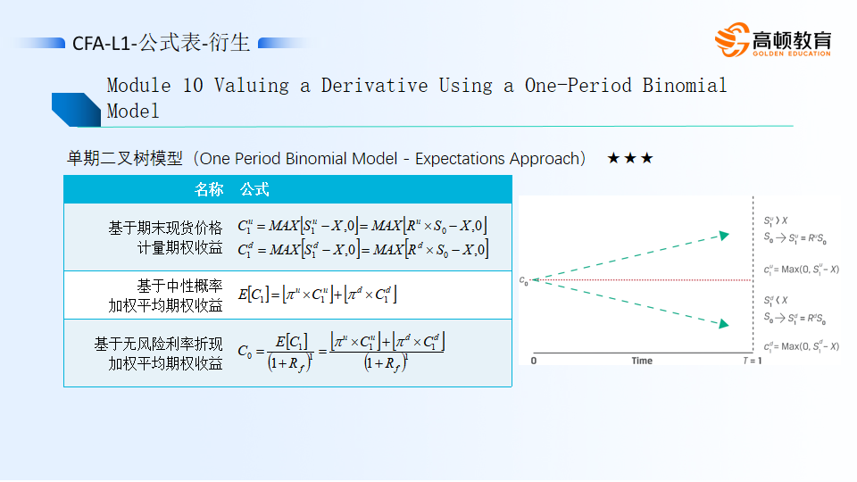
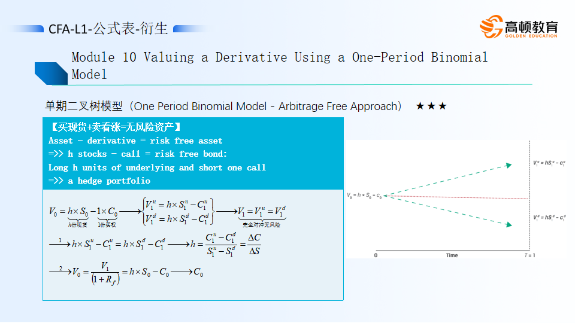

# 衍生品：公式笔记

Derivatives

[返回科目导航](../公式表-原文笔记.md) · [原版 PDF](../公式表-2123749.pdf#page=89) · [整理规范](../../讲义整理规范.md)

本笔记对应原 PDF 第 89–109 页，按原页顺序保留公式、名称、参数说明、注释和星级标记。每页均附原图链接，公式支持搜索、复制及 Obsidian 数学显示。

> 本页为原文转录。原表的记号、拼写、公式口径及疑似错误按原页保留，未作勘误。

## 章节导航

| 原章节 | PDF 页码 | 入口 |
| --- | --- | --- |
| PART 7 Derivatives | 89 | [p. 89](#pdf-p-89) |
| Module 2 Forward Commitment and Contingent Claim Features and Instruments | 90–94 | [p. 90](#pdf-p-90) |
| Module 4 Arbitrage, Replication, and the Cost of Carry in Pricing Derivatives | 95–97 | [p. 95](#pdf-p-95) |
| Module 5 Pricing and Valuation of Forward Contracts and for an Underlying with Varying Maturities | 98–99 | [p. 98](#pdf-p-98) |
| Module 6 Pricing and Valuation of Futures Contracts | 100 | [p. 100](#pdf-p-100) |
| Module 7 Pricing and Valuation of Interest Rates and Other Swaps | 101 | [p. 101](#pdf-p-101) |
| Module 8 Pricing and Valuation of Options | 102–103 | [p. 102](#pdf-p-102) |
| Module 9 Option Replication Using Put-Call Parity | 104–106 | [p. 104](#pdf-p-104) |
| Module 10 Valuing a Derivative Using a One-Period Binomial Model | 107–109 | [p. 107](#pdf-p-107) |

<!-- PDF page 89 -->
## PDF p. 89

[查看第 89 页原图](../assets/公式表原页/page-089.png)

### PART 7 Derivatives

<!-- PDF page 90 -->
## PDF p. 90

[查看第 90 页原图](../assets/公式表原页/page-090.png)

### Module 2 Forward Commitment and Contingent Claim Features and Instruments

#### 远期合约（Forward）★★★

**远期合约多头损益 Payoff of the long**

$$
\text{Payoff of the long（合约到期时）}=S_T-F_0(T)
$$

$F_0(T)$：期初确定的T时刻远期合约价格

**远期合约空头损益 Payoff of the short**

$$
\text{Payoff of the short（合约到期时）}=F_0(T)-S_T
$$

$S_T$：T时刻的现货价格

<!-- PDF page 91 -->
## PDF p. 91

[查看第 91 页原图](../assets/公式表原页/page-091.png)

### Module 2 Forward Commitment and Contingent Claim Features and Instruments

#### 看涨期权（Call option）★★★

**购买看涨期权损益 Payoff from buying call option**

$$
C_T=Max(0,S_T-X)
$$

**购买看涨期权利润 Profit from buying call option**

$$
\Pi=Max(0,S_T-X)-C_0
$$

**出售看涨期权损益 Payoff from selling call option**

$$
-C_T=-Max(0,S_T-X)
$$

**出售看涨期权利润 Profit from selling call option**

$$
\Pi=-Max(0,S_T-X)+C_0
$$

<!-- PDF page 92 -->
## PDF p. 92

[查看第 92 页原图](../assets/公式表原页/page-092.png)

### Module 2 Forward Commitment and Contingent Claim Features and Instruments

#### 远期与看涨期权收益（Long Forward and Long Call Option Payoff Profiles（F0(T) = X））★

| 名称 | 公式 |
| --- | --- |
| Forward profit > call option profit | $S_T-F_0(T)>-C_0$ |
| Forward profit = call option profit | $S_T-F_0(T)=-C_0$ |
| Call option profit > forward profit | $S_T-F_0(T)<-C_0$ |

原图标签：Payoff/profit；Forward profit；Option payoff；Option profit；$S_T$；$X=F_0(T)$；+；0；−。

<!-- PDF page 93 -->
## PDF p. 93

[查看第 93 页原图](../assets/公式表原页/page-093.png)

### Module 2 Forward Commitment and Contingent Claim Features and Instruments

#### 看跌期权（Put option）★★★

**购买看跌期权损益 Payoff from buying put option**

$$
P_T=Max(0,X-S_T)
$$

**购买看跌期权利润 Profit from buying put option**

$$
\Pi=Max(0,X-S_T)-P_0
$$

**出售看跌期权损益 Payoff from selling put option**

$$
-P_T=-Max(0,X-S_T)
$$

**出售看跌期权利润 Profit from selling put option**

$$
\Pi=-Max(0,X-S_T)+P_0
$$

<!-- PDF page 94 -->
## PDF p. 94

[查看第 94 页原图](../assets/公式表原页/page-094.png)

### Module 2 Forward Commitment and Contingent Claim Features and Instruments

#### 远期与看跌期权收益（Long Forward and Short Put Option Payoff Profiles（F0(T) = X））★

| 名称 | 公式 |
| --- | --- |
| Forward profit > put option profit | $S_T-F_0(T)>P_0$ |
| Forward profit = put option profit | $S_T-F_0(T)=P_0$ |
| Put option profit > forward profit | $S_T-F_0(T)<P_0$ |

原图标签：Payoff/Profit；Forward profit；Option profit；Option payoff；$S_T$；$X=F_0(T)$；+；0；−。

<!-- PDF page 95 -->
## PDF p. 95

[查看第 95 页原图](../assets/公式表原页/page-095.png)

### Module 4 Arbitrage, Replication, and the Cost of Carry in Pricing Derivatives

#### 现金流量现值（Present value of discounted cash flow）★

**现金流量现值 Present value of discounted cash flow**

$$
S_0=\frac{E(S_T)}{(1+r+\lambda)^T}-\theta+\gamma
$$

- $E(S_T)$：资产在T时刻的期望价值
- $r$：无风险利率
- $\lambda$：风险溢价
- $\theta$：持有该资产需要付出成本的现值
- $\gamma$：持有该资产可以获得收益的现值

<!-- PDF page 96 -->
## PDF p. 96

[查看第 96 页原图](../assets/公式表原页/page-096.png)

### Module 4 Arbitrage, Replication, and the Cost of Carry in Pricing Derivatives

#### 复制（Replication）★★★

**多现货+空衍生=多无风险资产**

$$
Asset-Derivative=\text{Risk-free asset}
$$

**多衍生+多无风险资产=多现货**

$$
Derivative+\text{Risk-free asset}=Asset
$$

**多现货+空无风险资产=多衍生**

$$
Asset-\text{Risk-free asset}=Derivative
$$

<!-- PDF page 97 -->
## PDF p. 97

[查看第 97 页原图](../assets/公式表原页/page-097.png)

### Module 4 Arbitrage, Replication, and the Cost of Carry in Pricing Derivatives

#### 汇率远期合约定价（FX (foreign exchange) forward contract pricing）★

**FX forward rate**

$$
\begin{gathered}
F_0(T)=S_0\times\exp[(R_{PC}-R_{BC})\times T]\\
\longleftarrow F_0(T)=S_0\times\frac{(1+R_{PC})^T}{(1+R_{BC})^T}\\
\longleftarrow F_0(T)=S_0\times\frac{1+R_{PC}\times T}{1+R_{BC}\times T}
\end{gathered}
$$

| Interest Rate Differential | Forward vs. Spot Price | Foreign Currency | FX Forward Premium/Discount |
| --- | --- | --- | --- |
| $(r_{pc}-r_{bc})>0$ | $F_0(T)>S_0$ | Discount | Premium |
| $(r_{pc}-r_{bc})<0$ | $F_0(T)<S_0$ | Premium | Discount |
| $(r_{pc}-r_{bc})=0$ | $F_0(T)=S_0$ | Neither a premium nor a discount | Neither a premium nor a discount |

<!-- PDF page 98 -->
## PDF p. 98

[查看第 98 页原图](../assets/公式表原页/page-098.png)

### Module 5 Pricing and Valuation of Forward Contracts and for an Underlying with Varying Maturities

#### 远期合约定价与估值（Pricing and valuation of forward）★★★

**签订时价值 Value at initiation**

$$
V_0(T)=0
$$

**签订时约定远期价格 The forward price at initiation**

$$
F_0(T)=(S_0-\gamma+\theta)(1+r)^T
$$

$\gamma-\theta$：净持有成本

**存续期价值 Value during the life**

$$
V_t(T)=S_t-(\gamma-\theta)(1+r)^t-F_0(T)(1+r)^{-(T-t)}
$$

- $T$：合约到期时间
- $T-t$：在t时期时合约剩余到期时间

**到期价值 Value at expiration**

$$
V_T(T)=S_T-F_0(T)
$$

<!-- PDF page 99 -->
## PDF p. 99

[查看第 99 页原图](../assets/公式表原页/page-099.png)

### Module 5 Pricing and Valuation of Forward Contracts and for an Underlying with Varying Maturities

#### 远期利率协议（Forward Rate Agreements）★★★

**Implied forward rate**

$$
(1+Z_A)^A\times(1+IFR_{A,B-A})^{B-A}=(1+Z_B)^B
$$

**Forward rate**

$$
FR_{T,N-T}\times d_{T,N}=\frac{1+S_{0,N}\times d_{0,N}}{1+S_{0,T}\times d_{0,T}}-1
$$

**Expiry Value for long FRA**

$$
V_T(L)=\frac{(MR_{T,N-T}-FR_{T,N-T})\times period\times NP}{1+MR_{T,N-T}\times period}
$$

**Expiry Value for short FRA**

$$
V_T(S)=\frac{(FR_{T,N-T}-MR_{T,N-T})\times period\times NP}{1+MR_{T,N-T}\times period}
$$

参数说明（按原页顺序）：

- $Z_A$：0时刻至A时刻的即期利率
- $Z_B$：0时刻至B时刻的即期利率
- $IFR_{A,B-A}$：A时刻至B时刻的隐含远期利率
- $FR_{T,N-T}$：T时刻至N时刻的远期利率
- $d_{T,N}$：从N时刻折现至T时刻的折现因子
- $S_{0,N}$：0时刻至N时刻的即期利率
- $d_{0,N}$：从N时刻折现至0时刻的折现因子
- $S_{0,T}$：0时刻至T时刻的即期利率
- $d_{0,T}$：从T时刻折现至0时刻的折现因子
- $V_T(L)$：T时刻，long方的价值
- $V_T(S)$：T时刻，short方的价值
- $MR_{T,N-T}$：T时刻至N时刻的市场利率
- period：利率所对应的期限
- NP：notional principal 名义本金

<!-- PDF page 100 -->
## PDF p. 100

[查看第 100 页原图](../assets/公式表原页/page-100.png)

### Module 6 Pricing and Valuation of Futures Contracts

#### 利率期货（Interest Rate Futures）★★★

**Interest Rate Futures Price**

$$
f_{A,B-A}=100\times(1-MRR_{A,B-A})
$$

$MRR_{A,B-A}$ = A时刻至B时刻的市场参照利率

**Futures basis point value**

$$
\text{Futures BPV}=\text{notional principal}\times0.01\%\times period
$$

原图标签：Futures contract initiated at t = 0；Futures contract settled at t = T；$f_{A,B-A}$；Time；t = 0；T = A；B；MRR Starts at A；MRR Ends at B；Underlying MRR Tenor of B - A。

价格/收益率图标签：Price；Yield（%）；Interest rate forward price / Non-linear price/yield changes；Interest rate futures price / Linear price/yield changes。

<!-- PDF page 101 -->
## PDF p. 101

[查看第 101 页原图](../assets/公式表原页/page-101.png)

### Module 7 Pricing and Valuation of Interest Rates and Other Swaps

#### 利率互换（Interest Rate Swaps）★★★

**Swap price**

$$
PV(\text{fixed payments})=PV(\text{floating payments})=Par
$$

=> S: periodic rate

Swap price = swap fixed rate

**Swap value**

$$
V=\text{PV of inflow}-\text{PV of outflow}
$$

固定支付方：

$$
V=PV(\text{floating payments})-PV(\text{fixed payments})
$$

浮动支付方：

$$
V=PV(\text{fixed payments})-PV(\text{floating payments})
$$

**Swap settlement value**

$$
\text{Periodic settlement value}=(MRR-S_N)\times\text{Notional amount}\times Period
$$

<!-- PDF page 102 -->
## PDF p. 102

[查看第 102 页原图](../assets/公式表原页/page-102.png)

### Module 8 Pricing and Valuation of Options

#### 期权的价值构成（Option Premium）★★★

**Option Price（Ct, Pt）**

$$
\begin{aligned}
\text{Option Price}&=\text{Option premium}=\text{Option Value}\\
&=\text{Exercise Value}+\text{Time Value}
\end{aligned}
$$

**Exercise Value（EV）**

$$
\text{Call }EV_t=Max[0,S_t-PV(X)]
$$

$$
\text{Put }EV_t=Max[0,PV(X)-S_t]
$$

**Time Value（TV）**

$$
\text{Call }TV_t=C_t-\text{Call }EV_t
$$

$$
\text{Put }TV=P_t-\text{Put }EV_t
$$

<!-- PDF page 103 -->
## PDF p. 103

[查看第 103 页原图](../assets/公式表原页/page-103.png)

### Module 8 Pricing and Valuation of Options

#### 期权合约价值界限（Lower Bound and Upper Bound of Options）★★★

**Call Option**

$$
Max[0,S_t-PV(X)]\leq C_t\leq S_t
\longrightarrow
\begin{cases}
C_{t,\text{Lower bound}}=Max[0,S_t-PV(X)]\\
C_{t,\text{Upper bound}}=S_t
\end{cases}
$$

**Put Option**

$$
Max[0,PV(X)-S_t]\leq P_t\leq X
\longrightarrow
\begin{cases}
P_{t,\text{Lower bound}}=Max[0,PV(X)-S_t]\\
P_{t,\text{Upper bound}}=X
\end{cases}
$$

<!-- PDF page 104 -->
## PDF p. 104

[查看第 104 页原图](../assets/公式表原页/page-104.png)

### Module 9 Option Replication Using Put-Call Parity

#### 期权平价公式（Put-Call Parity）★★★

**期权平价公式 Put-Call Parity**

$$
C+\frac{X}{(1+R_f)^T}=S+P
$$

- $C$：看涨期权的价格
- $P$：看跌期权的价格
- $S$：股票的价格
- $X$：行权价（同时也是零息债券的面值）

#### 远期—期权平价公式（Put-Call-Forward Parity）★★★

**远期-期权平价公式 Put-Call-Forward Parity**

$$
C+\frac{X}{(1+R_f)^T}=\frac{F_0(T)}{(1+R_f)^T}+P
$$

$$
P-C=\frac{X-F_0(T)}{(1+R_f)^T}
$$

- $C$：看涨期权的价格
- $P$：看跌期权的价格
- $S$：股票的价格
- $X$：行权价（同时也是零息债券的面值）
- $F_0(T)$：标的股票的远期合约价

<!-- PDF page 105 -->
## PDF p. 105

[查看第 105 页原图](../assets/公式表原页/page-105.png)

### Module 9 Option Replication Using Put-Call Parity

#### 期权平价公式策略合成（Synthetic Position）★★★

**合成看涨期权 Synthetic call**

$$
C=S+P-\frac{X}{(1+R_f)^T}
$$

**合成看跌期权 Synthetic put**

$$
P=C+\frac{X}{(1+R_f)^T}-S
$$

**合成标的股票 Synthetic stock**

$$
S=C+\frac{X}{(1+R_f)^T}-P
$$

**合成无风险资产 Synthetic bond**

$$
\frac{X}{(1+R_f)^T}=P+S-C
$$

- $C$：看涨期权的价格
- $P$：看跌期权的价格
- $S$：股票的价格
- $X$：行权价（同时也是零息债券的面值）
- +：多头头寸
- −：空头头寸

<!-- PDF page 106 -->
## PDF p. 106

[查看第 106 页原图](../assets/公式表原页/page-106.png)

### Module 9 Option Replication Using Put-Call Parity

#### 期权平价公式应用（Option Put-Call Parity Application on Firm Value）★

**At t = 0**

$$
V0=E0+PV(D)
$$

**Solvency（VT > D）**

Debtholders receive D and are repaid in full.

Shareholders receive the residual: ET = VT - D.

**Insolvency（VT < D）**

Debtholders have a priority claim on assets and receive VT < D.

Shareholders receive the residual, ET = 0.

**Shareholders**

$$
Payoff(Shareholder)=Max(0,V_T-D)
$$

股权收益=多资产+多看跌=保护性看跌

**Debtholders**

$$
Payoff(Debtholder)=Min(V_T,D)
$$

债权收益=多债券+空看跌

<!-- PDF page 107 -->
## PDF p. 107

[查看第 107 页原图](../assets/公式表原页/page-107.png)

### Module 10 Valuing a Derivative Using a One-Period Binomial Model

#### 单期二叉树模型（One Period Binomial Model）★★★

**下跌因子（D）**

$$
D=\frac{1}{U}
$$

U：上涨因子

**上涨的风险中性概率（$\pi_U$）**

$$
\pi_U=\frac{1+R_f-D}{U-D}
$$

**下跌的风险中性概率（$\pi_D$）**

$$
\pi_D=1-\pi_U
$$

<!-- PDF page 108 -->
## PDF p. 108

[查看第 108 页原图](../assets/公式表原页/page-108.png)

### Module 10 Valuing a Derivative Using a One-Period Binomial Model

#### 单期二叉树模型（One Period Binomial Model - Expectations Approach）★★★

**基于期末现货价格计算期权收益**

$$
C_1^u=MAX[S_1^u-X,0]=MAX[R^u\times S_0-X,0]
$$

$$
C_1^d=MAX[S_1^d-X,0]=MAX[R^d\times S_0-X,0]
$$

**基于中性概率加权平均期权收益**

$$
E[C_1]=[\pi^u\times C_1^u]+[\pi^d\times C_1^d]
$$

**基于无风险利率折现加权平均期权收益**

$$
C_0=\frac{E[C_1]}{(1+R_f)^1}=\frac{[\pi^u\times C_1^u]+[\pi^d\times C_1^d]}{(1+R_f)^1}
$$

原图标签：$C_0$；Time；0；T = 1。

上涨分支：

$$
S_1^u>X,\qquad S_0\to S_1^u=R^uS_0,\qquad C_1^u=Max(0,S_1^u-X)
$$

下跌分支：

$$
S_1^d<X,\qquad S_0\to S_1^d=R^dS_0,\qquad C_1^d=Max(0,S_1^d-X)
$$

<!-- PDF page 109 -->
## PDF p. 109

[查看第 109 页原图](../assets/公式表原页/page-109.png)

### Module 10 Valuing a Derivative Using a One-Period Binomial Model

#### 单期二叉树模型（One Period Binomial Model - Arbitrage Free Approach）★★★

（买现货+卖看涨=无风险资产）

Asset - derivative = risk free asset

=> h stocks - call = risk free bond:

Long h units of underlying and short one call

=> a hedge portfolio

$$
V_0=\underbrace{h\times S_0}_{h\text{份现货}}-\underbrace{1\times C_0}_{1\text{份看涨}}
\longrightarrow
\begin{cases}
V_1^u=h\times S_1^u-C_1^u\\
V_1^d=h\times S_1^d-C_1^d
\end{cases}
\longrightarrow\underbrace{V_1=V_1^u=V_1^d}_{\text{完全对冲无风险}}
$$

①

$$
h\times S_1^u-C_1^u=h\times S_1^d-C_1^d
\longrightarrow h=\frac{C_1^u-C_1^d}{S_1^u-S_1^d}=\frac{\Delta C}{\Delta S}
$$

②

$$
V_0=\frac{V_1}{1+R_f}=h\times S_0-C_0\longrightarrow C_0
$$

原图标签：$V_0=h\times S_0-C_0$；$V_1^u=hS_1^u-C_1^u$；$V_1^d=hS_1^d-C_1^d$；Time；0；T = 1。

## 完整性记录

- 本科目覆盖原 PDF 第 89–109 页，共 21 页，含科目分隔页。
- 保留 21 个主题标题、59 个独立公式块；正文及公式内容与拆分前逐页一致。
- 原版 PDF 和原页图片共用[总目录](../公式表-原文笔记.md)下的来源文件。
