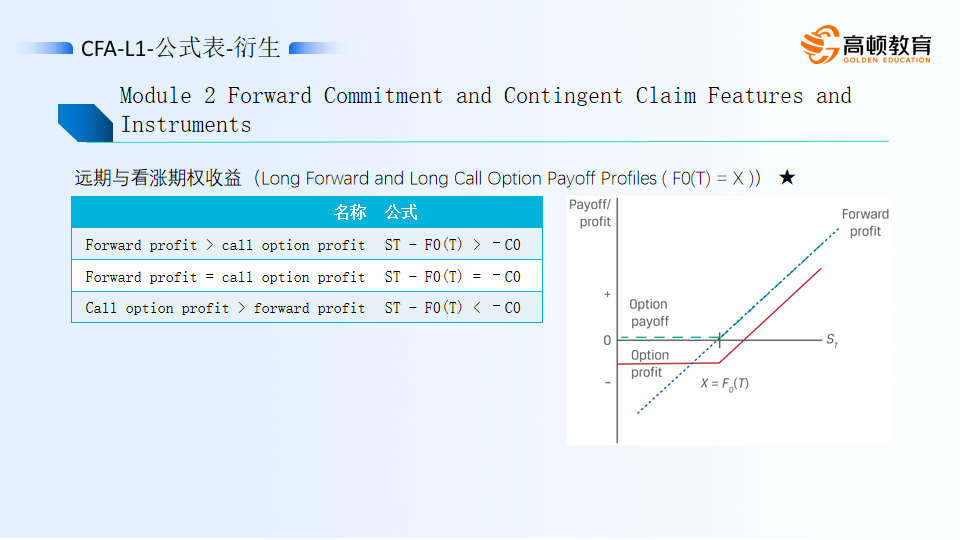
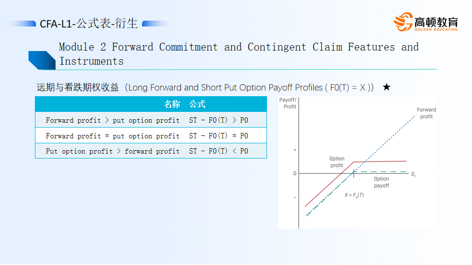
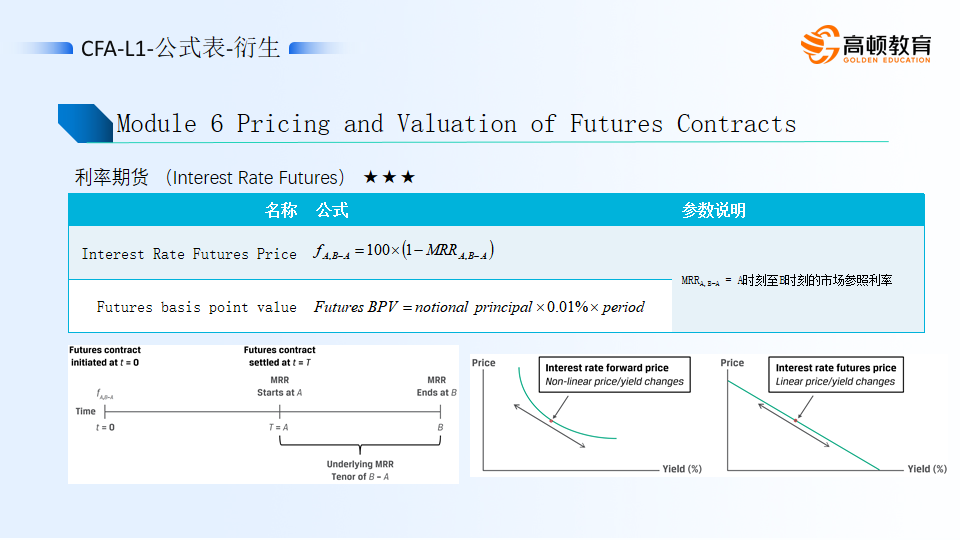
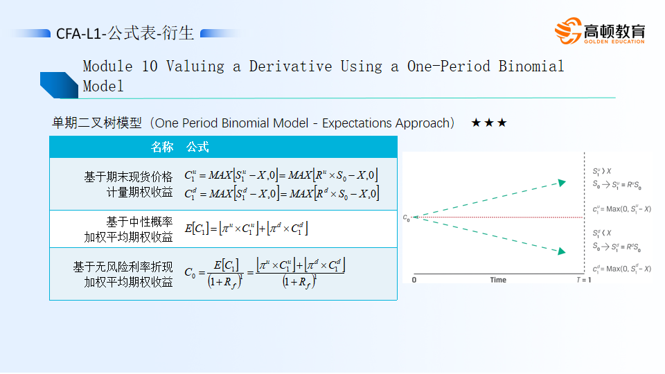
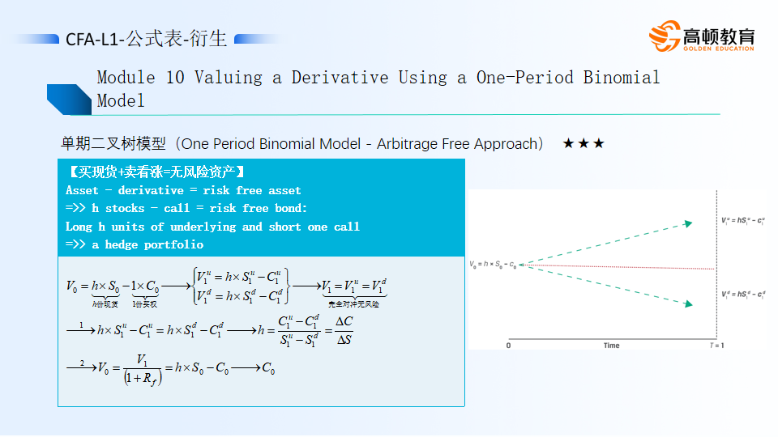

# CFA一级公式表：原文笔记

[原版 PDF](./公式表-2123749.pdf) · [整理规范](../讲义整理规范.md)

按原 PDF 页序提取公式、名称、参数说明和注释，保留原中英文语言与星级标记。公式为可搜索、可复制的 LaTeX；每页可打开原图核对，收益曲线和二叉树等图示嵌入正文。原 PDF 与原页图片同时归档。

> 本页是原文转录，不是勘误版。原表的记号、拼写、公式口径及疑似错误均按原页保留；未补写原表没有给出的变量定义或推导。页码为 PDF 物理页码。重复装饰性页眉、标识和宣传信息略去。

## 科目导航

| 原目录科目 | PDF 页码 | 入口 |
| --- | --- | --- |
| 封面、目录 | 1–2 | [p. 1](#pdf-p-1) |
| Quantitative Analysis | 3–29 | [p. 3](#pdf-p-3) |
| Economics | 30–41 | [p. 30](#pdf-p-30) |
| Financial Statement Analysis | 42–61 | [p. 42](#pdf-p-42) |
| Corporate Issuers | 62–67 | [p. 62](#pdf-p-62) |
| Equity Investment | 68–74 | [p. 68](#pdf-p-68) |
| Fixed Income | 75–88 | [p. 75](#pdf-p-75) |
| Derivatives | 89–109 | [p. 89](#pdf-p-89) |
| Alternative Investment | 110–113 | [p. 110](#pdf-p-110) |
| Portfolio Management | 114–123 | [p. 114](#pdf-p-114) |

<!-- PDF page 1 -->
## PDF p. 1

[查看第 1 页原图](./assets/公式表原页/page-001.png)

### CFA一级 公式表

FORMULA SHEET

高顿CFA/FRM学术中心编著

<!-- PDF page 2 -->
## PDF p. 2

[查看第 2 页原图](./assets/公式表原页/page-002.png)

### 目录 / CONTENTS

1. Quantitative Analysis
2. Economics
3. Financial Statement Analysis
4. Corporate Issuers
5. Equity Investment
6. Fixed Income
7. Derivatives
8. Alternative Investment
9. Portfolio Management

<!-- PDF page 3 -->
## PDF p. 3

[查看第 3 页原图](./assets/公式表原页/page-003.png)

### PART 1 Quantitative Analysis

<!-- PDF page 4 -->
## PDF p. 4

[查看第 4 页原图](./assets/公式表原页/page-004.png)

### Module 1 Rates and Returns

#### 利率的组成（Components of Interest Rate）

**无风险利率**

$$
\text{Nominal Risk-free Interest Rate}=\text{Real Risk-free Interest Rate}+\text{Inflation Premium}
$$

**风险资产收益率**

$$
\text{Return of Risky Asset}=\text{Nominal Risk-free Interest Rate}+\text{Risk Premium}
$$

$$
\text{Risk Premium}=\text{Default premium}+\text{Liquidity premium}+\text{Maturity premium}
$$

<!-- PDF page 5 -->
## PDF p. 5

[查看第 5 页原图](./assets/公式表原页/page-005.png)

### Module 1 Rates and Returns

#### 均值（Mean）

**算术平均 Arithmetic Mean**

$$
\mu=\frac{\sum_{i=1}^{N}X_i}{N},\qquad \overline X=\frac{\sum_{i=1}^{n}X_i}{n}
$$

**几何平均 Geometric Mean**

$$
G=\sqrt[n]{X_1X_2X_3\cdots X_n}
$$

$$
\text{Periodic Return}_{\text{compound}}=\sqrt[n]{(1+R_1)(1+R_2)\cdots(1+R_n)}-1
$$

**调和平均 Harmonic Mean**

$$
\overline X_{\text{Harmonic}}=\frac{N}{\sum_{i=1}^{N}\frac{1}{X_i}}
$$

**大小关系**

$$
\text{Harmonic Mean}\leq\text{Geometric Mean}\leq\text{Arithmetic Mean}
$$

**加权平均 Weighted Mean**

$$
\overline X_W=\sum_{i=1}^{n}w_iX_i
$$

<!-- PDF page 6 -->
## PDF p. 6

[查看第 6 页原图](./assets/公式表原页/page-006.png)

### Module 1 Rates and Returns

#### 收益率的衡量（Measurements of return）★★★

**持有期收益率 Holding period return**

$$
R=\frac{P_T+D_T}{P_0}-1
$$

- $P_0$：资产期初价格
- $P_T$：资产期末价格
- $D_T$：股息（或者其他收入）

**算数平均收益率 Arithmetic return**

$$
R=\frac{R_1+R_2+R_3+\cdots+R_n}{n}
$$

- $R_1,R_2,\ldots,R_n$：每期持有期收益率
- $n$：投资期数

**时间加权平均收益率 Time-weighted return（TWR）**

$$
TWR=[(1+HPR_1)\times\cdots\times(1+HPR_n)]^{\frac{1}{N}}-1
$$

- $HPR_1,\ldots,HPR_n$：每期持有期收益率
- $N$：年数

**货币加权收益率 Money-weighted return（MWR）**

$$
CF_0+\frac{CF_1}{(1+MWR)^1}+\cdots+\frac{CF_n}{(1+MWR)^n}=0
$$

$CF_1,\ldots,CF_n$：每期的现金流

<!-- PDF page 7 -->
## PDF p. 7

[查看第 7 页原图](./assets/公式表原页/page-007.png)

### Module 1 Rates and Returns

#### 现值与终值的转换（Conversion of Present Value and Future Value）★★★

**终值 Future Value（FV）**

$$
FV=PV\cdot\left(1+\frac{r}{m}\right)^{n\cdot m}
$$

$n$：年数

<!-- PDF page 8 -->
## PDF p. 8

[查看第 8 页原图](./assets/公式表原页/page-008.png)

### Module 1 Rates and Returns

#### 年化回报率（Annualizing Returns）

**年化回报率 Annualizing Returns**

$$
\begin{aligned}
R_{annual}&=(1+R_{period})^c-1\\
R_{annual}&=(1+R_{semiannual})^2-1\\
R_{annual}&=(1+R_{quarter})^4-1\\
R_{annual}&=(1+R_{month})^{12}-1\\
R_{annual}&=(1+R_{week})^{52}-1
\end{aligned}
$$

<!-- PDF page 9 -->
## PDF p. 9

[查看第 9 页原图](./assets/公式表原页/page-009.png)

### Module 1 Rates and Returns

#### 杠杆回报（Leveraged Return）

**杠杆回报 Leveraged Return**

$$
R_L=\frac{Return}{\text{Portfolio Equity}}=\frac{(V_E+V_B)\times R_P-V_B\times r_D}{V_E}=R_P+\frac{V_B}{V_E}(R_P-r_D)
$$

<!-- PDF page 10 -->
## PDF p. 10

[查看第 10 页原图](./assets/公式表原页/page-010.png)

### Module 2 The Time Value of Money in Finance

#### 现金流折现模型（Discounted cash flow model）

**现金流模型 DCF**

$$
V_0=\sum_{i=1}^{+\infty}\frac{CF_i}{(1+r)^i}
$$

$CF_i$：第i期现金流

#### 年金模式（Annuity Instruments）

**普通年金 Ordinary Annuity**

$$
A=\frac{PV\times r}{1-(1+r)^{-t}}
$$

- $A$：每期的金额
- $r$：每期利率
- $t$：总共期数
- $PV$：债券或贷款的现值

<!-- PDF page 11 -->
## PDF p. 11

[查看第 11 页原图](./assets/公式表原页/page-011.png)

### Module 2 The Time Value of Money in Finance

#### 股利折现模型（Dividend discount model）★★★

**优先股股利折现模型**

$$
V_0=\frac{D}{r}
$$

$D$：优先股股利

**戈登股利增长模型 GGM**

$$
V_0=\frac{D_1}{r-g}=\frac{D_0(1+g)}{r-g}
$$

$$
r=\frac{D_1}{V_0}+g,\qquad g=r-\frac{D_1}{V_0}
$$

- $r$：折现率
- $g$：股利固定增长率
- $D_0$：股票在0时刻派发的股利

**两阶段股利折现模型 Two-stage DDM**

$$
V_0=\sum_{i=1}^{N}\frac{D_0(1+g_S)^i}{(1+r)^i}+\frac{P_N}{(1+r)^N}
$$

$$
P_N=\frac{D_{N+1}}{r-g_L}
$$

- $g_S$：短期高速股利增长率
- $g_L$：长期低速股利增长率
- $D_{N+1}$：第N+1期期末股利

<!-- PDF page 12 -->
## PDF p. 12

[查看第 12 页原图](./assets/公式表原页/page-012.png)

### Module 2 The Time Value of Money in Finance

#### 市盈率（Price-to-Earnings ratio）

**市盈率指标 Price-to-Earnings ratio**

PE ratio = 每股股价p / 每股盈利 earnings per share（EPS）= 总市值 / 净利润总额

**静态市盈率 Trailing P/E**

$$
\frac{P}{E}=\frac{P_0}{EPS_0}
$$

**动态市盈率 Leading（forward）P/E**

$$
\frac{P}{E}=\frac{P_0}{EPS_1}
$$

**合理静态市盈率 Justified trailing P/E**

$$
\begin{aligned}
\frac{P}{E}&=\frac{V_0}{E_0}=\frac{D_1/r-g}{E_0}=\frac{D_1/E_0}{r-g}\\
&=\frac{D_0\times(1+g)/E_0}{r-g}=\frac{D_0/E_0}{r-g}\times(1+g)
\end{aligned}
$$

- $E_0$：第0期每股收益
- $D_0/E_0$：股利支付率

**合理动态市盈率 Justified leading P/E**

$$
\frac{P}{E}=\frac{V_0}{E_1}=\frac{D_1/r-g}{E_1}=\frac{D_1/E_1}{r-g}
$$

- $E_1$：第1期每股收益
- $D_1/E_1$：股利支付率

<!-- PDF page 13 -->
## PDF p. 13

[查看第 13 页原图](./assets/公式表原页/page-013.png)

### Module 2 The Time Value of Money in Finance

#### 远期利率（Forward rate）

**远期利率 Forward rate**

$$
(1+r_n)^n=(1+r_m)^m\times(1+F_{n-m})^{n-m}
$$

- $r_m$和$r_n$分别是m年和n年的即期利率
- $F_{m,n-m}$是n-m年的远期利率

#### 远期汇率（Forward exchange rate）

**离散复利下利率平价公式 Discrete Interest rate parity**

$$
\frac{F_{A/B}}{S_{A/B}}=\frac{(1+r_A)^n}{(1+r_B)^n}
$$

**连续复利下利率平价公式 Continuous Interest rate parity**

$$
\frac{F_{A/B}}{S_{A/B}}=\frac{e^{r_A\times n}}{e^{r_B\times n}}=e^{(r_A-r_B)\times n}
$$

- $F_{A/B}$：远期汇率
- $S_{A/B}$：即期汇率
- $r_A$：A国无风险利率
- $r_B$：B国无风险利率

<!-- PDF page 14 -->
## PDF p. 14

[查看第 14 页原图](./assets/公式表原页/page-014.png)

### Module 3 Statistical Measures of Asset Returns

#### 中心趋势（Central Tendency）

**总体算术平均数**

$$
\mu=\frac{\sum_{i=1}^{N}X_i}{N}
$$

**样本算术平均数**

$$
\overline X=\frac{\sum_{i=1}^{n}X_i}{n}
$$

**中位数（n为奇数）**：中位数 =（n + 1）/ 2 位置的数

**中位数（n为偶数）**：中位数 = n / 2 与（n + 2）/ 2 两个位置上的数的平均值

**分位数位置**

$$
L_y=(n+1)(y\%)
$$

<!-- PDF page 15 -->
## PDF p. 15

[查看第 15 页原图](./assets/公式表原页/page-015.png)

### Module 3 Statistical Measures of Asset Returns

#### 绝对离散程度（Absolute Dispersion）★★★

**极差 Range**

$$
\text{Range}=\text{Maximum Value}-\text{Minimum Value}
$$

**平均绝对偏离度 Mean Absolute Deviation（MAD）**

$$
MAD=\frac{\sum_{i=1}^{n}|X_i-\overline X|}{n}
$$

$\overline X$：样本均值；$n$：观测值个数

**目标下行标准差 Target Downside Deviation**

$$
s_{Target}=\sqrt{\sum_{\text{for all }X_i\leq B}^{n}\frac{(X_i-B)^2}{n-1}}
$$

$B$：目标值；$n$：样本量

**总体标准差 Population Standard Deviation**

$$
\sigma=\sqrt{\frac{\sum_{i=1}^{N}(X_i-\mu)^2}{N}}
$$

$\mu$：总体均值；$N$：总体大小

**样本标准差 Sample Standard Deviation**

$$
s=\sqrt{\frac{\sum_{i=1}^{n}(X_i-\overline X)^2}{n-1}}
$$

$\overline X$：样本均值；$n$：样本量

<!-- PDF page 16 -->
## PDF p. 16

[查看第 16 页原图](./assets/公式表原页/page-016.png)

### Module 3 Statistical Measures of Asset Returns

#### 相对离散程度（Relative Dispersion）

**变异系数 Coefficient of Variance**

$$
CV=\frac{s}{\overline X}
$$

$s$：样本标准差；$\overline X$：样本均值

**夏普比率 Sharpe Ratio**

$$
SR=\frac{R_P-R_f}{\sigma_P}
$$

- $R_P$：组合收益率
- $R_f$：无风险收益率
- $\sigma_P$：组合收益率标准差

<!-- PDF page 17 -->
## PDF p. 17

[查看第 17 页原图](./assets/公式表原页/page-017.png)

### Module 3 Statistical Measures of Asset Returns

#### 协方差和相关系数（Covariance and Correlation）

**协方差 Covariance**

$$
Cov(R_A,R_B)=\sum_{i,j=1}^{n}P(R_{A,i},R_{B,j})[R_{A,i}-E(R_A)][R_{B,j}-E(R_B)]
$$

$$
Cov(R_A,R_B)\in(-\infty,+\infty)
$$

协方差>0，表示两个变量有同向变动的趋势；协方差<0，表示两个变量有反向变动的趋势

**相关系数 Correlation**

$$
\rho_{i,j}=\frac{Cov(R_i,R_j)}{\sigma_i\sigma_j},\qquad r_{i,j}=\frac{Cov(R_i,R_j)}{s_is_j}
$$

- $\rho_{i,j}\in[-1,1]$
- $\rho_{i,j}=1$，$R_i$与$R_j$完全线性正相关
- $\rho_{i,j}=-1$，$R_i$与$R_j$完全线性负相关
- $\rho_{i,j}=0$，$R_i$与$R_j$无线性关系

<!-- PDF page 18 -->
## PDF p. 18

[查看第 18 页原图](./assets/公式表原页/page-018.png)

### Module 4 Probability Trees and Conditional Expectations

#### 概率（Probability）★★★

**事件发生的概率 The Probability of Event E**

$$
0\leq P(E)\leq1
$$

**随机变量的期望值 Expected value**

$$
E(X)=P(X_1)\cdot X_1+\cdots+P(X_N)\cdot X_N=\sum_iP(X_i)X_i
$$

**随机变量的方差 variance**

$$
\sigma^2(X)=P(X_1)\cdot[X_1-E(X_1)]^2+\cdots+P(X_N)\cdot[X_N-E(X_N)]^2=E[X-E(X)]^2
$$

**乘法法则 Multiplication Rule**

$$
P(AB)=P(A\mid B)P(B)
$$

- $P(AB)$：A和B都发生的概率
- $P(A\mid B)$：B发生的情况下，A发生的概率
- $P(B)$：B发生的概率

**独立事件的联合概率 Joint Probability of Independent Events**

$$
P(A\mid B)=P(A),\qquad P(AB)=P(A)P(B)
$$

**全概率公式 Total Probability Rule**

$$
P(A)=P(A\mid S1)P(S1)+\cdots+P(A\mid Sn)P(Sn)
$$

$S1,S2,\ldots,Sn$互斥且遍历

<!-- PDF page 19 -->
## PDF p. 19

[查看第 19 页原图](./assets/公式表原页/page-019.png)

### Module 4 Probability Trees and Conditional Expectations

#### 概率（Probability）★★★

**贝叶斯公式 Bayes’ Formula**

$$
P(A\mid B)=\frac{P(B\mid A)}{P(B)}\times P(A)
$$

**期望的全概率公式 Total Probability Rule for Expected Value**

$$
E(X)=E(X\mid S1)P(S1)+E(X\mid S2)P(S2)+\cdots+E(X\mid Sn)P(Sn)
$$

- $E(X\mid Sn)$：Sn发生的情况下X的期望值
- $S1,S2,\ldots,Sn$互斥且遍历

<!-- PDF page 20 -->
## PDF p. 20

[查看第 20 页原图](./assets/公式表原页/page-020.png)

### Module 5 Portfolio Mathematics

#### 投资组合的风险和预期收益（Expected return and risk of portfolio）★★★

**投资组合的预期收益率 expected return of portfolio**

$$
E(R_P)=w_1E(R_1)+\cdots+w_iE(R_i)
$$

$$
P_{(R_A=a_i,R_B=b_i)}
$$

- $w_i$：资产i占投资组合的比例
- $E(R_i)$：资产i的预期收益率

**投资组合的风险 risk of portfolio**

$$
\sigma_P^2=\sum_{i=1}^{n}\sum_{j=1}^{n}W_iW_jCov(R_i,R_j)
$$

- $w_i$：资产i占投资组合的比例
- $Cov(R_i,R_j)$：两资产之间的协方差

#### 联合概率分布预测协方差（Covariance given a joint probability function）★★★

**联合概率分布预测协方差 Covariance given a joint probability function**

$$
Cov_{AB}=\sum_iP_{(R_A=a_i,R_B=b_i)}\times[a_i-E(R_A)]\times[b_i-E(R_B)]
$$

$P(RA=ai,RB=bi)$：当A资产的收益率取到ai，同时B资产的收益率取到bi时的概率
<!-- PDF page 21 -->
## PDF p. 21

[查看第 21 页原图](./assets/公式表原页/page-021.png)

### Module 5 Portfolio Mathematics

#### 连续分布（Continuous Distribution）★★★

**正态分布标准化 Standardization**

$$
Z=\frac{X-\mu}{\sigma}
$$

- $X$：样本观测值，服从正态分布
- $\mu$：正态分布均值
- $\sigma$：正态分布标准差

#### 安全第一比率（Safety-first Ratio）

**安全第一比率 Safety-first Ratio**

$$
SFRatio=\frac{E(R_P)-R_L}{\sigma_P}
$$

- $R_L$：shortfall level
- $E(R_P)$：组合预期收益率
- $\sigma_P$：组合收益率标准差

<!-- PDF page 22 -->
## PDF p. 22

[查看第 22 页原图](./assets/公式表原页/page-022.png)

### Module 6 Simulation Methods

#### 连续复利下的回报率（Continuously Compounded Rate of Return）

**连续复利下的回报率 Continuously Compounded Rate of Return**

$$
P_T=P_0\times e^{r_{0,T}},\qquad r_{0,T}=\ln\left(\frac{P_T}{P_0}\right)
$$

<!-- PDF page 23 -->
## PDF p. 23

[查看第 23 页原图](./assets/公式表原页/page-023.png)

### Module 7 Estimation and Inference

#### 标准误（Standard Error）★★★

**样本均值的标准误 Standard Error of Sample Mean**

总体标准差$\sigma$已知：

$$
\sigma_{\overline x}=\frac{\sigma}{\sqrt n}
$$

总体标准差$\sigma$未知：

$$
s_{\overline x}=\frac{s}{\sqrt n}
$$

<!-- PDF page 24 -->
## PDF p. 24

[查看第 24 页原图](./assets/公式表原页/page-024.png)

### Module 8 Hypothesis Testing

#### 假设检验统计量（Hypothesis Testing Statistic）

**单个均值检验统计量（总体方差已知）**

$$
z=\frac{\overline X-\mu_0}{\sigma/\sqrt n}
$$

- $z$：z检验统计量
- $\overline X$：样本均值
- $\mu_0$：假设的总体均值
- $\sigma$：总体标准差

**单个均值检验统计量（总体方差未知）**

$$
t_{n-1}=\frac{\overline X-\mu_0}{s/\sqrt n}
$$

- $t_{n-1}$：t检验统计量
- $\overline X$：样本均值
- $\mu_0$：假设的总体均值
- $s$：样本标准差

<!-- PDF page 25 -->
## PDF p. 25

[查看第 25 页原图](./assets/公式表原页/page-025.png)

### Module 9 Parametricand Non-Parametric Tests of Independence

#### 相关系数的参数检验（Parametric Test of a Correlation）

**相关系数的参数检验统计量**

$$
t_{n-2}=\frac{r\sqrt{n-2}}{\sqrt{1-r^2}}
$$

- $t_{n-2}$：t检验统计量
- $r$：样本相关系数
- $n$：样本量

<!-- PDF page 26 -->
## PDF p. 26

[查看第 26 页原图](./assets/公式表原页/page-026.png)

### Module 10 Introduction to Linear Regression

#### 最小二乘法法则（Least Squares Criterion）★★★

**斜率系数项估计量**

$$
\widehat b_1=\frac{Cov(X,Y)}{Var(X)}
$$

- $\widehat b_1$：斜率系数项估计量
- $Cov(X,Y)$：X和Y的协方差
- $Var(X)$：X的方差

**截距项估计量**

$$
\widehat b_0=\overline Y-\widehat b_1\overline X
$$

- $\widehat b_0$：截距项估计量
- $\overline Y$：因变量的样本均值
- $\overline X$：自变量的样本均值

#### 回归斜率系数的检验（Test of Slope Coefficient）★★★

**t检验统计量 t Statistic**

$$
t=\frac{\widehat b_1}{s_{\widehat b_1}}
$$

- $\widehat b_1$：斜率系数项估计量
- $s_{\widehat b_1}$：斜率系数估计量的标准误

<!-- PDF page 27 -->
## PDF p. 27

[查看第 27 页原图](./assets/公式表原页/page-027.png)

### Module 10 Introduction to Linear Regression

#### 方差分析（Analysis of Variance）

**平方和 Sum of Squares**

$$
SST=SSR+SSE
$$

- $SST$：总的平方和
- $SSR$：回归平方和
- $SSE$：残差平方和

**可决系数 Coefficient of Determination**

$$
R^2=\frac{SSR}{SST}=r^2
$$

- $R^2$：可决系数
- $r$：自变量和因变量的相关系数

**估计的标准误 Standard Error of the Estimate**

$$
s_e=\sqrt{\frac{\sum_{i=1}^{n}(Y_i-\widehat Y_i)^2}{n-2}}
$$

- $Y_i$：第i个因变量
- $\widehat Y_i$：第i个因变量的估计量
- $n$：样本量

<!-- PDF page 28 -->
## PDF p. 28

[查看第 28 页原图](./assets/公式表原页/page-028.png)

### Module 10 Introduction to Linear Regression

#### F检验统计量（F Statistic）

**F检验统计量 F Statistic**

$$
F=\frac{MSR}{MSE}=\frac{SSR/1}{SSE/(n-2)}
$$

- $MSR$：均方回归
- $MSE$：均方误
- $SSR$：回归平方和
- $SSE$：残差平方和
- $n$：样本量

<!-- PDF page 29 -->
## PDF p. 29

[查看第 29 页原图](./assets/公式表原页/page-029.png)

### Module 10 Introduction to Linear Regression

#### 因变量的预测区间（Prediction Interval for Dependent Variable）

**因变量的预测区间 Prediction Interval for Dependent Variable**

$$
\widehat Y_f\pm t_c\times s_f
$$

- $\widehat Y_f$：因变量的预测值
- $t_c$：t检验统计量的关键值
- $s_f$：预测标准误

<!-- PDF page 30 -->
## PDF p. 30

[查看第 30 页原图](./assets/公式表原页/page-030.png)

### PART 2 Economics

<!-- PDF page 31 -->
## PDF p. 31

[查看第 31 页原图](./assets/公式表原页/page-031.png)

### 前导：Module 1 Topics in Demand and Supply Analysis

#### 需求弹性（Elasticity of Demand）★★★

**价格弹性 Own-price elasticity of demand**

$$
E_{P_X}^{d}=\frac{\%\Delta Q_X^{d}}{\%\Delta P_X}=\frac{\Delta Q_X^{d}/Q_X^{d}}{\Delta P_X/P_X}=\left(\frac{\Delta Q_X^{d}}{\Delta P_X}\right)\left(\frac{P_X}{Q_X^{d}}\right)
$$

$P_X$：商品X的价格

**交叉价格弹性 Cross-price elasticity of demand**

$$
E_{P_Y}^{d}=\frac{\%\Delta Q_X^{d}}{\%\Delta P_Y}=\frac{\Delta Q_X^{d}/Q_X^{d}}{\Delta P_Y/P_Y}=\left(\frac{\Delta Q_X^{d}}{\Delta P_Y}\right)\left(\frac{P_Y}{Q_X^{d}}\right)
$$

$P_Y$：商品Y的价格

**收入弹性 Income elasticity of demand**

$$
E_I^{d}=\frac{\%\Delta Q_X^{d}}{\%\Delta I}=\frac{\Delta Q_X^{d}/Q_X^{d}}{\Delta I/I}=\left(\frac{\Delta Q_X^{d}}{\Delta I}\right)\left(\frac{I}{Q_X^{d}}\right)
$$

$I$：消费者收入

<!-- PDF page 32 -->
## PDF p. 32

[查看第 32 页原图](./assets/公式表原页/page-032.png)

### 前导：Module 1 Topics in Demand and Supply Analysis

#### 收入（Revenue）

**总收入 Total revenue, TR**

$$
TR=P\times Q
$$

**平均收入 Average revenue, AR**

$$
AR=\frac{TR}{Q}
$$

**边际收入 Marginal revenue, MR**

$$
MR=\frac{\Delta TR}{\Delta Q},\qquad MR=P\left[1-\frac{1}{|\varepsilon_P|}\right]
$$

$\varepsilon_P$：需求价格弹性

<!-- PDF page 33 -->
## PDF p. 33

[查看第 33 页原图](./assets/公式表原页/page-033.png)

### 前导：Module 1 Topics in Demand and Supply Analysis

#### 成本（Cost）★★★

**总成本 Total cost, TC**

$$
TC=TVC+TFC
$$

**平均固定成本 Average fixed cost, AFC**

$$
AFC=\frac{TFC}{Q}
$$

**平均可变成本 Average variable cost, AVC**

$$
AVC=\frac{TVC}{Q}
$$

**边际成本 Marginal cost, MC**

$$
MC=\frac{\Delta TC}{\Delta Q}
$$

<!-- PDF page 34 -->
## PDF p. 34

[查看第 34 页原图](./assets/公式表原页/page-034.png)

### 前导：Module 3 Aggregate Output, Prices, and Economic Growth

#### GDP平减指数（GDP deflator）

**GDP平减指数 GDP deflator**

$$
\text{GDP deflator}=\frac{\text{Nominal GDP}}{\text{Real GDP}}\times100
$$

#### GDP的核算方法（GDP calculation）★★★

**支出法 Expenditure approach**

$$
GDP=C+I+G+(X-M)
$$

- $C$：私人部门消费
- $I$：国内私人部门投资
- $G$：政府部门支出
- $X-M$：净出口

**收入法 Income approach**

$$
GDP=C+S+T
$$

- $S$：私人部门储蓄
- $T$：政府税收

<!-- PDF page 35 -->
## PDF p. 35

[查看第 35 页原图](./assets/公式表原页/page-035.png)

### 前导：Module 3 Aggregate Output, Prices, and Economic Growth

#### 货币数量论（Quantity theory of money）★★★

**货币数量论 Quantity theory of money**

$$
MV=PY
$$

- $M$：名义货币供给
- $V$：货币流通速度
- $P$：平均价格水平
- $Y$：实际收入/支出

#### 生产函数（The production function）

**生产函数 Production function**

$$
Y=Af(L,K)
$$

$A$：全要素生产率（技术水平）

<!-- PDF page 36 -->
## PDF p. 36

[查看第 36 页原图](./assets/公式表原页/page-036.png)

### 前导：Module 3 Aggregate Output, Prices, and Economic Growth

#### 潜在GDP增长率（Growth in potential GDP）

**潜在GDP增长率 Growth in potential GDP**

$$
\begin{aligned}
\text{Growth in potential GDP}
&=\text{Growth in technology}+W_L*(\text{Growth in labor})+W_C*(\text{Growth in capital})\\
&=\text{Long-term growth rate of labor force}+\text{Long-term labor productivity growth rate}
\end{aligned}
$$

#### 人均潜在GDP增长率（Growth in per capita potential GDP）

**人均潜在GDP增长率 Growth in per capita potential GDP**

$$
\text{Growth in per capita potential GDP}=\text{Growth in technology}+W_C*(\text{Growth in capital-to-labor ratio})
$$

<!-- PDF page 37 -->
## PDF p. 37

[查看第 37 页原图](./assets/公式表原页/page-037.png)

### 前导：Module 5 Monetary and Fiscal Policy

#### 费雪效应（Fisher effect）

**费雪效应 Fisher effect**

$$
r_{nom}=r_{real}+\text{expected inflation}
$$

#### 货币乘数（Money multiplier）★★★

**货币乘数 Money multiplier**

$$
\text{Money multiplier}=1/\text{Reserve requirement}
$$

$$
\begin{aligned}
\text{Money created}&=\text{New deposit}\times\text{Money multiplier}\\
&=\text{New deposit}/\text{Reserve requirement}
\end{aligned}
$$

<!-- PDF page 38 -->
## PDF p. 38

[查看第 38 页原图](./assets/公式表原页/page-038.png)

### 正文：Module 2 Understanding Business Cycles

#### 失业率（Unemployment rate）★★★

**失业率 Unemployment rate**

$$
\text{Unemployment rate}=\text{Number of unemployed}/\text{Labor force}
$$

#### 劳动参与率（Participation ratio）★★★

**劳动参与率 Participation ratio**

$$
\text{Participation ratio}=\text{Labor force}/\text{Working age population}
$$

<!-- PDF page 39 -->
## PDF p. 39

[查看第 39 页原图](./assets/公式表原页/page-039.png)

### Module 3 Fiscal Policy

#### 财政乘数（Fiscal multiplier）★★★

**忽略所得税 Ignoring income taxes**

$$
\text{Fiscal multiplier}=1/(1-c)
$$

$c$：边际消费倾向（Marginal propensity to consume）

**考虑所得税 Including income taxes**

$$
\text{Fiscal multiplier}=1/[1-c(1-t)]
$$

$t$：净税率（Net tax rate）

<!-- PDF page 40 -->
## PDF p. 40

[查看第 40 页原图](./assets/公式表原页/page-040.png)

### Module 7 Capital Flows and the FX Market

#### 实际汇率（Real exchange rate）

**实际汇率 Real exchange rate**

$$
Real_{d/f}=Nominal_{d/f}\times\frac{P_f}{P_d}
$$

- $Real_{d/f}$：实际汇率
- $Nominal_{d/f}$：名义汇率
- $P_f$：外国物价水平
- $P_d$：本国物价水平
<!-- PDF page 41 -->
## PDF p. 41

[查看第 41 页原图](./assets/公式表原页/page-041.png)

### Module 8 Currency Exchange Rates

#### 利率平价（Interest rate parity）★★★

**利率平价 Interest rate parity**

$$
\frac{F_{forward(D/F)}}{S_{spot(D/F)}}=\frac{1+r_{DC}}{1+r_{FC}}
$$

- $F_{forward(D/F)}$：远期汇率
- $S_{spot(D/F)}$：即期汇率
- $r_{DC}$：本国无风险利率
- $r_{FC}$：外国无风险利率

$$
\frac{F-S}{S}=\frac{1+r_x}{1+r_y}-1=\frac{r_x-r_y}{1+r_y}\approx r_x-r_y
$$

- $F$：远期汇率
- $S$：即期汇率
- $r_x$：x国无风险利率
- $r_y$：y国无风险利率

<!-- PDF page 42 -->
## PDF p. 42

[查看第 42 页原图](./assets/公式表原页/page-042.png)

### PART 3 Financial Statement Analysis

<!-- PDF page 43 -->
## PDF p. 43

[查看第 43 页原图](./assets/公式表原页/page-043.png)

### Module 2 Analyzing Income Statements

#### 股东回报率（ROE）★★★

**股东回报率 Return on Equity**

$$
ROE=\frac{\text{Net Income}}{\text{Shareholder's Equity}}
$$

#### 每股收益（EPS）★★★

**基础每股收益 Basic EPS**

$$
\text{Basic EPS}=\frac{\text{Net Income}-\text{Preferred dividends}}{\text{Weighted average number of shares outstanding}}
$$

**稀释每股收益 Diluted EPS**

$$
\text{Diluted EPS}=\frac{NI-D_{PS,total}+D_{PS,C}+Int_{CD}*(1-t)}{\#+\#_{PS,C\to CS}+\#_{CD\to CS}+\#_{TSM}}
$$

- $\#$ = 加权平均发行在外普通股股数
- $\#_{PS,C\to CS}$ = 可转优先股转普通股股数
- $\#_{CD\to CS}$ = 可转债转普通股股数
- $\#_{TSM}$ = 库存股法计算期权/凭证转化后普通股股数
- $D_{PS}$ = 优先股股利，total为一共，C为可转
- $Int_{CD}$ = 可转债应付利息

<!-- PDF page 44 -->
## PDF p. 44

[查看第 44 页原图](./assets/公式表原页/page-044.png)

### Module 2 Analyzing Income Statements

#### 利润表公式★★★

**净利润率 Net Profit Margin**

$$
\text{Net Profit Margin}=\frac{\text{Net Income}}{Revenue}
$$

**毛利润率 Gross Profit Margin**

$$
\text{Gross Profit Margin}=\frac{\text{Gross Profit}}{Revenue}
$$

**经营利润率 Operating Profit Margin**

$$
\text{Operating Profit Margin}=\frac{EBIT}{Revenue}
$$

<!-- PDF page 45 -->
## PDF p. 45

[查看第 45 页原图](./assets/公式表原页/page-045.png)

### Module 3 Analyzing Balance Sheets

#### 流动性比率（Liquidity Ratios）★★★

**流动比率 Current Ratio**

$$
\text{Current Ratio}=\frac{\text{Current Assets}}{\text{Current Liabilities}}
$$

**速动比率 Quick Ratio（Acid test）**

$$
\text{Quick Ratio}=\frac{Cash+\text{Marketable securities}+Receivables}{\text{Current liabilities}}
$$

**现金比率 Cash Ratio**

$$
\text{Cash Ratio}=\frac{Cash+\text{Marketable securities}}{\text{Current liabilities}}
$$

<!-- PDF page 46 -->
## PDF p. 46

[查看第 46 页原图](./assets/公式表原页/page-046.png)

### Module 3 Analyzing Balance Sheets

#### 偿债比率（Solvency Ratios）★★★

**债务权益比（长期）（LT）Debt-to-Equity Ratio**

$$
\text{LT Debt-to-Equity Ratio}=\frac{\text{Total LT Debt}}{\text{Total Equity}}
$$

**债务权益比 Debt-to-Equity Ratio**

$$
\text{Debt-to-Equity Ratio}=\frac{\text{Total Debt}}{\text{Total Equity}}
$$

**总债务比 Total Debt Ratio**

$$
\text{Total Debt}=\frac{\text{Total Debt}}{\text{Total Assets}}
$$

**财务杠杆 Financial Leverage Ratio**

$$
\text{Financial Leverage}=\frac{\text{Total Assets}}{\text{Total Equity}}
$$

<!-- PDF page 47 -->
## PDF p. 47

[查看第 47 页原图](./assets/公式表原页/page-047.png)

### Module 4 Analyzing Statements of Cash Flows I

#### 股利支付相关★★

**股利BASE法则**

$$
\text{Beginning retained earnings}+\text{Net income}-\text{Dividends Declared}=\text{Ending retained earnings}
$$

#### 直接法计算CFO相关★★

**从客户收到的钱**

$$
\text{BEG A/R}+Revenue-\text{Cash received}=\text{END A/R}
$$

**支付给供应商的钱**

$$
\text{BEG A/P}+Purchase-\text{Cash paid}=\text{END A/P}
$$

$$
\text{BEG Inventory}+Purchase-COGS=\text{END Inventory}
$$

**支付给员工的工资**

$$
\text{BEG wage payable}+\text{Wage expense}-\text{Cash paid}=\text{END wage payable}
$$

**支付利息**

$$
\text{BEG int payable}+\text{Int expense}-\text{Cash paid}=\text{END int payable}
$$

**支付税费**

$$
\text{BEG tax payable}+\text{Tax expense}-\text{Cash paid}=\text{END tax payable}
$$

<!-- PDF page 48 -->
## PDF p. 48

[查看第 48 页原图](./assets/公式表原页/page-048.png)

### Module 5 Analyzing Statements of Cash Flows II

#### 自由现金流（FCF）★★

**公司自由现金流 FCFF**

$$
\begin{aligned}
FCFF&=NI+NCC+Int(1-T)-FCInv-WCInv\\
FCFF&=CFO+Int(1-T)-FCInv\\
FCFF&=EBIT*(1-t)+NCC-\text{WC Inv}-\text{FC Inv}
\end{aligned}
$$

FCInv = 固定资本投入，NCC = 非现金支出，WCInv = 营运资本投入

**股东自由现金流 FCFE**

$$
\begin{aligned}
FCFE&=FCFF-Int*(1-t)+NB\\
FCFE&=CFO-\text{FC Inv}+NB
\end{aligned}
$$

NB = 资本净借入
<!-- PDF page 49 -->
## PDF p. 49

[查看第 49 页原图](./assets/公式表原页/page-049.png)

### Module 5 Analyzing Statements of Cash Flows II

#### 现金流比率（Cash Flow Ratios）★★

**现金流收入比 Cash flow to Revenue Ratio**

$$
\text{Cash flow to Revenue Ratio}=\frac{CFO}{Revenue}
$$

**现金资产回报率 Cash return on Assets Ratio**

$$
\text{Cash return on Assets Ratio}=\frac{CFO}{\text{Average Total Assets}}
$$

**现金权益回报率 Cash return on Equity Ratio**

$$
\text{Cash return on Equity Ratio}=\frac{CFO}{\text{Average Shareholder's Equity}}
$$

**现金经营收入比 Cash to Income Ratio**

$$
\text{Cash to Income Ratio}=\frac{CFO}{\text{Operating Income}}
$$

<!-- PDF page 50 -->
## PDF p. 50

[查看第 50 页原图](./assets/公式表原页/page-050.png)

### Module 5 Analyzing Statements of Cash Flows II

#### 偿付比率（Coverage Ratios）★★

**债务偿付比 Debt Coverage Ratio**

$$
\text{Debt Coverage Ratio}=\frac{CFO}{\text{Total Debt}}
$$

**利息偿付比 Interest Coverage Ratio**

$$
\text{Interest Coverage Ratio}=\frac{CFO+\text{Interest paid}+\text{Tax paid}}{\text{Interest paid}}
$$

**重投资率 Reinvestment Ratio**

$$
\text{Reinvestment Ratio}=\frac{CFO}{\text{Cash paid for LT assets}}
$$

**债务清偿率 Debt Payment Ratio**

$$
\text{Debt Payment Ratio}=\frac{CFO}{\text{Cash paid for LT debt repayment}}
$$

**股利清偿率 Dividend Payment Ratio**

$$
\text{Dividend Payment Ratio}=\frac{CFO}{\text{Dividend paid}}
$$

**投资融资率 Investing & Financing Ratio**

$$
\text{Investing \& Financing Ratio}=\frac{CFO}{\text{Cash outflows for Investing \& Financing activities}}
$$

<!-- PDF page 51 -->
## PDF p. 51

[查看第 51 页原图](./assets/公式表原页/page-051.png)

### Module 6 Analysis of Inventories

#### 存货相关公式★★★

**存货周转率 Inventory Turnover Ratio**

$$
\text{Inventory Turnover Ratio}=\frac{COGS}{\text{Average Inventory}}
$$

**存货周转天数 Number of days of Inventory**

$$
DOH=\frac{365}{\text{Inventory Turnover Ratio}}
$$

**后进先出储备 LIFO Reserve**

$$
\begin{aligned}
\text{LIFO reserve}&=Inventory(FIFO)-Inventory(LIFO)\\
\Delta\text{LIFO reserve}&=COGS(LIFO)-COGS(FIFO)\\
\text{LIFO reserve}*t&=\text{Cash balance}(LIFO)-\text{Cash balance}(FIFO)\\
\Delta\text{LIFO reserve}*(1-t)&=\Delta NI\\
\text{LIFO reserve}*(1-t)&=\text{Retained earnings}(FIFO)-\text{Retained earnings}(LIFO)
\end{aligned}
$$

<!-- PDF page 52 -->
## PDF p. 52

[查看第 52 页原图](./assets/公式表原页/page-052.png)

### Module 7 Analysis of Long-Term Assets

#### 折旧/摊销（Depreciation/Amortization）★★★

**直线法 Staight-line Method**

$$
\text{Depreciation/Amortization}=\frac{Cost-Salvage}{\text{Total useful life}}
$$

**双倍加速法 Double Declining Balancing Method**

$$
\text{Depreciation/Amortization}=\frac{BV(begin)\times2}{\text{Total useful life}}
$$

**产能折旧法 Unit-of-production Method**

$$
\text{Depreciation/Amortization}=(Cost-Salvage)\times\frac{\text{Units Produced}}{\text{Total units}}
$$

**净账面价值 Net BV**

$$
\text{Net BV}=Cost-\text{Accumulated Depreciation}-Impairment
$$

<!-- PDF page 53 -->
## PDF p. 53

[查看第 53 页原图](./assets/公式表原页/page-053.png)

### Module 9 Analysis of Income Taxes

#### 递延所得税（Deferred Tax）★★

**税会所得税转化 “relation between taxes”**

$$
\text{Income Tax Expense}=\text{Income Tax Payable}+\Delta DTL-\Delta DTA
$$

#### 所得税率（Tax Rate）★★

**有效税率 Effective Tax Rate**

$$
T_{effective}=\frac{\text{Income Tax Expense}}{EBT}
$$

**现金税率 Cash tax rate**

$$
T_{cash}=\frac{\text{Cash Paid in Tax}}{EBT}
$$

<!-- PDF page 54 -->
## PDF p. 54

[查看第 54 页原图](./assets/公式表原页/page-054.png)

### Module 11 Financial Analysis Techniques

#### 活动比率（Activity Ratio）★★★

**存货周转率 Inventory Turnover**

$$
\text{Inventory Turnover}=\frac{COGS}{\text{Average Inventory}}
$$

**存货周转天数 Days of Inventory on Hand**

$$
DOH=\frac{\#_{\text{days in period}}}{\text{Inventory Turnover}}
$$

**应收周转率 Receivables Turnover**

$$
\text{A/R Turnover}=\frac{Revenue}{\text{Average A/R}}
$$

**应收周转天数 Days of Sales Outstanding**

$$
DSO=\frac{\#_{\text{days in period}}}{\text{A/R Turnover}}
$$

**应付周转率 Payables Turnover**

$$
\text{A/P Turnover}=\frac{Purchase}{\text{Average A/P}}
$$

**应付周转天数 Number of Days of Payable**

$$
DPO=\frac{\#_{\text{days in period}}}{\text{A/P Turnover}}
$$

<!-- PDF page 55 -->
## PDF p. 55

[查看第 55 页原图](./assets/公式表原页/page-055.png)

### Module 11 Financial Analysis Techniques

#### 活动比率（Activity Ratio）★★★

**营运资本周转率 Working Capital Turnover**

$$
\text{W.C.Turnover}=\frac{Revenue}{\text{Average W.C.}}
$$

**固定资产周转率 Fixed Asset Turnover**

$$
\text{Fixed Asset Turnover}=\frac{Revenue}{\text{Average net Fixed Assets}}
$$

**总资产周转率 Total Asset Turnover**

$$
\text{Total Asset Turnover}=\frac{Revenue}{\text{Average Total Assets}}
$$

<!-- PDF page 56 -->
## PDF p. 56

[查看第 56 页原图](./assets/公式表原页/page-056.png)

### Module 11 Financial Analysis Techniques

#### 流动比率（Liquidity Ratio）★★★

**流动比率 Current Ratio**

$$
\text{Current Ratio}=\frac{\text{Current Assets}}{\text{Current Liabilities}}
$$

**速动比率 Quick Ratio**

$$
\text{Quick Ratio}=\frac{Cash+\text{Marketable Investment (ST)}+Receivables}{\text{Current Liabilities}}
$$

**现金比率 Cash Ratio**

$$
\text{Cash Ratio}=\frac{Cash+\text{Marketable Investment (ST)}}{\text{Current Liabilities}}
$$

**防御区间比率 Defensive Interval Ratio**

$$
\text{Defensive Interval Ratio}=\frac{Cash+\text{Marketable Investment (ST)}+Receivables}{\text{Daily Cash Expenditures}}
$$

**经营周期 Operating Cycle**

$$
OC=DOH+DSO
$$

**现金周转周期/净经营周期 Cash Conversion Cycle**

$$
CCC=DOH+DSO-DPO=\text{Net OC}
$$
<!-- PDF page 57 -->
## PDF p. 57

[查看第 57 页原图](./assets/公式表原页/page-057.png)

### Module 11 Financial Analysis Techniques

#### 偿债比率（Solvency Ratio）★★★

**负债资产比 Debt-to-Assets Ratio**

$$
D/A=\frac{\text{Total Debt}}{\text{Total Assets}}
$$

Total Debt = ST Debt + LT Debt

**负债资本比 Debt-to-Capital Ratio**

$$
D/Capital=\frac{\text{Total Debt}}{\text{Total Debt}+\text{Total Shareholder's Equity}}
$$

**负债权益比 Debt-to-Equity Ratio**

$$
D/E=\frac{\text{Total Debt}}{\text{Total Shareholder's Equity}}
$$

**财务杠杆比 Financial Leverage Ratio**

$$
\text{Financial Leverage}=\frac{\text{Average Total Assets}}{\text{Average Total Equity}}
$$

**债务息税折旧摊销前利润比 Debt-to-EBITDA Ratio**

$$
D/EBITDA=\frac{\text{Total or Net Debt}}{EBITDA}
$$

<!-- PDF page 58 -->
## PDF p. 58

[查看第 58 页原图](./assets/公式表原页/page-058.png)

### Module 11 Financial Analysis Techniques

#### 偿债比率（Solvency Ratio）★★★

**利息负担比 Interest Coverage Ratio**

$$
ICR=\frac{EBIT}{\text{Interest Payments}}
$$

**固定支出负担比 Fixed Charge Coverage Ratio**

$$
\text{Fixed Charge Coverage Ratio}=\frac{EBIT+\text{Lease Payment}}{\text{Interest Payments}+\text{Lease Payment}}
$$

<!-- PDF page 59 -->
## PDF p. 59

[查看第 59 页原图](./assets/公式表原页/page-059.png)

### Module 11 Financial Analysis Techniques

#### 盈利比率（Profitability Ratio）★★★

**毛利润率 Gross Profit Margin**

$$
\text{Gross PM}=\frac{\text{Gross Profit}}{Revenue}
$$

**经营利润率 Operating Profit Margin**

$$
\text{Operating PM}=\frac{\text{Operating Profit}}{Revenue}
$$

**税前利润率 Pretax Margin**

$$
\text{Pretax Margin}=\frac{EBT}{Revenue}
$$

**净利润率 Net Profit Margin**

$$
\text{Net PM}=\frac{NI}{Revenue}
$$

<!-- PDF page 60 -->
## PDF p. 60

[查看第 60 页原图](./assets/公式表原页/page-060.png)

### Module 11 Financial Analysis Techniques

#### 盈利比率（Profitability Ratio）★★★

**经营资本回报率 Operating ROA**

$$
\text{Operating ROA}=\frac{\text{Operating Income}}{\text{Average Total Assets}}
$$

Total Debt = ST Debt + LT Debt；$D_{pref}$ = Preferred Dividends

**资本回报率 ROA**

$$
ROA=\frac{NI}{\text{Average Total Assets}}
$$

**投资回报率 Return on Invested Capital**

$$
ROIC=\frac{EBIT(1-t)}{\text{Average Total Debt}+\text{Average Total Equity}}
$$

**权益回报率 ROE**

$$
ROE=\frac{NI}{\text{Average Total Equity}}
$$

**普通股本回报率 Return on Common Equity**

$$
\text{Return on Common Equity}=\frac{NI-D_{pref}}{\text{Average Common Equity}}
$$

<!-- PDF page 61 -->
## PDF p. 61

[查看第 61 页原图](./assets/公式表原页/page-061.png)

### Module 11 Financial Analysis Techniques

#### 杜邦分解（DuPont Analysis）★★★

$$
ROE=\frac{NI}{Equity}
$$

**两分解**

$$
ROE=\frac{NI}{Asset}\times\frac{Asset}{Equity}
$$

**三分解**

$$
ROE^{*}=\underbrace{\frac{NI}{Sales}}_{\text{净利率}}\times\underbrace{\frac{Sales}{Asset}}_{\text{总资产周转率}}\times\underbrace{\frac{Asset}{Equity}}_{\text{杠杆率}}
$$

**五分解**

$$
ROE=\frac{NI}{EBT}\times\frac{EBT}{EBIT}\times\frac{EBIT}{Sales}\times\frac{Sales}{Asset}\times\frac{Asset}{Equity}
$$

| 因子 | 原页说明 |
| --- | --- |
| $NI/EBT$ | tax burden；税务负担比率（tax burden = 1 - tax rate） |
| $EBT/EBIT$ | interest burden；利息负担比率 |
| $EBIT/Sales$ | EBIT margin；息税前利润率 |
| $Sales/Asset$ | 总资产周转率 |
| $Asset/Equity$ | 杠杆率 |

> tax burden & interest burden 虽然翻译成税务负担比率和利息负担比率，但是不要被名字所迷惑，这两个比率是越大越好的。

<!-- PDF page 62 -->
## PDF p. 62

[查看第 62 页原图](./assets/公式表原页/page-062.png)

### PART 4 Corporate Issuers

<!-- PDF page 63 -->
## PDF p. 63

[查看第 63 页原图](./assets/公式表原页/page-063.png)

### Module 4 Working Capital and Liquidity

#### 流动性测量指标汇总 ★★★

**流动比率 Current ratio**

$$
\frac{\text{Current assets}}{\text{Current liabilities}}
$$

**速动比率 Quick ratio**

$$
\frac{Cash+\text{Short-term securities}+Receivables}{\text{Current liabilities}}
$$

**应收账款周转率 Accounts receivable（AR）turnover**

$$
\frac{\text{Credit sales}}{\text{Average AR}}
$$

$$
\text{Number of days in receivables}=\frac{365}{\text{AR turnover}}
$$

**存货周转率 Inventory turnover**

$$
\frac{\text{Costs of goods sold (COGS)}}{\text{Average inventory}}
$$

$$
\text{Number of days of inventory}=\frac{365}{\text{Inventory turnover}}
$$

**应付账款周转率 Accounts payable（AP）turnover**

$$
\frac{Purchases}{\text{Average AP}}
$$

$$
\text{Number of days of payables}=\frac{365}{\text{AP turnover}}
$$

**经营净周期 Net operating cycle**

$$
\text{Number of days in receivables}+\text{Number of days of inventory}-\text{Number of days of payables}
$$

<!-- PDF page 64 -->
## PDF p. 64

[查看第 64 页原图](./assets/公式表原页/page-064.png)

### Module 5 Capital Investments and Capital Allocation

#### 作为投资决策标准的变量 ★★★

**净现值 Net present value（NPV）**

$$
NPV=\sum_{t=1}^{n}\frac{CF_t}{(1+r)^t}-Outlay
$$

- $CF_t$ = after-tax cash flow at time t
- r = required rate of return of the project
- Outlay = cash investment at time zero
- Decision criterion: NPV > 0, then invest; NPV < 0, don’t invest

**内部收益率 Internal rate of return（IRR）**

$$
\sum_{t=0}^{n}\frac{CF_t}{(1+IRR)^t}=0
$$

The discount rate that equates the sum of the present value of cash flows with initial outlay
<!-- PDF page 65 -->
## PDF p. 65

[查看第 65 页原图](./assets/公式表原页/page-065.png)

### Module 6 Capital Structure

#### 加权平均资本成本（Weighted average cost of capital, WACC）★★★

**加权平均资本成本 Weighted average cost of capital（WACC）**

$$
WACC=w_d\times k_d\times(1-t)+w_{ps}\times k_{ps}+w_{ce}\times k_{ce}
$$

- $w_d,w_{ps},w_{ce}$ = the proportion of debt, preferred shares, and common stocks that the company uses, respectively
- $k_d,k_{ps},k_{cs}$ = the before-tax marginal cost of debt, preferred shares and common stocks, respectively
- t = the company’s marginal tax rate

<!-- PDF page 66 -->
## PDF p. 66

[查看第 66 页原图](./assets/公式表原页/page-066.png)

### Module 6 Capital Structure

#### MM理论（Modigliani-Miller Propositions）★★★

**无税条件下 without taxes**

$$
r_e=r_0+(r_0-r_d)\frac{D}{E}
$$

- $r_e$ = cost of common equity
- $r_0$ = cost of capital for a company financed only with equity
- $r_d$ = cost of debt
- D = market value of debt
- E = market value of equity

**有税条件下 with taxes**

$$
r_e=r_0+(r_0-r_d)(1-t)\frac{D}{E}
$$

- $r_e$ = cost of common equity
- $r_0$ = cost of capital for a company financed only with equity
- $r_d$ = cost of debt
- D = market value of debt
- E = market value of equity
- t = tax rate

<!-- PDF page 67 -->
## PDF p. 67

[查看第 67 页原图](./assets/公式表原页/page-067.png)

### Module 6 Capital Structure

#### 最优目标资本结构（Optimal and Target Capital Structure）★★★

**静态平衡理论 static trade-off theory of capital structure**

$$
V_{levered}=V_{unlevered}+t\times D-PV_{\text{cost of financial distress}}
$$

- $V_{levered}$ = 有杠杆下公司价值
- $V_{unlevered}$ = 无杠杆下公司价值
- D = market value of debt
- E = market value of equity
- $PV_{\text{cost of financial distress}}$ = 财务危机现值

<!-- PDF page 68 -->
## PDF p. 68

[查看第 68 页原图](./assets/公式表原页/page-068.png)

### PART 5 Equity Investment

<!-- PDF page 69 -->
## PDF p. 69

[查看第 69 页原图](./assets/公式表原页/page-069.png)

### Module 1 Market Organization and Structure

#### 杠杆头寸（Leveraged position）★★★

**杠杆比率 Leverage ratio**

$$
\text{Leverage ratio}=\frac{\text{Value of the position}}{\text{Value of equity investment}}
$$

**追加保证金价格 Margin call price**

$$
P_c=P_0\frac{1-IM}{1-MM}
$$

- $P_c$：追加保证金价格
- $P_0$：期初价格
- IM：初始保证金比例
- MM：维持保证金比例

<!-- PDF page 70 -->
## PDF p. 70

[查看第 70 页原图](./assets/公式表原页/page-070.png)

### Module 2 Security Market Indexes

#### 指数回报（Index return）★★★

**价格回报 Price return**

$$
PR_I=\frac{V_1-V_0}{V_0}
$$

- $PR_I$：价格回报
- $V_1$：期末价格指数值
- $V_0$：期初价格指数值

**总回报 Total return**

$$
TR_I=\frac{V_1-V_0+Inc_1}{V_0}
$$

- $TR_I$：总回报
- $V_1$：期末价格指数
- $V_0$：期初价格指数
- $Inc_1$：期间证券总收益

#### 价格加权指数（Price weighting index）

**价格加权指数**

$$
Index=\frac{\sum_{i=1}^{N}P_i}{N}
$$

- $P_i$：第i只证券价格
- $N$：期初证券数量

**价格加权指数（证券拆分/合股情况）**

$$
Index=\frac{\sum_{i=1}^{N}P_i}{Divisor}
$$

Divisor：调整因子

<!-- PDF page 71 -->
## PDF p. 71

[查看第 71 页原图](./assets/公式表原页/page-071.png)

### Module 2 Security Market Indexes

#### 等权重加权指数（Equal weighting index）

**等权重价格回报指数**

$$
Index_1=Index_0\left(1+\frac{\sum_{i=1}^{N}PR_i}{N}\right)
$$

- $PR_i$：第i只证券的价格回报
- $Index_1$：期末价格指数
- $Index_0$：期初价格指数

**等权重总回报指数**

$$
Index_1=Index_0\left(1+\frac{\sum_{i=1}^{N}TR_i}{N}\right)
$$

- $TR_i$：总回报
- $Index_1$：期末价格指数
- $Index_0$：期初价格指数

#### 市值加权指数（Market-capitalization weighting index）

**市值加权价格回报指数**

$$
Index_1=Index_0\frac{\sum_{i=1}^{N}N_i\times P1_i}{\sum_{i=1}^{N}N_i\times P0_i}
$$

- $P1_i$：第i只证券期末价格
- $P0_i$：第i只证券期初价格
- $N_i$：第i只证券数量

**市值加权总回报指数**

$$
Index_1=Index_0\frac{\sum_{i=1}^{N}(N_i\times P1_i+D_i)}{\sum_{i=1}^{N}N_i\times P0_i}
$$

$D_i$：第i只证券期间收益（例如：股利）

<!-- PDF page 72 -->
## PDF p. 72

[查看第 72 页原图](./assets/公式表原页/page-072.png)

### Module 8 Equity Valuation: Concepts and Basic Tools

#### 股利折现模型（Dividend discount model, DDM）★★★

**一期股利折现模型 One-period DDM**

$$
V_0=\frac{D_1}{1+r}+\frac{P_1}{1+r}
$$

- $V_0$：股票0时刻现值
- $D_1$：第1期期末股利
- $P_1$：股票第1期期末价格
- $r$：折现率

**N期股利折现模型 N-period DDM**

$$
V_0=\sum_{i=1}^{N}\frac{D_i}{(1+r)^i}+\frac{P_N}{(1+r)^N}
$$

- $D_i$：第i期期末股利
- $P_N$：第N期期末价格（终值价格）

**戈登增长模型 GGM**

$$
V_0=\frac{D_1}{r-g}=\frac{D_0(1+g)}{r-g}
$$

- $g$：股利固定增长率
- $D_0$：股票在0时刻派发的股利

**两阶段股利折现模型 Two-stage DDM**

$$
V_0=\sum_{i=1}^{N}\frac{D_0(1+g_h)^i}{(1+r)^i}+\frac{P_N}{(1+r)^N}
$$

$$
P_N=\frac{D_{N+1}}{r-g_l}
$$

- $g_h$：第1阶段高速股利增长率
- $g_l$：第2阶段低速股利增长率
- $D_{N+1}$：第N+1期期末股利

**优先股股利折现模型**

$$
V_0=\frac{D}{r}
$$

$D$：优先股股利
<!-- PDF page 73 -->
## PDF p. 73

[查看第 73 页原图](./assets/公式表原页/page-073.png)

### Module 8 Equity Valuation: Concepts and Basic Tools

#### 现金流折现模型（Free cash flow discount model）

**权益自由现金流模型 FCFE**

$$
V_0=\sum_{i=1}^{N}\frac{FCFE_i}{(1+r)^i}
$$

$FCFE_i$：第i期权益自由现金流

#### 乘数模型（Multiplier models）★★★

**市现率 P/CF**

$$
\frac{P}{CF}=\frac{\text{Price per share}}{\text{Cash flow per share}}
$$

**企业价值 Enterprise value**

$$
\begin{aligned}
EV={}&\text{MV of common stock}\\
&+\text{MV of preferred stock}\\
&+\text{MV of debt}\\
&-\text{cash and short term investments}
\end{aligned}
$$

MV：市场价值

**企业价值乘数 EV multiple**

$$
\text{EV Multiple}=\frac{\text{Enterprise value}}{EBITDA}
$$

EBITDA：息税折旧摊销前利润

<!-- PDF page 74 -->
## PDF p. 74

[查看第 74 页原图](./assets/公式表原页/page-074.png)

### Module 8 Equity Valuation: Concepts and Basic Tools

#### 基于资产的估值模型（Asset-based models）

**基于资产的估值模型**

$$
\text{Market value of equity}=\text{Market value of assets}-\text{Market value of liabilities}
$$

#### 乘数模型（Multiplier models）★★★

**预期市盈率 Leading P/E**

$$
\text{Leading P/E}=\frac{\text{Price per share}}{\text{Forecast EPS next 12 months}}
$$

**实际市盈率 Trailing P/E**

$$
\text{Trailing P/E}=\frac{\text{Price per share}}{\text{EPS previous 12 months}}
$$

**合理预期市盈率 Justified leading P/E**

$$
\text{Justified leading P/E}=\frac{D_1/E_1}{r-g}
$$

- $E_1$：第1期每股收益
- $D_1/E_1$：股利支付率

**市净率 P/B**

$$
P/B=\frac{\text{Price per share}}{\text{Book value per share}}
$$

**市销率 P/S**

$$
P/S=\frac{\text{Price per share}}{\text{Sales per share}}
$$

<!-- PDF page 75 -->
## PDF p. 75

[查看第 75 页原图](./assets/公式表原页/page-075.png)

### PART 6 Fixed Income

<!-- PDF page 76 -->
## PDF p. 76

[查看第 76 页原图](./assets/公式表原页/page-076.png)

### Module 1 Fixed-Income Instrument Features

#### 票息（Coupon）

**票息 Coupon**

$$
Coupon=\text{Coupon Rate}\times\text{Par Value}
$$

#### 可转换债券（Convertible Bond）

**转换比率 Conversion Ratio**

$$
\text{Conversion Ratio}=\text{Convertible bond par value}\div\text{Conversion price}
$$

**转换价值 Conversion Value**

$$
\text{Conversion value}=\text{Conversion ratio}\times\text{Current share price}
$$

<!-- PDF page 77 -->
## PDF p. 77

[查看第 77 页原图](./assets/公式表原页/page-077.png)

### Module 1 Fixed-Income Instrument Features

#### 内嵌期权（Embedded Option）★★★

**可赎回债券 Callable Bond**

$$
V_{\text{Callable Bond}}=V_{\text{Non-callable Bond}}-V_{\text{Call Option}}
$$

**可回售债券 Putable Bond**

$$
V_{\text{Putable Bond}}=V_{\text{Non-putable Bond}}+V_{\text{Put Option}}
$$

#### 当前收益率（Current Yield）

**当前收益率 Current Yield**

$$
\text{Current Yield}=\text{Annual coupon}\div\text{Bond Price}
$$

<!-- PDF page 78 -->
## PDF p. 78

[查看第 78 页原图](./assets/公式表原页/page-078.png)

### Module 6 Fixed-Income Bond Valuation: Prices and Yields

#### 市场折现率（Market Discount Rate, r）

$$
P=\sum_{t=1}^{n}\frac{PMT_t}{(1+r)^t}+\frac{F}{(1+r)^n}
$$

- $F$：债券票面价值
- $r$：市场折现率

#### 到期收益率（Yield-to-Maturity, YTM）★★★

$$
P=\sum_{t=1}^{n}\frac{PMT_t}{(1+YTM)^t}+\frac{F}{(1+YTM)^n}
$$

- $F$：债券票面价值
- $YTM$：到期收益率

<!-- PDF page 79 -->
## PDF p. 79

[查看第 79 页原图](./assets/公式表原页/page-079.png)

### Module 6 Fixed-Income Bond Valuation: Prices and Yields

#### 债券报价和计算（Price Quotation and Calculation）★★★

**债券全价 Full Price / Dirty Price**

$$
\text{Full Price}=\text{Flat Price}+\text{Accrued Interest (AI)}
$$

$$
\text{Dirty Price}=\text{Clean Price}+\text{Accrued Interest (AI)}
$$

Flat/Clean Price：债券净价

**应计利息 Accrued Interest（AI）**

$$
AI=\frac{t}{T}\times PMT
$$

<!-- PDF page 80 -->
## PDF p. 80

[查看第 80 页原图](./assets/公式表原页/page-080.png)

### Module 7 Yield and Yield Spread Measures for Fixed-Rate Bonds

#### 赎回收益率（Yield to Call）

$$
P=\sum_{t=1}^{n}\frac{PMT_t}{(1+YTC)^t}+\frac{\text{Call price}}{(1+YTC)^n}
$$

- Call：债券赎回价格
- Yield to X call：在第X个赎回行权日的赎回收益率

#### 收益率利差（Yield Spread）★★★

**期权调整利差 Option-adjusted Spread（OAS）**

$$
OAS=\text{Z-spread}-\text{Option Value }(\%)
$$

Callable bond:

$$
OAS<\text{Z-spread}
$$

Putable bond:

$$
OAS>\text{Z-spread}
$$
<!-- PDF page 81 -->
## PDF p. 81

[查看第 81 页原图](./assets/公式表原页/page-081.png)

### Module 7 Yield and Yield Spread Measures for Fixed-Rate Bonds

#### 不同复利频率的年化收益率之间相互转换 ★★★

$$
\left(1+\frac{APR_m}{m}\right)^m=\left(1+\frac{APR_n}{n}\right)^n
$$

- $APR_m$：每年付息频次为m的债券的YTM
- $APR_n$：每年付息频次为n的债券的YTM

<!-- PDF page 82 -->
## PDF p. 82

[查看第 82 页原图](./assets/公式表原页/page-082.png)

### Module 8 Yield and Yield Spread Measures for Floating-Rate Instruments

#### 货币市场工具（Money Market Instrument）★★★

**折扣率 Discount Rate（DR）**

$$
PV=FV\times\left(1-\frac{Days}{Year}\times DR\right)
$$

DR：折扣率

**附加利率 Add-on Rate（AOR）**

$$
PV=\frac{FV}{1+\frac{Days}{Year}\times AOR}
$$

AOR：附加利率

#### 浮动票息债券（Floating-rate Notes）

**浮动利率债券票息率 Floating Rate Note**

$$
\text{Coupon Rate}=\text{Reference Rate}+\text{Quoted Margin}
$$

**反向浮动票据票息率 Reverse FRN**

$$
\text{Coupon Rate}=-\text{Reference Rate}*Leverage+\text{Quoted Margin}
$$

<!-- PDF page 83 -->
## PDF p. 83

[查看第 83 页原图](./assets/公式表原页/page-083.png)

### Module 9 The Term Structure of Interest Rates: Spot, Par, and Forward Curves

#### 即期利率（Spot Rates, Zero Rates）★★★

$$
P=\sum_{t=1}^{n}\frac{PMT_t}{(1+Z_t)^t}+\frac{F}{(1+Z_n)^n}
$$

- $F$：债券票面价值
- $Z_t$：在t时间点对应现金流所使用的折现率（即期利率）

#### 隐含远期利率（Implied Forward Rate）★★★

$$
(1+Z_A)^A\times(1+IFR_{A,B-A})^{B-A}=(1+Z_B)^B
$$

- $IFR_{A,B-A}$：以A时刻起点，以B - A为期限的远期利率
- $Z_A$：期限为A的即期利率
- $Z_B$：期限为B的即期利率

<!-- PDF page 84 -->
## PDF p. 84

[查看第 84 页原图](./assets/公式表原页/page-084.png)

### Module 10 & Module 11 & Module 12 & Module 13

#### 收益率久期（Yield Duration）★★★

**麦考利久期 Macaulay Duration**

$$
MacDur=\frac{\sum_{t=1}^{n}t\times PVCF_t}{\sum PVCF_t}
$$

- $PVCF_t$：t时刻现金流的现值
- $\sum PVCF_t$：所有折现现金流之和

**修正久期 Modified Duration**

$$
ModDur=\frac{MacDur}{1+r}
$$

$r$：期间收益率

$$
\%\Delta Price\approx-ModDur\times\Delta Yield
$$

$\Delta Yield$：收益率变动程度

**近似修正久期 Approximate Modified Duration**

$$
ApproxModDur=\frac{P_{-}-P_{+}}{2\times(\Delta Yield)\times P_0}
$$

- $P_{-}$：收益率减少一定程度导致债券价格上升后的债券价格
- $P_{+}$：收益率增加同等程度导致债券价格下降后的债券价格

$$
ApproxMacDur=ApproxModDur\times(1+r)
$$

$r$：期间收益率

**现金久期/美元久期 Money Duration/Dollar Duration**

$$
MoneyDur=ModDur\times Price^{Full}
$$

$Price^{Full}$：债券全价

$$
\Delta Price^{Full}\approx-MoneyDur\times\Delta Yield
$$

$\Delta Yield$：收益率变动程度

<!-- PDF page 85 -->
## PDF p. 85

[查看第 85 页原图](./assets/公式表原页/page-085.png)

### Module 10 & Module 11 & Module 12 & Module 13

#### 基点价值（Price Value of a Basis Point）★★★

**基点价值 PVBP**

$$
PVBP=\frac{P_{-}-P_{+}}{2}
$$

- $P_{-}$：收益率下降一个基点时的债券价格
- $P_{+}$：收益率上升一个基点时的债券价格

#### 收益率曲线久期（Curve Duration）★★★

**有效久期 Effective Duration**

$$
EffDur=\frac{P_{-}-P_{+}}{2\times(\Delta Curve)\times P_0}
$$

- $\Delta Curve$：收益率曲线变化的幅度
- $P_{-}$：收益率曲线向下平移一定幅度导致债券价格上升后的债券价格
- $P_{+}$：收益率曲线向上平移同等程度导致债券价格下降后的债券价格
- $P_0$：收益率曲线变化前的债券价格

<!-- PDF page 86 -->
## PDF p. 86

[查看第 86 页原图](./assets/公式表原页/page-086.png)

### Module 10 & Module 11 & Module 12 & Module 13

#### 投资组合久期（Portfolio Duration）

**投资组合久期 Portfolio Duration**

$$
\text{Portfolio Duration}=w_1D_1+w_2D_2+\cdots+w_iD_i
$$

- $w_i$：债券i的权重
- $D_i$：债券i的久期

#### 久期缺口（Duration Gap）★★★

**久期缺口 Duration Gap**

$$
\text{Duration Gap}=\text{Macaulay Duration}-\text{Investment Horizon}
$$

<!-- PDF page 87 -->
## PDF p. 87

[查看第 87 页原图](./assets/公式表原页/page-087.png)

### Module 10 & Module 11 & Module 12 & Module 13

#### 凸度（Convexity）★★★

**凸度 Convexity**

$$
\%\Delta Price^{Full}\approx[-ModDur\times\Delta Yield]+\left[\frac{1}{2}\times Con\times\Delta Yield^2\right]
$$

**近似凸度 Approximate Convexity**

$$
ApproxCon=\frac{P_{-}+P_{+}-2P_0}{(\Delta Yield)^2\times P_0}
$$

**现金凸度 Money Convexity**

$$
MoneyCon=Convexity\times Price^{Full}
$$

$$
\Delta P^{Full}\approx[-MoneyDur\times(\Delta Yield)]+\left[\frac{1}{2}\times MoneyCon\times(\Delta Yield)^2\right]
$$

**有效凸度 Effective Convexity**

$$
EffecCon=\frac{P_{-}+P_{+}-2P_0}{(\Delta Curve)^2\times P_0}
$$

<!-- PDF page 88 -->
## PDF p. 88

[查看第 88 页原图](./assets/公式表原页/page-088.png)

### Module 14 Credit Risk

#### 预期损失率（Expected Loss）

**预期损失率 Expected Loss**

$$
\text{Expected Loss}=\text{Default Probability}\times\text{Loss Severity}
$$

#### 违约后可回收率（Recovery Rate）

**违约后可回收率 Recovery Rate**

$$
\text{Recovery Rate}=1-\text{Loss Severity}
$$
<!-- PDF page 89 -->
## PDF p. 89

[查看第 89 页原图](./assets/公式表原页/page-089.png)

### PART 7 Derivatives

<!-- PDF page 90 -->
## PDF p. 90

[查看第 90 页原图](./assets/公式表原页/page-090.png)

### Module 2 Forward Commitment and Contingent Claim Features and Instruments

#### 远期合约（Forward）★★★

**远期合约多头损益 Payoff of the long**

$$
\text{Payoff of the long（合约到期时）}=S_T-F_0(T)
$$

$F_0(T)$：期初确定的T时刻远期合约价格

**远期合约空头损益 Payoff of the short**

$$
\text{Payoff of the short（合约到期时）}=F_0(T)-S_T
$$

$S_T$：T时刻的现货价格

<!-- PDF page 91 -->
## PDF p. 91

[查看第 91 页原图](./assets/公式表原页/page-091.png)

### Module 2 Forward Commitment and Contingent Claim Features and Instruments

#### 看涨期权（Call option）★★★

**购买看涨期权损益 Payoff from buying call option**

$$
C_T=Max(0,S_T-X)
$$

**购买看涨期权利润 Profit from buying call option**

$$
\Pi=Max(0,S_T-X)-C_0
$$

**出售看涨期权损益 Payoff from selling call option**

$$
-C_T=-Max(0,S_T-X)
$$

**出售看涨期权利润 Profit from selling call option**

$$
\Pi=-Max(0,S_T-X)+C_0
$$

<!-- PDF page 92 -->
## PDF p. 92

[查看第 92 页原图](./assets/公式表原页/page-092.png)

### Module 2 Forward Commitment and Contingent Claim Features and Instruments

#### 远期与看涨期权收益（Long Forward and Long Call Option Payoff Profiles（F0(T) = X））★

| 名称 | 公式 |
| --- | --- |
| Forward profit > call option profit | $S_T-F_0(T)>-C_0$ |
| Forward profit = call option profit | $S_T-F_0(T)=-C_0$ |
| Call option profit > forward profit | $S_T-F_0(T)<-C_0$ |

原图标签：Payoff/profit；Forward profit；Option payoff；Option profit；$S_T$；$X=F_0(T)$；+；0；−。

<!-- PDF page 93 -->
## PDF p. 93

[查看第 93 页原图](./assets/公式表原页/page-093.png)

### Module 2 Forward Commitment and Contingent Claim Features and Instruments

#### 看跌期权（Put option）★★★

**购买看跌期权损益 Payoff from buying put option**

$$
P_T=Max(0,X-S_T)
$$

**购买看跌期权利润 Profit from buying put option**

$$
\Pi=Max(0,X-S_T)-P_0
$$

**出售看跌期权损益 Payoff from selling put option**

$$
-P_T=-Max(0,X-S_T)
$$

**出售看跌期权利润 Profit from selling put option**

$$
\Pi=-Max(0,X-S_T)+P_0
$$

<!-- PDF page 94 -->
## PDF p. 94

[查看第 94 页原图](./assets/公式表原页/page-094.png)

### Module 2 Forward Commitment and Contingent Claim Features and Instruments

#### 远期与看跌期权收益（Long Forward and Short Put Option Payoff Profiles（F0(T) = X））★

| 名称 | 公式 |
| --- | --- |
| Forward profit > put option profit | $S_T-F_0(T)>P_0$ |
| Forward profit = put option profit | $S_T-F_0(T)=P_0$ |
| Put option profit > forward profit | $S_T-F_0(T)<P_0$ |

原图标签：Payoff/Profit；Forward profit；Option profit；Option payoff；$S_T$；$X=F_0(T)$；+；0；−。

<!-- PDF page 95 -->
## PDF p. 95

[查看第 95 页原图](./assets/公式表原页/page-095.png)

### Module 4 Arbitrage, Replication, and the Cost of Carry in Pricing Derivatives

#### 现金流量现值（Present value of discounted cash flow）★

**现金流量现值 Present value of discounted cash flow**

$$
S_0=\frac{E(S_T)}{(1+r+\lambda)^T}-\theta+\gamma
$$

- $E(S_T)$：资产在T时刻的期望价值
- $r$：无风险利率
- $\lambda$：风险溢价
- $\theta$：持有该资产需要付出成本的现值
- $\gamma$：持有该资产可以获得收益的现值

<!-- PDF page 96 -->
## PDF p. 96

[查看第 96 页原图](./assets/公式表原页/page-096.png)

### Module 4 Arbitrage, Replication, and the Cost of Carry in Pricing Derivatives

#### 复制（Replication）★★★

**多现货+空衍生=多无风险资产**

$$
Asset-Derivative=\text{Risk-free asset}
$$

**多衍生+多无风险资产=多现货**

$$
Derivative+\text{Risk-free asset}=Asset
$$

**多现货+空无风险资产=多衍生**

$$
Asset-\text{Risk-free asset}=Derivative
$$
<!-- PDF page 97 -->
## PDF p. 97

[查看第 97 页原图](./assets/公式表原页/page-097.png)

### Module 4 Arbitrage, Replication, and the Cost of Carry in Pricing Derivatives

#### 汇率远期合约定价（FX (foreign exchange) forward contract pricing）★

**FX forward rate**

$$
\begin{gathered}
F_0(T)=S_0\times\exp[(R_{PC}-R_{BC})\times T]\\
\longleftarrow F_0(T)=S_0\times\frac{(1+R_{PC})^T}{(1+R_{BC})^T}\\
\longleftarrow F_0(T)=S_0\times\frac{1+R_{PC}\times T}{1+R_{BC}\times T}
\end{gathered}
$$

| Interest Rate Differential | Forward vs. Spot Price | Foreign Currency | FX Forward Premium/Discount |
| --- | --- | --- | --- |
| $(r_{pc}-r_{bc})>0$ | $F_0(T)>S_0$ | Discount | Premium |
| $(r_{pc}-r_{bc})<0$ | $F_0(T)<S_0$ | Premium | Discount |
| $(r_{pc}-r_{bc})=0$ | $F_0(T)=S_0$ | Neither a premium nor a discount | Neither a premium nor a discount |

<!-- PDF page 98 -->
## PDF p. 98

[查看第 98 页原图](./assets/公式表原页/page-098.png)

### Module 5 Pricing and Valuation of Forward Contracts and for an Underlying with Varying Maturities

#### 远期合约定价与估值（Pricing and valuation of forward）★★★

**签订时价值 Value at initiation**

$$
V_0(T)=0
$$

**签订时约定远期价格 The forward price at initiation**

$$
F_0(T)=(S_0-\gamma+\theta)(1+r)^T
$$

$\gamma-\theta$：净持有成本

**存续期价值 Value during the life**

$$
V_t(T)=S_t-(\gamma-\theta)(1+r)^t-F_0(T)(1+r)^{-(T-t)}
$$

- $T$：合约到期时间
- $T-t$：在t时期时合约剩余到期时间

**到期价值 Value at expiration**

$$
V_T(T)=S_T-F_0(T)
$$

<!-- PDF page 99 -->
## PDF p. 99

[查看第 99 页原图](./assets/公式表原页/page-099.png)

### Module 5 Pricing and Valuation of Forward Contracts and for an Underlying with Varying Maturities

#### 远期利率协议（Forward Rate Agreements）★★★

**Implied forward rate**

$$
(1+Z_A)^A\times(1+IFR_{A,B-A})^{B-A}=(1+Z_B)^B
$$

**Forward rate**

$$
FR_{T,N-T}\times d_{T,N}=\frac{1+S_{0,N}\times d_{0,N}}{1+S_{0,T}\times d_{0,T}}-1
$$

**Expiry Value for long FRA**

$$
V_T(L)=\frac{(MR_{T,N-T}-FR_{T,N-T})\times period\times NP}{1+MR_{T,N-T}\times period}
$$

**Expiry Value for short FRA**

$$
V_T(S)=\frac{(FR_{T,N-T}-MR_{T,N-T})\times period\times NP}{1+MR_{T,N-T}\times period}
$$

参数说明（按原页顺序）：

- $Z_A$：0时刻至A时刻的即期利率
- $Z_B$：0时刻至B时刻的即期利率
- $IFR_{A,B-A}$：A时刻至B时刻的隐含远期利率
- $FR_{T,N-T}$：T时刻至N时刻的远期利率
- $d_{T,N}$：从N时刻折现至T时刻的折现因子
- $S_{0,N}$：0时刻至N时刻的即期利率
- $d_{0,N}$：从N时刻折现至0时刻的折现因子
- $S_{0,T}$：0时刻至T时刻的即期利率
- $d_{0,T}$：从T时刻折现至0时刻的折现因子
- $V_T(L)$：T时刻，long方的价值
- $V_T(S)$：T时刻，short方的价值
- $MR_{T,N-T}$：T时刻至N时刻的市场利率
- period：利率所对应的期限
- NP：notional principal 名义本金

<!-- PDF page 100 -->
## PDF p. 100

[查看第 100 页原图](./assets/公式表原页/page-100.png)

### Module 6 Pricing and Valuation of Futures Contracts

#### 利率期货（Interest Rate Futures）★★★

**Interest Rate Futures Price**

$$
f_{A,B-A}=100\times(1-MRR_{A,B-A})
$$

$MRR_{A,B-A}$ = A时刻至B时刻的市场参照利率

**Futures basis point value**

$$
\text{Futures BPV}=\text{notional principal}\times0.01\%\times period
$$

原图标签：Futures contract initiated at t = 0；Futures contract settled at t = T；$f_{A,B-A}$；Time；t = 0；T = A；B；MRR Starts at A；MRR Ends at B；Underlying MRR Tenor of B - A。

价格/收益率图标签：Price；Yield（%）；Interest rate forward price / Non-linear price/yield changes；Interest rate futures price / Linear price/yield changes。

<!-- PDF page 101 -->
## PDF p. 101

[查看第 101 页原图](./assets/公式表原页/page-101.png)

### Module 7 Pricing and Valuation of Interest Rates and Other Swaps

#### 利率互换（Interest Rate Swaps）★★★

**Swap price**

$$
PV(\text{fixed payments})=PV(\text{floating payments})=Par
$$

=> S: periodic rate

Swap price = swap fixed rate

**Swap value**

$$
V=\text{PV of inflow}-\text{PV of outflow}
$$

固定支付方：

$$
V=PV(\text{floating payments})-PV(\text{fixed payments})
$$

浮动支付方：

$$
V=PV(\text{fixed payments})-PV(\text{floating payments})
$$

**Swap settlement value**

$$
\text{Periodic settlement value}=(MRR-S_N)\times\text{Notional amount}\times Period
$$

<!-- PDF page 102 -->
## PDF p. 102

[查看第 102 页原图](./assets/公式表原页/page-102.png)

### Module 8 Pricing and Valuation of Options

#### 期权的价值构成（Option Premium）★★★

**Option Price（Ct, Pt）**

$$
\begin{aligned}
\text{Option Price}&=\text{Option premium}=\text{Option Value}\\
&=\text{Exercise Value}+\text{Time Value}
\end{aligned}
$$

**Exercise Value（EV）**

$$
\text{Call }EV_t=Max[0,S_t-PV(X)]
$$

$$
\text{Put }EV_t=Max[0,PV(X)-S_t]
$$

**Time Value（TV）**

$$
\text{Call }TV_t=C_t-\text{Call }EV_t
$$

$$
\text{Put }TV=P_t-\text{Put }EV_t
$$

<!-- PDF page 103 -->
## PDF p. 103

[查看第 103 页原图](./assets/公式表原页/page-103.png)

### Module 8 Pricing and Valuation of Options

#### 期权合约价值界限（Lower Bound and Upper Bound of Options）★★★

**Call Option**

$$
Max[0,S_t-PV(X)]\leq C_t\leq S_t
\longrightarrow
\begin{cases}
C_{t,\text{Lower bound}}=Max[0,S_t-PV(X)]\\
C_{t,\text{Upper bound}}=S_t
\end{cases}
$$

**Put Option**

$$
Max[0,PV(X)-S_t]\leq P_t\leq X
\longrightarrow
\begin{cases}
P_{t,\text{Lower bound}}=Max[0,PV(X)-S_t]\\
P_{t,\text{Upper bound}}=X
\end{cases}
$$

<!-- PDF page 104 -->
## PDF p. 104

[查看第 104 页原图](./assets/公式表原页/page-104.png)

### Module 9 Option Replication Using Put-Call Parity

#### 期权平价公式（Put-Call Parity）★★★

**期权平价公式 Put-Call Parity**

$$
C+\frac{X}{(1+R_f)^T}=S+P
$$

- $C$：看涨期权的价格
- $P$：看跌期权的价格
- $S$：股票的价格
- $X$：行权价（同时也是零息债券的面值）

#### 远期—期权平价公式（Put-Call-Forward Parity）★★★

**远期-期权平价公式 Put-Call-Forward Parity**

$$
C+\frac{X}{(1+R_f)^T}=\frac{F_0(T)}{(1+R_f)^T}+P
$$

$$
P-C=\frac{X-F_0(T)}{(1+R_f)^T}
$$

- $C$：看涨期权的价格
- $P$：看跌期权的价格
- $S$：股票的价格
- $X$：行权价（同时也是零息债券的面值）
- $F_0(T)$：标的股票的远期合约价
<!-- PDF page 105 -->
## PDF p. 105

[查看第 105 页原图](./assets/公式表原页/page-105.png)

### Module 9 Option Replication Using Put-Call Parity

#### 期权平价公式策略合成（Synthetic Position）★★★

**合成看涨期权 Synthetic call**

$$
C=S+P-\frac{X}{(1+R_f)^T}
$$

**合成看跌期权 Synthetic put**

$$
P=C+\frac{X}{(1+R_f)^T}-S
$$

**合成标的股票 Synthetic stock**

$$
S=C+\frac{X}{(1+R_f)^T}-P
$$

**合成无风险资产 Synthetic bond**

$$
\frac{X}{(1+R_f)^T}=P+S-C
$$

- $C$：看涨期权的价格
- $P$：看跌期权的价格
- $S$：股票的价格
- $X$：行权价（同时也是零息债券的面值）
- +：多头头寸
- −：空头头寸

<!-- PDF page 106 -->
## PDF p. 106

[查看第 106 页原图](./assets/公式表原页/page-106.png)

### Module 9 Option Replication Using Put-Call Parity

#### 期权平价公式应用（Option Put-Call Parity Application on Firm Value）★

**At t = 0**

$$
V0=E0+PV(D)
$$

**Solvency（VT > D）**

Debtholders receive D and are repaid in full.

Shareholders receive the residual: ET = VT - D.

**Insolvency（VT < D）**

Debtholders have a priority claim on assets and receive VT < D.

Shareholders receive the residual, ET = 0.

**Shareholders**

$$
Payoff(Shareholder)=Max(0,V_T-D)
$$

股权收益=多资产+多看跌=保护性看跌

**Debtholders**

$$
Payoff(Debtholder)=Min(V_T,D)
$$

债权收益=多债券+空看跌

<!-- PDF page 107 -->
## PDF p. 107

[查看第 107 页原图](./assets/公式表原页/page-107.png)

### Module 10 Valuing a Derivative Using a One-Period Binomial Model

#### 单期二叉树模型（One Period Binomial Model）★★★

**下跌因子（D）**

$$
D=\frac{1}{U}
$$

U：上涨因子

**上涨的风险中性概率（$\pi_U$）**

$$
\pi_U=\frac{1+R_f-D}{U-D}
$$

**下跌的风险中性概率（$\pi_D$）**

$$
\pi_D=1-\pi_U
$$

<!-- PDF page 108 -->
## PDF p. 108

[查看第 108 页原图](./assets/公式表原页/page-108.png)

### Module 10 Valuing a Derivative Using a One-Period Binomial Model

#### 单期二叉树模型（One Period Binomial Model - Expectations Approach）★★★

**基于期末现货价格计算期权收益**

$$
C_1^u=MAX[S_1^u-X,0]=MAX[R^u\times S_0-X,0]
$$

$$
C_1^d=MAX[S_1^d-X,0]=MAX[R^d\times S_0-X,0]
$$

**基于中性概率加权平均期权收益**

$$
E[C_1]=[\pi^u\times C_1^u]+[\pi^d\times C_1^d]
$$

**基于无风险利率折现加权平均期权收益**

$$
C_0=\frac{E[C_1]}{(1+R_f)^1}=\frac{[\pi^u\times C_1^u]+[\pi^d\times C_1^d]}{(1+R_f)^1}
$$

原图标签：$C_0$；Time；0；T = 1。

上涨分支：

$$
S_1^u>X,\qquad S_0\to S_1^u=R^uS_0,\qquad C_1^u=Max(0,S_1^u-X)
$$

下跌分支：

$$
S_1^d<X,\qquad S_0\to S_1^d=R^dS_0,\qquad C_1^d=Max(0,S_1^d-X)
$$

<!-- PDF page 109 -->
## PDF p. 109

[查看第 109 页原图](./assets/公式表原页/page-109.png)

### Module 10 Valuing a Derivative Using a One-Period Binomial Model

#### 单期二叉树模型（One Period Binomial Model - Arbitrage Free Approach）★★★

（买现货+卖看涨=无风险资产）

Asset - derivative = risk free asset

=> h stocks - call = risk free bond:

Long h units of underlying and short one call

=> a hedge portfolio

$$
V_0=\underbrace{h\times S_0}_{h\text{份现货}}-\underbrace{1\times C_0}_{1\text{份看涨}}
\longrightarrow
\begin{cases}
V_1^u=h\times S_1^u-C_1^u\\
V_1^d=h\times S_1^d-C_1^d
\end{cases}
\longrightarrow\underbrace{V_1=V_1^u=V_1^d}_{\text{完全对冲无风险}}
$$

①

$$
h\times S_1^u-C_1^u=h\times S_1^d-C_1^d
\longrightarrow h=\frac{C_1^u-C_1^d}{S_1^u-S_1^d}=\frac{\Delta C}{\Delta S}
$$

②

$$
V_0=\frac{V_1}{1+R_f}=h\times S_0-C_0\longrightarrow C_0
$$

原图标签：$V_0=h\times S_0-C_0$；$V_1^u=hS_1^u-C_1^u$；$V_1^d=hS_1^d-C_1^d$；Time；0；T = 1。

<!-- PDF page 110 -->
## PDF p. 110

[查看第 110 页原图](./assets/公式表原页/page-110.png)

### PART 8 Alternative Investment

<!-- PDF page 111 -->
## PDF p. 111

[查看第 111 页原图](./assets/公式表原页/page-111.png)

### Module 2 Alternative Investment Performance and Returns

#### 另类投资业绩度量（Appraisal of Perfeomanc）

**MOIC（money multiple）**

$$
\frac{\text{Realized value of investment}+\text{Unrealized value of investment}}{\text{Total amount of invested capital}}
$$

**leveraged rate of return with borrowed funds**

$$
r_L=r+V_b/V_C\,(r-r_b)
$$

<!-- PDF page 112 -->
## PDF p. 112

[查看第 112 页原图](./assets/公式表原页/page-112.png)

### Module 4 Real Estate and Infrastructure

#### 房地产投资（Real Estate Investment）

**LTV（Loan to Value）**

$$
\text{Mortgage liability}/\text{Portfolio value}
$$

**Required mortgage liability**

$$
\text{Required LTV}\times\text{Portfolio value}
$$

**Required reduction in mortgage liability**

$$
\text{Mortgage liability}-(\text{Required LTV}\times\text{Portfolio value})
$$
<!-- PDF page 113 -->
## PDF p. 113

[查看第 113 页原图](./assets/公式表原页/page-113.png)

### Module 5 Natural Resources

#### 大宗商品（Commodities）★★★

**期货价格 Futures price**

$$
\text{Futures price}\approx\text{Spot price}(1+R_f)+\text{Storage costs}-\text{Convenience yield}
$$

**期货溢价 Contango**

$$
\text{Futures price}>\text{Spot price}
$$

**现货溢价 Backwardation**

$$
\text{Futures price}<\text{Spot price}
$$

<!-- PDF page 114 -->
## PDF p. 114

[查看第 114 页原图](./assets/公式表原页/page-114.png)

### PART 9 Portfolio Management

<!-- PDF page 115 -->
## PDF p. 115

[查看第 115 页原图](./assets/公式表原页/page-115.png)

### Module 1 Portfolio Risk and Return: Part I

#### 两个风险资产组合的收益（Return of portfolio with two risky assets）

$$
R_P=\omega_1R_1+(1-\omega_1)R_2
$$

- $\omega_1$：资产1的权重
- $R_1$：资产1的收益率
- $R_2$：资产2的收益率

#### 效用理论（Utility theory）★★★

**效用函数 Utility function**

$$
U=E(R)-\frac{1}{2}A\sigma^2
$$

- $E(R)$：资产的预期收益率
- $U$：投资者的效用
- $A$：风险厌恶系数
- $\sigma$：资产收益率的标准差

<!-- PDF page 116 -->
## PDF p. 116

[查看第 116 页原图](./assets/公式表原页/page-116.png)

### Module 1 Portfolio Risk and Return: Part I

#### 两个风险资产组合的风险（Risk of portfolio with two risky assets）★★★

$$
\begin{aligned}
\sigma_P&=\sqrt{\omega_1^2\sigma_1^2+\omega_2^2\sigma_2^2+2\omega_1\omega_2cov(R_1,R_2)}\\
&=\sqrt{\omega_1^2\sigma_1^2+\omega_2^2\sigma_2^2+2\omega_1\omega_2\sigma_1\sigma_2\rho_{1,2}}
\end{aligned}
$$

**总体**：

$$
cov(x,y)=\frac{\sum_{i=1}^{N}(x_i-E(x))(y_i-E(y))}{N},\qquad \rho_{x,y}=\frac{cov(x,y)}{\sigma_x\sigma_y}
$$

**样本**：

$$
cov(x,y)=\frac{\sum_{i=1}^{n}(x_i-\overline x)(y_i-\overline y)}{n-1},\qquad r_{x,y}=\frac{cov(x,y)}{s_xs_y}
$$

- $cov(R_1,R_2)$：资产1和2收益率的协方差
- $\rho_{1,2}$：资产1和2收益率的总体相关系数
- $r_{x,y}$：资产1和2收益率的样本相关系数

<!-- PDF page 117 -->
## PDF p. 117

[查看第 117 页原图](./assets/公式表原页/page-117.png)

### Module 1 Portfolio Risk and Return: Part I

#### 无风险资产和单个风险资产组合的收益（Return of portfolio with risk-free asset and one risky asset）

$$
R_P=\omega_{risky}R_{risky}+\omega_{\text{risk-free}}R_{\text{risk-free}}
$$

- $\omega_{risky}$：风险资产的权重
- $R_{risky}$：风险资产的收益率
- $R_{\text{risk-free}}$：无风险资产的收益率

#### 无风险资产和单个风险资产组合的风险（Risk of portfolio with risk-free asset and one risky asset）

$$
\sigma_P=\omega_{risky}\sigma_{risky}
$$

$\sigma_{risky}$：风险资产收益率的标准差

<!-- PDF page 118 -->
## PDF p. 118

[查看第 118 页原图](./assets/公式表原页/page-118.png)

### Module 1 Portfolio Risk and Return: Part I

#### 资本配置线（Capital allocation line, CAL）★★★

$$
E(R_P)=R_{\text{risk-free}}+\frac{E(R_{risky})-R_{\text{risk-free}}}{\sigma_{risky}}\sigma_P
$$

$\sigma_P$：资产组合收益率的标准差

<!-- PDF page 119 -->
## PDF p. 119

[查看第 119 页原图](./assets/公式表原页/page-119.png)

### Module 2 Portfolio Risk and Return: Part II

#### 资本市场线（Capital market line, CML）★★★

$$
E(R_P)=R_f+\frac{E(R_m)-R_f}{\sigma_m}\sigma_P
$$

- $R_f$：无风险收益率
- $E(R_m)$：市场的预期收益率
- $\sigma_m$：市场收益率的标准差

#### 贝塔值（Beta, β）★★★

$$
\beta_i=\frac{cov(R_i,R_m)}{\sigma_m^2}=\frac{\rho_{i,m}\sigma_i\sigma_m}{\sigma_m^2}=\rho_{i,m}\frac{\sigma_i}{\sigma_m}
$$

$$
\beta_m=\frac{cov(R_m,R_m)}{\sigma_m^2}=\frac{\sigma_m^2}{\sigma_m^2}=1
$$

$$
\beta_{portfolio}=\sum_{i=1}^{n}\omega_i\beta_i
$$

- $\rho_{i,m}$：$R_i$和$R_m$的相关系数
- $\beta_m$：市场的贝塔值
- $\beta_{portfolio}$：投资组合的贝塔值
- $\omega_i$：资产i的市值占组合市值的比率，且$\sum_{i=1}^{n}\omega_i=1$

<!-- PDF page 120 -->
## PDF p. 120

[查看第 120 页原图](./assets/公式表原页/page-120.png)

### Module 2 Portfolio Risk and Return: Part II

#### 资本资产定价模型（Capital asset pricing model）★★★

$$
E(R_i)=R_f+\beta_i[E(R_m-R_f)]
$$

$\beta_i$：资产i的系统性风险

#### 夏普比率（Sharpe ratio）★★★

$$
\text{Sharpe Ratio}=SR_P=\frac{R_P-R_f}{\sigma_P}
$$

- $SR_P$：投资组合的夏普比率、CAL的斜率
- $\sigma_P$：投资组合的总风险
- $R_P$：投资组合的总回报

<!-- PDF page 121 -->
## PDF p. 121

[查看第 121 页原图](./assets/公式表原页/page-121.png)

### Module 2 Portfolio Risk and Return: Part II

#### M-Squared（$M^2$）

$$
M^2=(R_P-R_f)\frac{\sigma_m}{\sigma_P}+R_f
$$

$$
M^2\text{ alpha}=(R_P-R_f)\frac{\sigma_m}{\sigma_P}-(R_m-R_f)=(SR_P-SR_m)\sigma_m
$$

$SR_m$：市场组合的夏普比率

<!-- PDF page 122 -->
## PDF p. 122

[查看第 122 页原图](./assets/公式表原页/page-122.png)

### Module 2 Portfolio Risk and Return: Part II

#### 特雷诺指数（Treynor ratio）

$$
\text{Treynor Ratio}=\frac{R_P-R_f}{\beta_P}
$$

$\beta_P$：投资组合的系统性风险

#### 詹森指数，α（Jensen’s alpha）★★★

$$
\alpha_P=R_P-[R_f+\beta_P(R_m-R_f)]
$$

<!-- PDF page 123 -->
## PDF p. 123

[查看第 123 页原图](./assets/公式表原页/page-123.png)

### Module 2 Portfolio Risk and Return: Part II

#### 多因子模型（Multi-factor model）★★★

$$
E(R_i)-R_f=\beta_{i,1}E(\text{Factor 1})+\beta_{i,2}E(\text{Factor 2})+\cdots+\beta_{i,k}E(\text{Factor k})
$$

$\beta_{i,k}$：资产i的超额收益率相对某个因子k的敏感性

#### 单因子模型（Single-index model）★★★

$$
E(R_i)-R_f=\beta_i[E(R_m-R_f)]
$$

$E(R_m)$：市场的预期收益率

#### 市场模型（Market model）★★★

$$
R_i=\alpha_i+\beta_iR_m+e_i
$$

- $\alpha_i$：截距项
- $e_i$：残差项

## 完整性记录

- 原 PDF：123 页；正文按 p. 1–123 连续覆盖，含封面、目录和九个科目分隔页。
- 九个科目顺序与原目录一致；112 个内容页、146 个主题标题均保留对应公式、说明与原页链接。
- 公式采用独立的 `$$` 块或 `$` 行内定界符，支持 Obsidian 数学公式显示；重复出现的公式按原页分别保留。
- 123 张原页图片直接从 PDF 无损提取，保存前后像素一致；5 页含收益图、时间轴或二叉树的原图在正文中嵌入。
- 原件 SHA-256：`2b8d22cb23c4dd2594f77502c913a5c2f6fe99b608fb3261db2f8ed34598eb42`。
- 原图分辨率为 960 × 540；未留下无法辨认标记。原表自身的疑似错误仍保留，转录检查不等于教材勘误或考纲核验。
